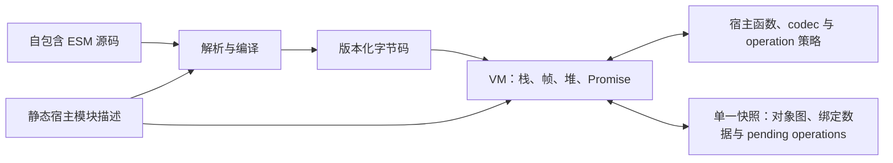

# 可恢复迷你 JavaScript 虚拟机：总体设计

## 目标

构建一个可暂停、可序列化、可快照与恢复的迷你 JavaScript 引擎，作为原生 UI 的脚本执行层。引擎自行实现可恢复虚拟机，不使用 WebAssembly，也不依赖宿主 JS 引擎的调用栈保存执行状态。

本文描述目标契约，不代表当前 PoC 已实现。VM 不实现平台 UI；宿主提供绑定实现和平台服务，VM 快照保存重建这些绑定所需的全部运行时状态。

## 已确定的设计约束

- 面向应用自有脚本，输入默认按 ECMAScript Module（ESM）解析和执行，隐式启用严格模式；不依赖文件扩展名或 `"use strict"`，也不回退到 Script 模式。不以完整 ECMAScript 或任意 npm 包兼容为目标。
- `BigInt` 是首版的一等原始值类型，由 VM 自有的任意精度整数表示；不依赖宿主 JS 引擎，也不把大整数降级为 `Number`。它与框架验收基线无关，但属于首版语言契约。
- 同步执行阶段和原生函数调用中不要求支持暂停或恢复。
- 宿主静态声明模块函数、类及其原型方法。VM 持有函数值、实例和 JS 值槽；实例身份是 VM 对象身份，不由宿主分配或查表。
- 恢复只有一份状态来源：VM 快照。可达绑定的 JS 引用、非 JS 数据以及 pending operation 的状态全部随快照保存。相同的字节码构建、兼容的静态绑定实现和平台服务是运行前提，不是第二份存档。
- 每种宿主异步操作都必须接受中断，并声明如何从任一 pending 阶段恢复。恢复针对原 VM Promise，不保存原生任务、调用栈、回调指针或 OS 句柄。
- 只支持精确版本恢复：快照格式、字节码版本、脚本构建 ID 和所需绑定契约版本均须匹配；不承诺迁移旧快照。

## 已确认的实现方向

- VM 与 compiler 核心使用 Rust；宿主接口面向 Apple 与 Android，但本项目不实现原生 UI。
- Rust 与宿主之间采用手工设计的 C ABI，以不透明 VM 句柄表达跨调用生命周期状态。
- compiler 复用 Rust JavaScript parser（如 Oxc），转换到项目自有 IR；实现时选择当时最新稳定版本并锁定依赖。Oxc AST 不进入 VM 或字节码契约。
- VM 堆采用 VM 自有对象表/句柄与 tracing GC，支持对象环、闭包共享状态及快照对象身份。
- 首版以能运行锁定版本的 Solid Universal 和 React 自定义 renderer 为兼容基线，按下文的构建产物与行为用例验收，而不是按 ECMAScript 年份或 npm 包名宣称兼容。
- Rust 宏可以生成静态模块描述；编译器、VM 和未来的 TypeScript 声明生成器消费同一份声明，不要求宿主实现统一的字符串分派入口。


## 首版 JavaScript 支持范围

### 兼容目标与构建输入

| 验收目标 | 锁定的运行时入口 | 不包含 |
| --- | --- | --- |
| Solid 非 Web | [`solid-js@1.9.9`](https://unpkg.com/solid-js@1.9.9/package.json) 的生产响应式核心、`solid-js/universal` 的 `createRenderer` 和 `solid-js/store` 的 `createStore`。构建显式选用 `dist/solid.js` 和 `store/dist/store.js`，不能因 `node`/`worker` 条件误选 SSR 入口。 | `solid-js/web`、SSR、浏览器 hydration；不启用依赖浏览器 `MessageChannel` 的可选 `enableScheduling()` 路径。 |
| React 非 Web | `react@19.2.0`、`react/jsx-runtime`、[`react-reconciler@0.33.0`](https://unpkg.com/react-reconciler@0.33.0/package.json) 和 `scheduler@0.27.0` 的生产包；使用自定义 mutation-mode `HostConfig`，按该版本实现调度与事件优先级接口。 | React DOM、React Native/Fabric 平台层、SSR/RSC、hydration 和开发工具。 |

应用可写 JS/TS/JSX/TSX。离线构建负责去除类型、用 Solid 的 universal JSX 转换或 React 的 JSX runtime 转换，并解析 npm 依赖及条件导出、固定生产分支、转换 CommonJS、打成一个自包含的 ESM 入口。`compiler` 接收这份源码、声明的宿主绑定及可选源码映射；不承担 JSX/TS 转译或包解析，VM 不加载其他 JS 模块。转换必须保留 ESM 活绑定和 CommonJS 初始化等可观察行为，并保留入口显式声明的公开导出名及其绑定语义，不把依赖的内部导出自动暴露给宿主。产物只允许保留指向已声明宿主模块的静态导入，不得残留 JS 依赖导入、再导出或运行时 `require`。不得替换框架核心或 scheduler 来通过验收。

新建 VM 时先验证构建与宿主导入，再在同步初始化帧执行一次入口模块，并排空由此调度的微任务；未完成的宿主 operation 仍由宿主交付。顶层 `var`、`let`、`const` 和函数声明的绑定属于模块环境；它们可以遮蔽同名全局，但不会创建或覆盖全局变量或 `globalThis` 属性。顶层 `this` 为 `undefined`，给未声明名字赋值不会隐式创建全局。只有显式 `export` 的绑定对宿主公开；未导出的顶层函数和变量不构成宿主接口。快照保留模块环境，恢复时不重播初始化。

### 字节码编译器直接支持的语法

| 类别 | 首版直接支持 |
| --- | --- |
| 模块执行模型 | 输入采用严格 ESM 的解析目标与顶层作用域，编译为同步模块初始化帧。允许从静态宿主模块导入绑定，例如 `import { expect } from 'test'`。支持本地命名导出：`export function`、`export async function`、`export var` / `let` / `const`，以及 `export { local }` / `export { local as publicName }`。未知局部绑定和重复导出名在编译期报错。不支持默认导出、再导出（`export … from` / `export *`）、运行时模块加载或 `import.meta`。 |
| 表达式 | `number` 与 `bigint` 字面量（BigInt 支持十进制、`0x` / `0o` / `0b` 前缀及数字分隔符，不带小数点或指数）、布尔、字符串、`null`、正则字面量与数组/对象字面量（含空洞、计算属性、展开）；非标签模板；普通/成员/构造调用与实参展开；算术、位运算、比较、赋值、自增减、短路、三元、逗号、可选链、`??` 与逻辑赋值；`typeof`、`void`、`delete`、`in`、`instanceof`。 |
| 控制流 | `if`、`switch`、`for`、`while`、`do…while`、`for…in`、同步 `for…of`（含提前退出时的 iterator close）、`for await…of`（含异步 iterator close）；标签、`break`、`continue`、`return`、`throw`、`try/catch/finally`。 |
| 异步 | `async` 函数与 `await`；generator（`function*`、`yield`、`yield*`）、async generator（`async function*`）；thenable 同化、异常拒绝、Promise 微任务顺序与已结算 Promise 的异步恢复。 |

`class`（含 `extends`、字段和私有成员）是一等支持的语法：字节码编译器直接编译类声明与类表达式，不经离线转译降级——转译私有字段会生成额外的弱映射/闭包代码，破坏快照可恢复性和代码量目标。类语义（构造器、继承链、`super`、静态成员、字段初始化、私有字段/方法/访问器）在编译器与 VM 内建层面实现；宿主类声明（`#[host_class]`）与脚本类共用同一套 VM 类对象表示。标签模板仍应在离线构建降级，只接受落在上述子集内且保留所用语义的输出；动态模块加载、`eval`、`Function` 动态构造、`with` 不在首版契约内。直接输入中不支持的语法在编译期报告特性名和源码位置；缺失声明的宿主绑定在装载时拒绝。普通 JS 的可选全局探测保留标准语义（如未声明的 `MessageChannel` 在 `typeof` 中返回 `"undefined"`）。

### Generator、async generator 与异步迭代

生成器同样由编译器直接编译，不使用宿主的原生生成器，也不用原生调用栈保存挂起位置。每个生成器函数编译为普通字节码函数加一张独立的生成器恢复表；调用生成器函数只分配生成器对象，不执行函数体。生成器对象是 VM 堆对象，持有 `func_id`、状态（未启动、挂起于 `yield`、执行中、已完成）以及与挂起入口对应的持久槽；其原型提供 `next` / `return` / `throw` 和返回自身的 `[Symbol.iterator]`。

`yield` 降低为显式挂起指令，形状与 `AWAIT` 类似但同步返回：`YIELD input, generator_id` 把操作数交给调用者，并保存该恢复表项选出的持久槽。`next(value)` 同步恢复，把 `value` 写入该入口的结果槽；`throw(error)` 从异常落点恢复，使 `yield` 周围的词法 `try/catch/finally` 按普通异常处理；`return(value)` 进入完成路径，先执行挂起的 `finally` 链，不继续执行 `yield` 之后的普通语句。`yield*` 降低为显式循环：读取委托对象的 `next` / `throw` / `return` 并向其逐次转发，委托是异步迭代器时在每步按 `AWAIT` 挂起；委托异常按同步/异步迭代协议收尾。生成器执行中再次调用 `next` / `throw` / `return` 抛出可捕获的 `TypeError`；完成后 `next` 返回 `{ value: undefined, done: true }`，`return(value)` 返回 `{ value, done: true }`，`throw(error)` 直接抛出 `error`，未捕获的异常使生成器进入已完成状态。

async generator 复用同一套挂起指令；`yield` 的操作数先按 `await` 同化，再交付给请求。`next` / `throw` / `return` 各返回一个 VM Promise，每个请求以 `(种类, 参数, 结果 Promise)` 进入该生成器的请求队列，严格按入队顺序逐个结算，前一个请求结束前不推进生成器；生成器在 `await` 挂起期间到达的请求留在队列中，恢复执行后继续处理。其原型提供 `[Symbol.asyncIterator]`。

`for await…of` 先读取 `[Symbol.asyncIterator]`，不存在时退回 `[Symbol.iterator]`，并把同步迭代器包装成异步迭代。每轮先 `Await` 迭代结果、检查 `done`，再 `Await` 迭代值（同步回退时）；循环体和其中任意 `await` / `yield` 都是普通挂起点。循环提前退出（`break`、`return` 或抛出）时调用迭代器的 `return()` 并等待其结果；收尾本身抛出异常时保持原完成状态。迭代结果不是对象、`next` 不可调用或结果未兑现时抛出可捕获的 `TypeError`。异步迭代协议、`Symbol.asyncIterator` 和同步转异步回退包装都是 VM 内建，不需要离线转译。

### VM 内建与可观察语义

- 支持普通对象和原型链、属性描述符、getter/setter、字符串与 Symbol 属性键、标准枚举顺序、稀疏数组、严格模式赋值失败。实现 `Object` 的创建、原型/描述符查询、`defineProperty`/`defineProperties`、枚举、`assign`、`is`、冻结及冻结检查。不安装旧式 `Object.prototype.__proto__` 访问器；保留 `Object` / `Reflect` 的显式原型操作。`"__proto__"` 仍可用作普通自有属性键，对象字面量的语义不变。
- `call` / `apply` / `bind` 是可调用的 `Function.prototype` 上的自有方法。全局 `Function` 的调用与构造均抛出 `TypeError`，不编译字符串。
- 函数转字符串按设计返回 `function <初始名>() { [native code] }`；共享的 `Function.prototype.toString` 不读取公开 `name`，也不保留或反编译源码。
- 支持 `Array`/`String` 的常用访问、转换、搜索、切片与迭代，以及 `Array.isArray/from`、`push/pop/shift/unshift/splice`、`map/filter/reduce/forEach/some/every/flat`；提供 `Number`、`BigInt`、`Math`、`RegExp`、`JSON` 和标准 `Error` 类型。具体方法和正则用法以锁定构建和回归用例补齐，不以整个内建对象的存在宣称完整兼容。
- `globalThis` 是字节码内建名单中的一个固定根对象（普通对象，原型为 `Object.prototype`），不是对任意宿主全局对象的代理。内建名单里的名字（`Math`、`JSON`、`Symbol` 等）以数据属性挂在该对象上；脚本可以通过 `globalThis` 显式访问它们，但裸名称不做属性查找，而是走静态解析。裸名称解析顺序为：局部绑定 → 显式宿主导入 → preload 导出 → 内建 → `undefined` 字面量；解析不到的名字在编译期报错（读取、赋值和除 `typeof` 外的引用都不可见），`typeof 未知名字` 折叠为 `"undefined"`。运行时动态添加到 `globalThis` 的属性不会反向进入编译期的裸名称解析。
- preload 全局：`Vm::new` 执行 preload 初始化器后，把 preload 的显式导出安装为 `globalThis` 上的可枚举、不可配置、仅 getter 的活绑定——每个名字一个捕获 preload 模块环境的 getter 函数，读值时实时读取 preload 绑定槽，不是安装时复制的快照值。安装只发生在 VM 启动路径，快照恢复不重新安装，但恢复时会校验 `globalThis` 上这些 getter 的描述符与 preload 记录一致（名字、环境、函数身份），不一致拒绝整个 restore。preload 名字在静态解析中优先于内建；同名局部绑定仍遮蔽 preload 全局。
- 支持 `Symbol`（含 `Symbol.for/keyFor`、`Symbol.iterator`、`Symbol.asyncIterator`）、同步与异步 iterator 协议、生成器与 async generator 的原型、`Map`、`Set`、`WeakMap`。快照保存 symbol 注册表和引用身份、集合条目与顺序；`WeakMap` 遵循弱键/ephemeron 可达性，只存活键所对应的条目，不能把键提升成强根。
- Solid 响应式 props/store 需要真正的 VM `Proxy`：首版覆盖普通对象/数组目标的 `get`、`set`、`has`、`deleteProperty`、`ownKeys`、`getOwnPropertyDescriptor` 陷阱及相应 `Reflect` 操作；遵守属性描述符与不可扩展目标不变量。快照保存代理、目标、handler 及其捕获环境的身份和关系，不执行 trap 来枚举快照。可撤销代理、代理函数/构造器及其他 traps 不在此基线。
- `for…in` 到达每一原型层时才取得该层的自有键列表；逐键检查时读取实时描述符，不提前读取属性值。快照保存已经记录的键及枚举进度，恢复时不重跑该层的 `ownKeys`。
- `Promise` 由 VM 实现：构造器、`then/catch/finally`、`resolve/reject/all/allSettled/race/any`。快照保留未结算 Promise 的反应闭包、链式结果与 async 续体；不序列化宿主 Promise。`queueMicrotask` 进入同一 VM 微任务队列，不是宿主 timer。`WeakRef`、`FinalizationRegistry`、共享内存、`Atomics` 不在此基线。

#### BigInt

`BigInt` 是首版的一等原始值类型，与 `Number` 并列，不依赖宿主 JS 引擎的 BigInt 实现。它不是 Solid/React 验收基线的一部分，而是首版语言契约的独立补充：需要精确整数运算的脚本不必退回字符串或浮点近似。

- **表示与字面量。** 任意精度有符号整数，没有负零，也没有 `NaN` / `Infinity`。支持带 `n` 后缀的十进制、`0x` / `0o` / `0b` 字面量，允许数字分隔符；字面量不得带小数点或指数，十进制不得使用旧式前导零。构建常量与快照值使用带专用标记的规范十进制字符串编码，不以 JSON 数值承载，避免 binary64 精度丢失。
- **值与比较。** `typeof` 返回 `"bigint"`；`Object.prototype.toString` 识别为 `[object BigInt]`。`===` 在 BigInt 与 Number 之间为 `false`；`==` 按数学值比较（如 `1n == 1`、`0n == 0`、`1n == "1"` 为真）；`<`、`<=`、`>`、`>=` 允许 BigInt 与 Number 混合比较。
- **运算。** `+`、`-`、`*`、`/`、`%`、`**`、`&`、`|`、`^`、`~`、`<<`、`>>` 接受 BigInt 操作数。除法向零截断，`%` 取被除数符号，`**` 的指数为负时抛 `RangeError`。BigInt 与 Number 混合的算术或按位运算抛 `TypeError`，但 `+` 遇到字符串仍按字符串拼接；BigInt 没有无符号右移，`>>>` 抛 `TypeError`。一元 `-` / `~` 保留 BigInt，一元 `+` 抛 `TypeError`。
- **转换与内建。** `BigInt(value)` 接受布尔、字符串、整数 Number、BigInt 以及经 `ToPrimitive` 得到的上述值；非整数 Number 抛 `RangeError`，非法字符串抛 `SyntaxError`。`Number(bigint)` 允许精度丢失；`Math` 方法、`Number.prototype` 方法和一元 `+` 遇到 BigInt 抛 `TypeError`。`String`、模板和属性键使用规范十进制，`0n` 为假值。`BigInt` 不可用 `new` 构造，提供 `BigInt.asIntN` / `asUintN`、`BigInt.prototype.toString(radix?)` / `toLocaleString` / `valueOf` 和 `[Symbol.toStringTag] = "BigInt"`。`Object(bigint)` 创建 BigInt 包装对象。`JSON.stringify` 在序列化 BigInt 时抛 `TypeError`（replacer 可先把它转换成可序列化值），`JSON.parse` 不产生 BigInt，`parseInt` / `parseFloat` 仍只返回 Number。
- **宿主边界。** BigInt 是原始值，但任意精度内容由 VM 持有；`JsValue` 仍是不透明定长句柄。宿主可构造并读取规范十进制文本，但不得把大整数交给 JSON 数值、浮点转换或宿主侧第二套值模型。槽、模块状态、operation 交付值和 Promise 拒绝原因中的 BigInt 与普通脚本值遵循同一套快照编码。

### 非 Web 宿主与验收

- 两套 renderer 均在 VM 内执行 JS，调用同一类宿主树能力：创建节点/文本、设置属性/文本、插入/移动/删除、遍历父子兄弟、分发输入事件。节点以绑定实例表示：节点间和事件回调的引用走 VM 托管槽，重建平台节点所需的非 JS 数据随实例写入快照。可用可观察的内存节点树验收，无需先实现 Apple/Android UI，也不提供 DOM、Node 或 React Native 全局环境。
- React 的生产 `scheduler` 选用 [`setTimeout` 回退分支](https://unpkg.com/scheduler@0.27.0/cjs/scheduler.production.js)。宿主适配器提供可取消的 timer、`performance.now()` 单调时钟和错误日志出口；恢复须延续同一时钟域，不能从零重新计时。`setTimeout`/`clearTimeout` 包装层与回调在 VM 内；快照中的 timer operation 记录保存到期及取消所需的状态，不保存平台 timer 句柄。到期后宿主在新的 VM 任务轮次结算原 Promise，由 VM 驱动已登记的脚本回调并排空微任务；回调抛错按任务错误报告，不把内部 Promise 拒绝暴露给应用。取消或重复到期投递不执行回调。树事件也在新任务轮次投递，不从原生调用栈同步重入 VM。
- **运行验收**：用冻结版本的真实生产包和实际 JSX 构建产物。Solid 验证 signal/memo、响应式 props、嵌套 store、列表节点重排、事件更新和卸载清理；React 验证函数组件、`useState`、effect 及清理、带 key 的子节点重排、Promise 驱动的 Suspense 恢复和卸载。与参考 JS 引擎以 ESM 模式执行同一产物、遵循同一宿主适配器契约时的节点树和事件日志对照。
- **恢复验收**：分别在已挂载、等待可恢复 operation 的边界保存快照。用新的宿主从快照重建节点后投递事件或结算原 operation。断言脚本可见的节点和闭包身份延续、挂载副作用不重跑、后续更新和清理正常；React 另验证挂起的 scheduler timer 恢复后只触发一次、已取消 timer 不执行。不能用重新挂载代替恢复。

## 总体架构



### 编译器

`compiler` 是唯一接收 JS 源码的运行核心模块。它复用 Rust JavaScript parser，以 ESM 为解析目标，将离线构建输出转换为项目自有 IR；负责校验语法子集、解析词法绑定、降低异常与异步控制流、分析活性并分配帧槽，最后输出版本化字节码。不支持的语法在编译期报错。源码映射与变量名等调试信息作为可选旁路产物，不参与执行或恢复。

### 虚拟机

`vm` 只接受字节码构建产物及宿主绑定，不接收源码、AST 或编译器 IR，不依赖 `compiler`。它拥有字节码契约及加载验证，显式管理脚本栈、对象堆、彼此独立的模块环境与全局环境、Promise 和 async 续体。VM 堆使用自有对象表/句柄与 tracing GC。编译器遵循该契约；发布产物可只部署 `vm` 与字节码，不携带解析器。恢复时必须先加载同一构建的字节码，不重新编译源码。

### 宿主接口

详细展开（非最终草案）见 [`host-bindings.md`](host-bindings.md)。

- 提供稳定的 C ABI 宿主接口，并管理 VM 句柄的创建、恢复、执行与释放。
- 模块初始化完成后，宿主可按公开导出名读取当前值或调用当前可调用值；公开名可不同于局部名。导出是活绑定，不缓存初始化时的值，也不给宿主提供直接改写绑定的接口。未知导出名和调用不可调用值均报错，不回退到查找顶层声明或全局对象。

#### 静态模块与原型

每份模块描述声明模块名、导出函数及其签名、类的槽布局与方法、可选的构造器导出，以及所用 codec 和 operation 类型。编译器从描述中取得导入清单，VM 装载时把声明标识链接到注册的实现。函数和方法都是一等 JS 函数值；读属性走普通原型链，调用时传入实际 `this`。宿主不用实现 `call_native`、按名字读取原生属性，或为每个实例制造方法函数。

下面以 `test` 模块的 `expect` 导出为例：`Matcher` 在模块内静态注册，只有工厂函数向 JS 返回其实例。Rust 宏语法仅示意，不规定最终命名或要求使用 builder：

```rust
#[host_module("test")]
mod test {
    #[host_class]
    struct Matcher {
        #[js_slot]
        actual: JsValue,
    }

    #[export]
    fn expect(cx: &mut CallCx, actual: JsValue) -> JsResult<Instance<Matcher>> {
        Matcher::alloc(cx, MatcherSlots { actual })
    }

    #[methods(Matcher)]
    impl Matcher {
        #[method(name = "toEqual")]
        fn to_equal(cx: &mut CallCx, this: This<Matcher>, expected: JsValue) -> JsResult<()> {
            let actual = this.actual(cx);
            check_own_data_equal(cx, actual, expected)
        }
    }
}
```

一个 VM 中的 `Matcher` 实例共享原型和方法：`a.toEqual === b.toEqual`。方法检查接收者是否具有 `Matcher` 的内部槽；裸调或用仅伪造了原型的对象作 `this`，抛出可捕获的 `TypeError`。跨 `await` 保存方法时用 `a.toEqual.bind(a)`，或保留 `a` 并作成员调用。注册类型不隐式导出 JS 构造器：上述公开签名足以生成 `export function expect(actual: unknown): Matcher` 和带有 `toEqual(expected: unknown): void` 的 `interface Matcher`，不生成可 `new` 的值，也不公开内部槽。

#### JS 值槽与非 JS 数据

- `JsValue` 句柄仅用于当前 VM 的本次同步调用，不可藏在 Rust 数据或注册闭包中供下次调用。要长期持有任意 JS 值或另一个绑定实例，写入声明的 VM 托管槽。槽不是可枚举或可伪造的 JS 属性，而是对象图的强边；与普通引用一起追踪，保留身份、别名和环，不把所有实例提升为根。
- `expect(x)` 把 `x` 本身放进槽，不投影或复制对象图。`toBe` 比较原值（`SameValue`）；`toEqual` 在调用方法时读取当时的自有可枚举数据，不执行 getter 或 Proxy trap。因此在 `expect(obj)` 之后修改 `obj.x`，后续比较能看到修改。断言失败以脚本可捕获的异常返回。
- 需要 Rust 状态的实例可附带有类型、有版本的 payload。绑定提供 `encode(&T, &EncodeCx, &mut PayloadWriter)` 和 `decode(&mut DecodeCx, &mut PayloadReader) -> Result<T, …>`；两者均可报告错误。普通 `serde` 类型可用适配器，不要求所有类型只实现标准序列化 trait。**上下文提供能力，快照提供状态**：例如用 `DecodeCx` 的平台工厂和快照里的属性创建节点，而不是去旧宿主按节点 ID 取回对象。payload 不得暗藏指向 VM 对象的 ID；这类边一律走槽，无需给绑定作者另设追踪协议。
- 会影响后续调用的模块级可变状态属于 VM 托管的模块记录，作为持久根保存；JS 引用和非 JS 数据分别遵循上述槽和 codec 规则。静态模块描述只包含声明及实现入口，不持有某个 VM 的实例状态。

## 字节码与续体布局

### 构建产物

字节码采用显式槽位操作数，不保留跨挂起点的隐式操作数栈。构建产物包含 `bytecode_version`、常量池、宿主导入表、函数表及指令、模块初始化帧的函数 ID，以及从公开导出名到模块绑定的导出表。导出绑定保留在模块环境中，不降为初始化帧的临时槽；加载时校验导出名唯一且目标是有效模块绑定。常量池只放不可变字面量与静态描述；每次求值应创建新身份的对象不得提升成共享常量。BigInt 常量按规范十进制字符串加专用标记保存并进入构建摘要，不以 JSON 数值承载。`build_id` 是执行相关字节码内容的摘要，覆盖恢复表、生成器恢复表、异常表、宿主导入声明及导出表，不含源码映射等旁路数据。

每个函数有构建内的 `func_id`、入口、瞬时槽数、持久槽数、异常表、恢复表，以及仅生成器函数拥有的生成器恢复表。`AWAIT input, resume_id` 引用函数内的恢复表项，不以运行时栈指针或下一条指令的 PC 标识续体。表项为：

```text
ResumeEntry {
  fulfill_pc, fulfill_dst,  // 写入收到的值，再进入成功落点
  reject_pc,  reject_dst,   // 写入拒绝原因，再进入异常落点
  saved_slots              // 严格升序、无重复的持久槽编号
}
```

恢复落点是专用入口。拒绝落点按原 `await` 的词法位置进入 `catch` / `finally`，无处理器时拒绝外层 async Promise；不从恢复入口的物理 PC 推断处理器。结果槽由恢复路径写入：不因作为结果槽而保存旧值；若该旧值在另一条路径仍然活跃，编译器不得在那条路径上覆盖它。

生成器函数用 `YIELD input, generator_id` 引用独立的生成器恢复表项；`next` / `throw` 各写入自己的结果槽，`return` 不写结果槽而进入完成路径：

```text
GeneratorEntry {
  next_pc,   next_dst,    // next(value)：写入收到的值，再进入正常落点
  throw_pc,  throw_dst,   // throw(error)：写入抛出值，再进入异常落点
  return_pc,              // return(value)：进入 finally / 完成路径
  saved_slots             // 严格升序、无重复的持久槽编号
}
```

`return(value)` 的值在 `finally` 执行前记入显式的待完成状态，不依赖结果槽；`finally` 内可以再次 `await` 或 `yield`，完成状态与其他挂起点一样参与活性分析和快照。

### 固定槽位与快照保留规则

| 状态 | 存放位置 | 挂起时怎么处理 |
| --- | --- | --- |
| 不跨任何挂起点的值，如局部临时值、已消费的实参 | 瞬时槽 `T[n]` | 整组丢弃；不写快照，不作为挂起帧的堆根 |
| 某个挂起点之后可能读到的值 | 函数内固定的持久槽 `P[n]` | 只保留当前 `resume_id` 对应 `saved_slots` 中的槽 |
| 闭包共享的可变绑定 | 堆上的环境或单元 | 从活跃引用遍历，保存同一对象身份；不可把单元内容复制成帧私有值 |
| 指令、只读常量、恢复表、静态异常处理器 | 字节码构建产物 | 不写快照，用构建内 ID 或静态引用定位 |
| async 返回 Promise、等待关系 | VM 的 Promise / 续体记录 | 保存引用与关系，不把它们混入普通局部槽图 |
| 生成器实例与挂起位置 | VM 堆上的生成器对象（`func_id`、状态、恢复入口、持久槽） | 只保存该入口 `saved_slots` 中的槽；瞬时槽丢弃，生成器对象本身按普通堆对象遍历 |
| async generator 的请求队列 | VM 堆上的请求记录与结果 Promise | 按入队顺序保存请求种类、参数、结果 Promise 及队列游标 |

`P[n]` 在一个函数内布局固定，编号只需在同一构建内稳定。首版不复用不同跨挂起逻辑值的持久槽；无需为快照压缩重排运行帧。实际挂起时清除未列入 `saved_slots` 的持久槽，并释放瞬时槽存储；保存和恢复都按表中的槽顺序进行，不扫描整帧来猜测哪些值还活着。`undefined` 是有效值，不能用它代替“槽未初始化”。词法绑定在作用域入口写成普通 `undefined`，不另存 TDZ 标记。

`const` 的不可变性针对绑定而非绑定值。声明初始化（含循环声明的每轮写入）不受此限制；其他写入在完成该赋值所需的前置求值后抛出可捕获的 `TypeError`。编译期按词法绑定确定写入规则，快照不需要保存绑定可变性。

### 编译期分析与加载验证

1. 在降低后的控制流图上做逆向活性分析。图包含正常落点、拒绝落点、生成器恢复落点和异常处理边，包括 `catch`、`finally`、循环回边与隐式读写。挂起点需要保留的是各恢复入口的 live-in 并集：`AWAIT` 有兑现/拒绝两个入口，`YIELD` 有 next/throw/return 三个入口；每个入口先扣除由 VM 写入的结果槽（`return` 入口没有结果槽），可证明无后续读取才省略。结果不依赖运行时猜测 Promise 最终会成功还是失败。
2. 将跨挂起活跃的逻辑值分配到固定 `P` 槽，其余用 `T` 槽；在每个 `AWAIT` / `YIELD` 处生成该点的 `saved_slots`。已捕获绑定的跨挂起引用指向环境或共享单元；`this`、实参、环境引用等按普通逻辑值分析，不能假定恢复时还能从原调用帧拿到。
3. 将 `finally` 中待完成的 `return`、`throw`、`break` 或 `continue` 降低为显式控制状态（种类、值及适用时的静态目标标签），参与同一活性分析。`finally` 内再 `await` 或 `yield` 时保留仍活跃的待完成状态；若 `finally` 自身以新的 abrupt completion 退出，按 JS 语义覆盖旧状态。无需快照化原生异常栈。
4. VM 加载时检查版本、操作数与槽编号、指令边界、控制流/异常目标、恢复表及生成器恢复表；只有对应的 VM 恢复边能进入专用恢复入口。数据流校验要求 `AWAIT` / `YIELD` 保存的每个槽在挂起前都有可编码状态；以 `saved_slots` 加上该入口写入的结果槽作为恢复入口的已定义集合，沿正常及异常边校验读前有定义，汇合处取交集。每个入口路径都要检查，不接受遗漏的活跃槽；不要求 VM 重做源码分析或拒绝多保留的槽。

### 挂起与恢复协议

- `AWAIT` 将输入转为 VM 内可等待的 Promise，读取操作数后保存续体，按 JS 微任务顺序安排后续反应。即使 Promise 已结算，也不能在 `AWAIT` 原地同步执行续体。
- `YIELD` 不创建等待关系，也不经过微任务：生成器对象自身保存函数 ID、生命周期状态和按 `GeneratorEntry` 选出的持久槽，调用者的 `next(value)` 在不新建脚本帧的前提下同步恢复。async generator 的请求队列是 VM 堆对象，每个请求记录种类、参数和结果 Promise；请求由普通 Promise 反应驱动，不借用原生任务。
- 挂起帧的逻辑快照记录为 `(object_id, func_id, resume_id, result_promise_ref, slot_values[])`；最后一项按 `saved_slots` 顺序写值，无需逐槽写编号。被等待 Promise 的反应记录引用续体，等待关系不在帧中重复编码。VM 在当前微任务轮次排空后才允许快照，因此无需落盘已入队但尚未执行的恢复任务。
- 恢复先核对版本与构建，再为堆、Promise 和续体分配身份并解析引用，校验槽值数量、ID、记录类型与等待关系；每个挂起续体必须恰好对应一个未结算 Promise 上的等待反应，挂起于 `yield` 的生成器则按同一构建的生成器恢复表校验状态、入口与槽，async generator 的每个排队请求必须恰好关联一个未结算的结果 Promise。根据函数布局重建挂起帧，只填充指定的 `P` 槽；其余槽初始不可读。原生绑定验证通过前不调度。未来 Promise 结算时，VM 重建瞬时槽，写入成功值或拒绝原因，从对应落点执行；不重跑 `AWAIT`、`YIELD` 或之前的副作用。
快照从模块环境、全局环境、绑定模块状态、显式脚本根及 pending operation 等持久根遍历对象图。绑定实例的槽按普通强边遍历；挂起续体、生成器对象及 async generator 请求队列只访问恢复表中的槽值与必要的运行时引用。从续体省略某个引用，不代表经模块、绑定实例或闭包仍可达的对象也可以省略。

### 两个挂起点的示例

```js
import { inspect, seed, wait } from 'demo';

export async function run(input) {
  inspect(input);
  const base = seed();
  const x = await wait("a");
  const sum = base + x;
  const y = await wait("b");
  return sum + y;
}
```

本例中 `inspect`、`seed` 和 `wait` 来自演示宿主；这里的 `wait` 在恢复后继续等待外部交付数值，区别于下文仅用作暂停点的 `test.wait`。`base` 固定为 `P[0]`，`sum` 固定为 `P[1]`，`x` 和 `y` 各自由成功入口写入瞬时槽。

| `resume_id` | `saved_slots` | 示例槽值（`seed()` 返回 `10`，`a` 返回 `2`） |
| --- | --- | --- |
| `0` / `await wait("a")` | `[0]` | `[10]` |
| `1` / `await wait("b")` | `[1]` | `[12]` |

`input` 不从续体保存，`base` 也不进入第二个快照。若从第二个快照恢复后 `b` 返回 `3`，成功入口只需写入 `y`，函数返回 `15`，不会再调用 `inspect`、`seed` 或 `wait("a")`。若 `b` 拒绝，则进入拒绝落点并拒绝 `run` 的 Promise。

## 暂停与快照边界

只在同步执行栈已清空、当前微任务轮次排空后创建快照。同步调用和原生函数执行中的状态不保证可暂停或恢复。此边界避免序列化宿主栈及半途执行的原生调用。生成器只在控制权已返回脚本并挂起于 `yield` 时进入快照；执行中的生成器以及重新进入的 `next` / `throw` / `return` 属于同步执行栈，不提供暂停。

待触发的宿主 timer 不等于已入队的 VM 微任务，可以跨快照存在。宿主的快照切点须协调 timer/事件投递与存档：不接受已从宿主摘下、却尚未进入 VM 处理且未持久化的投递。恢复完成且绑定通过前不得投递；不保存正在运行的框架调度调用栈。

### Operation 的中断与恢复

异步绑定返回 VM Promise，并建立该次操作的持久记录。每个 operation 类型必须声明从任一 pending 阶段被中断后的恢复策略；没有策略的类型不能注册，也不能启动这类工作。允许正常快照不等于要求原生任务可续跑；宿主根据该类型的配置和快照内的状态决定原 Promise 的结果：

| 操作语义 | 恢复后的动作 |
| --- | --- |
| `test.wait` 只用来制造暂停点 | 静默成功，以 `undefined` 兑现原 Promise，不再等待一次外部交付。 |
| timer 或等待外部交付的操作 | 根据快照状态重新登记；到期或收到交付时结算原 Promise。 |
| `fetch` 等网络请求 | 类型配置可选择用中断错误拒绝原 Promise，或根据保存的请求描述重发并交付结果。有外部副作用的请求不可默认重发。 |

ID 只用于关联交付与 pending 记录，不是去另一份宿主存档查询数据的键。只有整份快照恢复成功后才能重新登记、重发或结算；旧任务的迟到结果不能再次结算。按策略拒绝 Promise 是有效的恢复结果，经原来的反应和异常路径交付，不是 VM 恢复失败。恢复不重跑发起该 operation 的函数。

## 快照数据

快照至少应包含：

- VM 快照格式版本、字节码版本、脚本构建 ID，以及所需静态绑定的声明标识和契约版本（含槽布局、payload codec 和 operation 策略）。
- VM 堆对象图与对象间引用关系、入口模块的顶层环境（独立于全局环境），包括导出绑定的当前值。恢复后从同一构建的导出表定位恢复后的绑定，不重复序列化导出值。
- 可达 BigInt 原始值，包括脚本槽、续体、Promise 结果和 operation 交付；按规范十进制字符串加专用标记编码，恢复时校验符号、数字与无前导零形式。
- 可达的 VM Promise、挂起续体和等待关系；局部状态只包含当前恢复表指定的持久槽。
- 可达生成器对象的函数 ID、生命周期状态、挂起恢复入口和该入口的持久槽；async generator 的请求队列按入队顺序保存请求种类、参数、结果 Promise 及下一个待处理位置。生成器对象按普通堆对象保留身份和引用关系，不保存原生迭代器或宿主生成器。
- 绑定模块状态和可达绑定实例：对象身份、普通属性、实际原型引用、类型标识、JS 值槽与可选 payload 的版本和编码内容。绑定函数对象保存稳定声明标识，调用实现由本进程提供。
- 每个 pending operation 的类型及版本、实例 ID、恢复策略所需的完整状态（JS 引用或编码后的非 JS 数据），以及它与原 VM Promise 的关联。

快照不包含机器码、原生指针、OS 句柄、原生回调或正在执行的任务。JS 回调是 VM 函数对象，其引用和捕获环境仍在对象图中。恢复无需旧 host 内存、实例索引表或第二份 operation/UI 绑定存档。

## 绑定恢复协议

1. 校验格式、Build 和快照引用的静态声明及版本，链接函数实现、codec 和 operation 策略。注册表不提供任何旧实例。
2. 先为堆对象、Promise 和续体建立身份，再解析并校验原型、槽、等待关系、生成器恢复状态及模块状态。恢复已保存的原型对象与属性，不用静态模板覆盖脚本所做的修改。
3. 在未对外可用的 VM 中用 codec 解码非 JS 数据，准备所有 pending 记录。声明缺失、槽布局或引用非法、数据无法解码，均整体拒绝恢复；此时不执行脚本、不重发请求，也不投递事件。
4. 所有记录就绪后开放交付，按各 operation 策略恢复工作或结算原 Promise。脚本反应遵循正常微任务顺序；不重跑模块初始化、工厂函数或挂载副作用。

## 版本与失败策略

快照格式、字节码版本、脚本构建 ID 或所需绑定契约版本任一不匹配时，拒绝恢复并报告不匹配项；不承诺自动迁移旧快照。宿主可按应用策略另行初始化脚本并重建 UI，但不得把这一路径当作成功恢复。

## 主要风险与待实现时验证事项

- 框架升级或打包器改动可能引入新的语法、内建或宿主依赖；升级时须重新检查实际构建产物并通过上述运行及恢复验收，不能仅凭入口不变宣称兼容。
- async 帧、生成器挂起状态、闭包环境和对象图的序列化必须保留引用关系与对象身份。
- 区分恢复校验和外部副作用：损坏的绑定或 operation 记录必须整体拒绝且不重发请求；合法的“恢复即拒绝”只拒绝对应 Promise，不阻碍其他续体运行。
- 精确版本策略简单可靠，但脚本升级后旧快照不可直接恢复；宿主需实现重新初始化与 UI 重建路径。
- 实现阶段应为快照往返、挂起 async 帧恢复、对象身份保持、缺失绑定拒绝执行及版本不匹配拒绝恢复设计针对性验证。
- 销毁原 VM 和宿主后，只用快照、同一 Build、静态绑定和平台服务恢复：保存 `m = expect(obj)`、`obj.matcher = m` 和 `f = m.toEqual.bind(m)`，恢复后经别名修改 `obj` 再调用 `f`。同时验证实例共享方法、裸调抛错、不可达实例不要求解码；另用带 payload 的节点验证上下文解码，不依赖旧节点表。
- 对每种 operation 策略验证原 Promise 的结果及交付次数：`test.wait` 静默成功；继续等待的操作只接受一次完成；`fetch` 配置为拒绝时不发请求，配置为重发时不重跑发起函数。
- 验证无需 `"use strict"` 即按严格 ESM 执行：顶层 `this` 为 `undefined`，顶层声明不成为全局对象属性，且同名模块绑定不会修改原全局值。
- 验证宿主只能通过公开名读取或调用显式导出，包括别名；未导出的函数不能调用，非可调用导出可以读取但不能调用。脚本更新导出绑定后，宿主读到新值、调用新函数；恢复后仍观察到更新后的绑定，且顶层初始化不重跑。编译器拒绝重复导出名与不存在的局部绑定。
- 验证生成器跨快照的挂起与恢复：在 `yield` 挂起时保存，恢复后分别执行 `next` / `throw` / `return`，断言结果对象的 `done` / `value`、`finally` 完成状态与生成器身份一致；生成器执行中重入抛出 `TypeError`；`yield*` 委托在恢复后继续向同一迭代器转发。
- 验证 async generator 的请求队列：在 `await` 与 `yield` 边界保存，恢复后按入队顺序逐个结算，每个请求只结算一次，`return` 请求在已排队请求处理完后才完成生成器；`for await…of` 在 `break`、异常退出及恢复后只调用一次异步 `return()`，收尾异常不覆盖原完成状态。
- 对同一函数的不同挂起点断言实际写出的槽和值；验证不从快照保存只在瞬时槽可达的对象，同时保留由闭包或全局别名引用的对象。对生成器函数分别覆盖 `next` 的正常落点、`throw` 的异常落点与 `return` 的完成落点，断言三条入口的 `saved_slots` 与恢复落点。以未快照运行作为对照，比较结果、宿主 operation 完成次序及副作用次数。
- 覆盖仅拒绝路径使用的槽、`finally` 内二次挂起时的待完成状态、已结算 Promise 仍通过微任务恢复，以及续体释放后无多余强引用。
- 验证加载器拒绝缺失活跃槽、越界恢复点和非法落点，快照恢复器拒绝槽数量不符或 Promise/续体关联损坏，均不得启动 VM。
- BigInt 的任意精度表示、混合类型比较/相等和 `Number` 转换边界容易偏离 ECMAScript；构建常量、快照、宿主槽与 operation 交付都不得经过浮点或 JSON 数值中转。
- 验证 BigInt 字面量、算术与位运算、混合类型 `==` / `===` 的差异、除法向零截断、负指数 `RangeError` 和 `JSON.stringify` 抛错；把大整数写入槽、跨 `await` 保存并在新 VM 恢复，断言值逐位一致、`typeof` 与包装对象行为不变。
