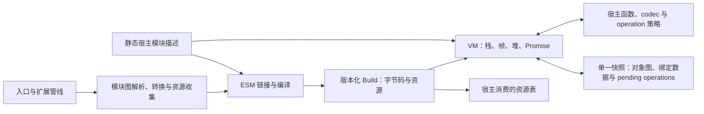

# 可恢复迷你 JavaScript 虚拟机：总体设计

## 目标

构建一个可暂停、可序列化、可快照与恢复的迷你 JavaScript 引擎，作为原生 UI 的脚本执行层。引擎自行实现可恢复虚拟机，不使用 WebAssembly，也不依赖宿主 JS 引擎的调用栈保存执行状态。

本文描述目标契约，不代表当前 PoC 已实现。VM 不实现平台 UI；宿主提供绑定实现和平台服务，VM 快照保存重建这些绑定所需的全部运行时状态。

本文只保留总体约束、实现方向与架构；具体主题拆到 `design/` 下的专题文档，入口见文末[设计文档](#设计文档)。

## 已确定的设计约束

- 面向应用自有脚本，输入默认按 ECMAScript Module（ESM）解析和执行，隐式启用严格模式；不依赖文件扩展名或 `"use strict"`，也不回退到 Script 模式。不以完整 ECMAScript 或任意 npm 包兼容为目标。
- `BigInt` 是首版的一等原始值类型，由 VM 自有的任意精度整数表示；不依赖宿主 JS 引擎，也不把大整数降级为 `Number`。它与框架验收基线无关，但属于首版语言契约。
- 同步执行阶段和原生函数调用中不要求支持暂停或恢复。
- 宿主静态声明模块函数、类及其原型方法。VM 持有函数值、实例和 JS 值槽；实例身份是 VM 对象身份，不由宿主分配或查表。
- 恢复只有一份状态来源：VM 快照。可达绑定的 JS 引用、非 JS 数据以及 pending operation 的状态全部随快照保存。相同的字节码构建、兼容的静态绑定实现和平台服务是运行前提，不是第二份存档。
- 每种宿主异步操作都必须接受中断，并声明如何从任一 pending 阶段恢复。恢复针对原 VM Promise，不保存原生任务、调用栈、回调指针或 OS 句柄。
- 只支持精确版本恢复：快照格式、字节码版本、脚本构建 ID 和所需绑定契约版本均须匹配；不承诺迁移旧快照。

## 已确认的实现方向

- VM 与 compiler 核心使用 Rust；宿主接口面向 Apple 与 Android，但本项目不实现原生 UI。
- Rust 与宿主之间采用手工设计的 C ABI，以不透明 VM 句柄表达跨调用生命周期状态。
- compiler 复用 Rust JavaScript parser（如 Oxc），转换到项目自有 IR；实现时选择当时最新稳定版本并锁定依赖。Oxc AST 不进入 VM 或字节码契约。
- VM 堆采用 VM 自有对象表/句柄与 tracing GC，支持对象环、闭包共享状态及快照对象身份。
- 首版以能运行锁定版本的 Solid Universal 和 React 自定义 renderer 为兼容基线，按[构建产物](design/bytecode.md)与[框架验收用例](design/framework-acceptance.md)验收，而不是按 ECMAScript 年份或 npm 包名宣称兼容。
- Rust 宏可以生成静态模块描述；编译器、VM 和未来的 TypeScript 声明生成器消费同一份声明，不要求宿主实现统一的字符串分派入口。

## 总体架构

### 编译器

`compiler` 是唯一接收 JS 源码的运行核心模块。扩展编译接口在编译器前端组织可组合的模块解析/加载、按模块转换和资源处理阶段；默认路径仍可直接编译 ESM，扩展转换后的模块也统一以 ESM 进入链接器。包管理不属于该接口的职责：调用方提供依赖文件，扩展只解析和读取。解析与转换完成后，核心复用 Rust JavaScript parser，以 ESM 为目标，将模块图转换为项目自有 IR；负责校验语法子集、解析词法绑定、降低异常与异步控制流、分析绑定逃逸与活性、省略可证明不可观察的绑定环境并分配帧槽，最后输出包含版本化字节码及资源表的 Build。不支持的语法在编译期报错。资源由宿主从 Build 中消费，不参与 VM 执行；资源内容和映射进入 Build 身份。源码映射与变量名等调试信息作为可选旁路产物，不参与执行或恢复。

### 虚拟机

`vm` 只接受字节码构建产物及宿主绑定，不接收源码、AST 或编译器 IR，不依赖 `compiler`。它拥有字节码契约及加载验证，显式管理脚本栈、对象堆、彼此独立的模块环境与全局环境、Promise 和 async 续体。VM 堆使用自有对象表/句柄与 tracing GC。编译器遵循该契约；发布产物可只部署 `vm` 与字节码，不携带解析器。恢复时必须先加载同一构建的字节码，不重新编译源码。

### 宿主接口

稳定 C ABI 封装 VM 句柄的创建、恢复、执行与释放。模块初始化完成后，宿主按公开导出名读取当前值或调用当前可调用值；导出是活绑定，未知导出名和不可调用值均报错。声明模型、导出可见性与 JS 值槽见[宿主接口与静态绑定模型](design/host-interface.md)，完整 ABI、记录编码与宏细节见 [`design/host-bindings.md`](design/host-bindings.md)。

## 设计文档

| 文档 | 内容 |
| --- | --- |
| [`design/build.md`](design/build.md) | Solid/React 锁定基线、构建输入、扩展管线、CJS 互操作与资源表。 |
| [`design/language.md`](design/language.md) | ESM 模块执行与导出、语法子集、生成器与异步迭代、`using`、VM 内建、BigInt。 |
| [`design/framework-acceptance.md`](design/framework-acceptance.md) | 非 Web 宿主树能力，以及 Solid/React 的运行与恢复验收。 |
| [`design/wintertc.md`](design/wintertc.md) | WinterTC API 范围、全局暴露、快照边界、VM 相对时钟、可选宿主能力、随机 API 与定时器。 |
| [`design/fetch.md`](design/fetch.md) | Fetch 的 VM 对象与获取算法、单跳宿主传输、背压、环境服务、快照与验收。 |
| [`design/host-interface.md`](design/host-interface.md) | C ABI 边界、静态模块/类原型、导出可见性、JS 值槽与非 JS payload。 |
| [`design/host-bindings.md`](design/host-bindings.md) | 宿主绑定详细契约：声明模型、`JsValue`、类/实例、codec、operation 与快照记录。 |
| [`design/bytecode.md`](design/bytecode.md) | Build 产物、显式槽位、恢复表/生成器表、活性分析、绑定逃逸优化、挂起协议。 |
| [`design/snapshot.md`](design/snapshot.md) | 暂停与快照边界、operation 中断策略、快照数据、绑定恢复协议、版本失败策略。 |
| [`design/risks.md`](design/risks.md) | 主要风险与实现阶段的逐项验证清单。 |

当前实现覆盖面、缺口、内部契约与测试契约分别见 [`implemented.md`](implemented.md)、[`gaps.md`](gaps.md)、[`internals.md`](internals.md)、[`testing.md`](testing.md)。
