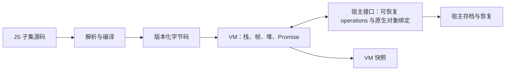

# 可恢复迷你 JavaScript 虚拟机：总体设计

## 目标

构建一个可暂停、可序列化、可快照与恢复的迷你 JavaScript 引擎，作为原生 UI 的脚本执行层。引擎自行实现可恢复虚拟机，不使用 WebAssembly，也不依赖宿主 JS 引擎的调用栈保存执行状态。

当前只设计 `compiler`、`vm` 及其字节码契约，不开始实现。UI 状态与 UI 恢复不属于 VM 范围，但 VM 提供宿主对接接口。

## 已确定的设计约束

- 面向应用自有脚本，采用严格模式 JavaScript 子集，不以完整 ECMAScript 兼容或任意 npm 包兼容为目标。
- 同步执行阶段和原生函数调用中不要求支持暂停或恢复。
- 支持可恢复的异步帧；VM 内 Promise 可恢复，宿主异步工作通过统一的可恢复 operation 协议接入。operation 类型的恢复语义由宿主适配器定义。
- 不恢复正在执行的一次性原生异步任务；宿主回调、Promise、句柄和原生指针不进入 VM 快照。可恢复 operation 的宿主状态由宿主持有；VM 快照只保存稳定 operation ID 及其与 VM Promise/续体的关联。
- VM 不做 UI 存档、宿主 operation 状态与 VM 快照之间的严格代际校验；宿主负责协调同一恢复代际的一致性。
- 原生对象必须通过稳定键恢复并绑定；必需绑定缺失时，VM 不得开始执行。
- 仅支持精确版本恢复：VM 快照格式版本和脚本构建 ID 必须匹配；不承诺迁移旧快照。
## 已确认的实现方向

- VM 与 compiler 核心使用 Rust；宿主接口面向 Apple 与 Android，但本项目不实现原生 UI。
- Rust 与宿主之间采用手工设计的 C ABI，以不透明 VM 句柄表达跨调用生命周期状态。
- compiler 复用 Rust JavaScript parser（如 Oxc），转换到项目自有 IR；实现时选择当时最新稳定版本并锁定依赖。Oxc AST 不进入 VM 或字节码契约。
- VM 堆采用 VM 自有对象表/句柄与 tracing GC，支持对象环、闭包共享状态及快照对象身份。
- 首版以能运行锁定版本的 Solid Universal 和 React 自定义 renderer 为兼容基线，按下文的构建产物与行为用例验收，而不是按 ECMAScript 年份或 npm 包名宣称兼容。
- 宿主异步操作统一使用 operation 生命周期协议；timer、UI 事件订阅、fetch 等由各自宿主适配器定义恢复、重试或拒绝策略。宿主是 operation 状态的权威来源。
- 恢复时若任一待恢复 operation 缺失或不可重建，整体拒绝恢复，不启动 VM。


## 首版 JavaScript 支持范围

### 兼容目标与构建输入

| 验收目标 | 锁定的运行时入口 | 不包含 |
| --- | --- | --- |
| Solid 非 Web | [`solid-js@1.9.9`](https://unpkg.com/solid-js@1.9.9/package.json) 的生产响应式核心、`solid-js/universal` 的 `createRenderer` 和 `solid-js/store` 的 `createStore`。构建显式选用 `dist/solid.js` 和 `store/dist/store.js`，不能因 `node`/`worker` 条件误选 SSR 入口。 | `solid-js/web`、SSR、浏览器 hydration；不启用依赖浏览器 `MessageChannel` 的可选 `enableScheduling()` 路径。 |
| React 非 Web | `react@19.2.0`、`react/jsx-runtime`、[`react-reconciler@0.33.0`](https://unpkg.com/react-reconciler@0.33.0/package.json) 和 `scheduler@0.27.0` 的生产包；使用自定义 mutation-mode `HostConfig`，按该版本实现调度与事件优先级接口。 | React DOM、React Native/Fabric 平台层、SSR/RSC、hydration 和开发工具。 |

应用可写 JS/TS/JSX/TSX。离线构建负责去除类型、用 Solid 的 universal JSX 转换或 React 的 JSX runtime 转换，并解析 npm 依赖及条件导出、固定生产分支、转换 CommonJS、打成单一严格模式 JS 脚本。`compiler` 接收这份脚本、声明的宿主绑定及可选源码映射；不承担 JSX/TS 转译或包解析，VM 不加载模块。转换必须保留 ESM 活绑定和 CommonJS 初始化等可观察行为；若打包后仍有裸 `import`、`export` 或运行时 `require`，构建失败。不得替换框架核心或 scheduler 来通过验收。

新建 VM 时先验证构建与宿主导入，再在同步脚本帧执行一次顶层初始化，并排空由此调度的微任务；未完成的宿主 operation 仍由宿主交付。宿主按顶层函数声明名调用其当前绑定。快照保留顶层环境，恢复时不重播初始化。

### 字节码编译器直接支持的语法

| 类别 | 首版直接支持 |
| --- | --- |
| 脚本执行模型 | 当前实现将严格模式脚本编译为脚本帧；直接函数声明是宿主入口，脚本初始化执行一次且恢复不重播。顶层 `await` 与模块语法不支持。语法支持范围以 `README.md` 当前子集为准。 |
| 表达式 | 标准数字、布尔、字符串、`null`、正则字面量与数组/对象字面量（含空洞、计算属性、展开）；非标签模板；普通/成员/构造调用与实参展开；算术、位运算、比较、赋值、自增减、短路、三元、逗号、可选链、`??` 与逻辑赋值；`typeof`、`void`、`delete`、`in`、`instanceof`。 |
| 控制流 | `if`、`switch`、`for`、`while`、`do…while`、`for…in`、同步 `for…of`（含提前退出时的 iterator close）；标签、`break`、`continue`、`return`、`throw`、`try/catch/finally`。 |
| 异步 | `async` 函数与 `await`；thenable 同化、异常拒绝、Promise 微任务顺序与已结算 Promise 的异步恢复。 |

`class`（含 `extends`、字段和私有成员）与标签模板应在离线构建降级，只接受落在上述子集内且保留所用语义的输出；原生 generator、async generator、`for await…of`、顶层 `await`、动态模块加载、`eval`、`Function` 动态构造、`with` 不在首版契约内。直接输入中不支持的语法在编译期报告特性名和源码位置；缺失声明的宿主绑定在装载时拒绝。普通 JS 的可选全局探测保留标准语义（如未声明的 `MessageChannel` 在 `typeof` 中返回 `"undefined"`）。

### VM 内建与可观察语义

- 支持普通对象和原型链、属性描述符、getter/setter、字符串与 Symbol 属性键、标准枚举顺序、稀疏数组、严格模式赋值失败。实现 `Object` 的创建、原型/描述符查询、`defineProperty`/`defineProperties`、枚举、`assign`、`is`、冻结及冻结检查，以及 `Function.prototype.call/apply/bind`。
- 支持 `Array`/`String` 的常用访问、转换、搜索、切片与迭代，以及 `Array.isArray/from`、`push/pop/shift/unshift/splice`、`map/filter/reduce/forEach/some/every/flat`；提供 `Number`、`Math`、`RegExp`、`JSON` 和标准 `Error` 类型。具体方法和正则用法以锁定构建和回归用例补齐，不以整个内建对象的存在宣称完整兼容。
- 支持 `Symbol`（含 `Symbol.for/keyFor`、`Symbol.iterator`）、同步 iterator 协议、`Map`、`Set`、`WeakMap`。快照保存 symbol 注册表和引用身份、集合条目与顺序；`WeakMap` 遵循弱键/ephemeron 可达性，只存活键所对应的条目，不能把键提升成强根。
- Solid 响应式 props/store 需要真正的 VM `Proxy`：首版覆盖普通对象/数组目标的 `get`、`set`、`has`、`deleteProperty`、`ownKeys`、`getOwnPropertyDescriptor` 陷阱及相应 `Reflect` 操作；遵守属性描述符与不可扩展目标不变量。快照保存代理、目标、handler 及其捕获环境的身份和关系，不执行 trap 来枚举快照。可撤销代理、代理函数/构造器及其他 traps 不在此基线。
- `Promise` 由 VM 实现：构造器、`then/catch/finally`、`resolve/reject/all/allSettled/race/any`。快照保留未结算 Promise 的反应闭包、链式结果与 async 续体；不序列化宿主 Promise。`queueMicrotask` 进入同一 VM 微任务队列，不是宿主 timer。`WeakRef`、`FinalizationRegistry`、共享内存、`Atomics` 不在此基线。

### 非 Web 宿主与验收

- 两套 renderer 均在 VM 内执行 JS，调用同一类宿主树能力：创建节点/文本、设置属性/文本、插入/移动/删除、遍历父子兄弟、分发输入事件。框架状态和回调闭包归 VM；原生节点由宿主持有，用稳定键恢复。可用可观察的内存节点树测试此接口，无需先实现 Apple/Android UI，也不提供 DOM、Node 或 React Native 全局环境。
- React 的生产 `scheduler` 选用 [`setTimeout` 回退分支](https://unpkg.com/scheduler@0.27.0/cjs/scheduler.production.js)。宿主适配器提供可取消的 timer、`performance.now()` 单调时钟和错误日志出口；恢复须延续同一时钟域，不能从零重新计时。`setTimeout`/`clearTimeout` 包装层与回调在 VM 内，宿主只保存 timer operation 的 ID、计时及取消状态。到期后宿主在新的 VM 任务轮次结算 operation 对应的 Promise，由 VM 驱动已登记的脚本回调并排空微任务；回调抛错按任务错误报告，不把内部 Promise 拒绝暴露给应用。取消或重复到期投递不执行回调。树事件也在新任务轮次投递，不从原生调用栈同步重入 VM。
- **运行验收**：用冻结版本的真实生产包和实际 JSX 构建产物。Solid 验证 signal/memo、响应式 props、嵌套 store、列表节点重排、事件更新和卸载清理；React 验证函数组件、`useState`、effect 及清理、事件更新、带 key 的子节点重排、Promise 驱动的 Suspense 恢复和卸载。与同一产物在参考 JS 引擎、同一宿主适配器契约下的节点树和事件日志对照。
- **恢复验收**：分别在已挂载、等待可恢复 operation 的边界保存并恢复，补齐原生绑定后触发原事件或完成原 operation。断言状态与节点/闭包身份延续、挂载副作用不重跑、后续更新和清理正常；React 另验证挂起的 scheduler timer 恢复后只触发一次、已取消 timer 不执行。参考连续运行结果，不能用重新挂载代替恢复。

## 总体架构



### 编译器

`compiler` 是唯一接收 JS 源码的运行核心模块。它复用 Rust JavaScript parser，将离线构建输出的严格模式 JS 转换为项目自有 IR；负责校验语法子集、解析词法绑定、降低异常与异步控制流、分析活性并分配帧槽，最后输出版本化字节码。不支持的语法在编译期报错。源码映射与变量名等调试信息作为可选旁路产物，不参与执行或恢复。

### 虚拟机

`vm` 只接受字节码构建产物及宿主绑定，不接收源码、AST 或编译器 IR，不依赖 `compiler`。它拥有字节码契约及加载验证，显式管理脚本栈、对象堆、全局环境、Promise 和 async 续体。VM 堆使用自有对象表/句柄与 tracing GC。编译器遵循该契约；发布产物可只部署 `vm` 与字节码，不携带解析器。恢复时必须先加载同一构建的字节码，不重新编译源码。

### 宿主接口

- 提供稳定的 C ABI 宿主接口，并管理 VM 句柄的创建、恢复、执行与释放。
- 为 timer、UI 事件订阅、fetch 等异步工作提供统一 operation ID 与 Promise/续体关联；各 operation 类型的恢复、重试或拒绝策略由宿主适配器定义。
- 持有并持久化宿主 operation 状态；恢复时按 operation ID 重新建立宿主工作，并完成或拒绝对应 VM Promise。
- 持久化 VM 快照，并独立处理 UI 状态存档；协调 UI 状态、VM 快照与宿主 operation 状态属于同一恢复代际。
- 恢复原生对象，并按稳定键重新绑定到 VM。
- 在 VM 执行前确认所有必需原生绑定及快照中引用的宿主 operations 均已恢复；缺少任一项则整体拒绝恢复。

## 字节码与续体布局

### 构建产物

字节码采用显式槽位操作数，不保留跨挂起点的隐式操作数栈。构建产物包含 `bytecode_version`、常量池、宿主导入表、函数表及指令、脚本帧的函数 ID 和宿主入口绑定表。常量池只放不可变字面量与静态描述；每次求值应创建新身份的对象不得提升成共享常量。`build_id` 是执行相关字节码内容的摘要，覆盖恢复表、异常表、宿主导入声明及入口元数据，不含源码映射等旁路数据。

每个函数有构建内的 `func_id`、入口、瞬时槽数、持久槽数、异常表和恢复表。`AWAIT input, resume_id` 引用函数内的恢复表项，不以运行时栈指针或下一条指令的 PC 标识续体。表项为：

```text
ResumeEntry {
  fulfill_pc, fulfill_dst,  // 写入收到的值，再进入成功落点
  reject_pc,  reject_dst,   // 写入拒绝原因，再进入异常落点
  saved_slots              // 严格升序、无重复的持久槽编号
}
```

恢复落点是专用入口。拒绝落点按原 `await` 的词法位置进入 `catch` / `finally`，无处理器时拒绝外层 async Promise；不从恢复入口的物理 PC 推断处理器。结果槽由恢复路径写入：不因作为结果槽而保存旧值；若该旧值在另一条路径仍然活跃，编译器不得在那条路径上覆盖它。

### 固定槽位与快照保留规则

| 状态 | 存放位置 | 挂起时怎么处理 |
| --- | --- | --- |
| 不跨任何挂起点的值，如局部临时值、已消费的实参 | 瞬时槽 `T[n]` | 整组丢弃；不写快照，不作为挂起帧的堆根 |
| 某个挂起点之后可能读到的值 | 函数内固定的持久槽 `P[n]` | 只保留当前 `resume_id` 对应 `saved_slots` 中的槽 |
| 闭包共享的可变绑定 | 堆上的环境或单元 | 从活跃引用遍历，保存同一对象身份；不可把单元内容复制成帧私有值 |
| 指令、只读常量、恢复表、静态异常处理器 | 字节码构建产物 | 不写快照，用构建内 ID 或静态引用定位 |
| async 返回 Promise、等待关系 | VM 的 Promise / 续体记录 | 保存引用与关系，不把它们混入普通局部槽图 |

`P[n]` 在一个函数内布局固定，编号只需在同一构建内稳定。首版不复用不同跨挂起逻辑值的持久槽；无需为快照压缩重排运行帧。实际挂起时清除未列入 `saved_slots` 的持久槽，并释放瞬时槽存储；保存和恢复都按表中的槽顺序进行，不扫描整帧来猜测哪些值还活着。`undefined` 是有效值，不能用它代替“槽未初始化”。词法绑定在作用域入口写成普通 `undefined`，不另存 TDZ 标记。

### 编译期分析与加载验证

1. 在降低后的控制流图上做逆向活性分析。图包含正常落点、拒绝落点和异常处理边，包括 `catch`、`finally`、循环回边与隐式读写。挂起点需要保留的是两个恢复入口的 live-in 并集，分别先扣除该入口由 VM 写入的结果槽；可证明无后续读取才省略。结果不依赖运行时猜测 Promise 最终会成功还是失败。
2. 将跨挂起活跃的逻辑值分配到固定 `P` 槽，其余用 `T` 槽；在每个 `AWAIT` 处生成该点的 `saved_slots`。已捕获绑定的跨挂起引用指向环境或共享单元；`this`、实参、环境引用等按普通逻辑值分析，不能假定恢复时还能从原调用帧拿到。
3. 将 `finally` 中待完成的 `return`、`throw`、`break` 或 `continue` 降低为显式控制状态（种类、值及适用时的静态目标标签），参与同一活性分析。`finally` 内再 `await` 时保留仍活跃的待完成状态；若 `finally` 自身以新的 abrupt completion 退出，按 JS 语义覆盖旧状态。无需快照化原生异常栈。
4. VM 加载时检查版本、操作数与槽编号、指令边界、控制流/异常目标及恢复表；只有对应的 VM 恢复边能进入专用恢复入口。数据流校验要求 `AWAIT` 保存的每个槽在挂起前都有可编码状态；以 `saved_slots` 加上该入口写入的结果槽作为恢复入口的已定义集合，沿正常及异常边校验读前有定义，汇合处取交集。两条恢复路径都要检查，不接受遗漏的活跃槽；不要求 VM 重做源码分析或拒绝多保留的槽。

### 挂起与恢复协议

- `AWAIT` 将输入转为 VM 内可等待的 Promise，读取操作数后保存续体，按 JS 微任务顺序安排后续反应。即使 Promise 已结算，也不能在 `AWAIT` 原地同步执行续体。
- 挂起帧的逻辑快照记录为 `(object_id, func_id, resume_id, result_promise_ref, slot_values[])`；最后一项按 `saved_slots` 顺序写值，无需逐槽写编号。被等待 Promise 的反应记录引用续体，等待关系不在帧中重复编码。VM 在当前微任务轮次排空后才允许快照，因此无需落盘已入队但尚未执行的恢复任务。
- 恢复先核对版本与构建，再为堆、Promise 和续体分配身份并解析引用，校验槽值数量、ID、记录类型与等待关系；每个挂起续体必须恰好对应一个未结算 Promise 上的等待反应。根据函数布局重建挂起帧，只填充指定的 `P` 槽；其余槽初始不可读。原生绑定验证通过前不调度。未来 Promise 结算时，VM 重建瞬时槽，写入成功值或拒绝原因，从对应落点执行；不重跑 `AWAIT` 或之前的副作用。
快照从全局环境、宿主持有的脚本根及 VM 的可恢复 operation 等持久根遍历对象图。遍历可达续体时只访问表中槽值与必要的运行时引用；从槽中省略某个引用，不代表经全局或闭包仍可达的对象也可以省略。

### 两个挂起点的示例

```js
async function run(input) {
  inspect(input);
  const base = seed();
  const x = await wait("a");
  const sum = base + x;
  const y = await wait("b");
  return sum + y;
}
```

假设 `wait` 返回由宿主可恢复 operation 驱动的 VM Promise；`base` 固定为 `P[0]`，`sum` 固定为 `P[1]`，`x` 和 `y` 各自由成功入口写入瞬时槽。

| `resume_id` | `saved_slots` | 示例槽值（`seed()` 返回 `10`，`a` 返回 `2`） |
| --- | --- | --- |
| `0` / `await wait("a")` | `[0]` | `[10]` |
| `1` / `await wait("b")` | `[1]` | `[12]` |

`input` 不从续体保存，`base` 也不进入第二个快照。若从第二个快照恢复后 `b` 返回 `3`，成功入口只需写入 `y`，函数返回 `15`，不会再调用 `inspect`、`seed` 或 `wait("a")`。若 `b` 拒绝，则进入拒绝落点并拒绝 `run` 的 Promise。

## 暂停与快照边界

只在同步执行栈已清空、当前微任务轮次排空后创建快照。同步调用和原生函数执行中的状态不保证可暂停或恢复。此边界避免序列化宿主栈及半途执行的原生调用。

待触发的宿主 timer 不等于已入队的 VM 微任务，可以跨快照存在。宿主的快照切点须协调 timer/事件投递与存档：不接受已从宿主摘下、却尚未进入 VM 处理且未持久化的投递。恢复完成且绑定通过前不得投递；不保存正在运行的框架调度调用栈。

宿主恢复其权威持有的异步 operation 状态，并按稳定 operation ID 重新建立宿主工作；完成或拒绝对应 VM Promise 后，VM 推进相应 Promise 反应或 async 续体。operation ID 用于当前待恢复工作的关联，不要求 VM 保留已处理 ID 历史。

## 快照数据

快照至少应包含：

- VM 快照格式版本、字节码版本与脚本构建 ID。
- VM 堆对象图与对象间引用关系、顶层脚本环境。
- 可达的 VM Promise、挂起续体和等待关系；局部状态只包含当前恢复表指定的持久槽。
- 当前挂起的宿主 operation ID，以及它与 VM Promise/续体的关联；operation 私有状态由宿主持久化，不复制到 VM 快照。
- 原生对象包装对象的脚本侧身份和属性，以及关联的 `(type, id)` 稳定键。

快照不包含原生对象本体、进程内指针、宿主回调或正在进行的一次性原生异步任务。宿主 operation 的持久状态不属于 VM 快照。

## 原生对象恢复协议

VM 以稳定键 `(type, id)` 标识外部原生对象，不把原生指针写入快照。恢复流程由宿主负责：

1. 加载 VM 快照。
2. 重建快照所需的原生对象。
3. 将对象按稳定键绑定回 VM 中的脚本包装对象。
4. 验证所有必需绑定完成后，才启动 VM 执行。

脚本包装对象在 VM 对象图中的身份应在恢复后保持稳定，使其脚本属性和 `===` 关系得以保留。必需绑定缺失时，VM 拒绝开始执行，并报告缺失键。

## 版本与失败策略

快照格式版本、字节码版本或脚本构建 ID 任一不匹配时，拒绝恢复；不承诺自动迁移字节码、堆对象或 async 帧。宿主按应用策略重新初始化脚本并重建 UI。

宿主负责协调 UI 存档、VM 快照与宿主 operation 状态，使它们属于同一恢复代际；VM 不执行跨存档代际校验。宿主需避免组合不匹配的状态。恢复时，任何快照引用的待恢复 operation 缺失或不可重建，都整体拒绝恢复，不启动 VM。

## 主要风险与待实现时验证事项

- 框架升级或打包器改动可能引入新的语法、内建或宿主依赖；升级时须重新检查实际构建产物并通过上述运行及恢复验收，不能仅凭入口不变宣称兼容。
- async 帧、闭包环境和对象图的序列化必须保留引用关系与对象身份。
- 宿主必须协调 UI 存档、VM 快照与宿主 operation 状态；恢复中任一必需原生绑定或 operation 缺失时整体失败，避免从不一致状态启动脚本。
- 精确版本策略简单可靠，但脚本升级后旧快照不可直接恢复；宿主需实现重新初始化与 UI 重建路径。
- 实现阶段应为快照往返、挂起 async 帧恢复、对象身份保持、缺失绑定拒绝执行及版本不匹配拒绝恢复设计针对性验证。
- 对同一函数的不同挂起点断言实际写出的槽和值；验证不从快照保存只在瞬时槽可达的对象，同时保留由闭包或全局别名引用的对象。以未快照运行作为对照，比较结果、宿主 operation 完成次序及副作用次数。
- 覆盖仅拒绝路径使用的槽、`finally` 内二次挂起时的待完成状态、已结算 Promise 仍通过微任务恢复，以及续体释放后无多余强引用。
- 验证加载器拒绝缺失活跃槽、越界恢复点和非法落点，快照恢复器拒绝槽数量不符或 Promise/续体关联损坏，均不得启动 VM。
