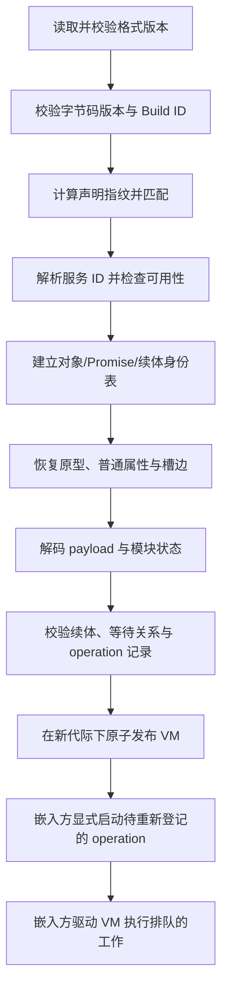

# 宿主绑定详细设计（草案）

> **状态：首版契约已落地，仍非最终设计。** 本文展开 [`host-interface.md`](host-interface.md) 的静态模块与 JS 值槽模型，以及 [`snapshot.md`](snapshot.md) 的 operation 中断与恢复规则；命名与记录编码仍可能调整。
>
> `crates/vm/src/binding/schema.rs` 提供 `ModuleDecl`、`HostClass`、`HostModule` / `FromServices` / `ModuleExports`、`Operation` 及内部静态绑定表；`binding/codec.rs` 提供 `Encode` / `Decode`；`binding/call/` 提供 `JsValue`、`CallCx` 与 `ModuleCx`。VM 接管 `Host`，持有原型、实例槽、payload、模块状态和 operation 记录。第 15 节还记录尚未实现的能力。

## 1. 目标与范围

### 1.1 目标

- 宿主绑定不再以「模块 + 导出名 + 实例 ID」作为运行时分派键。模块函数、原型方法和实例都由 VM 持有，按普通 JavaScript 对象语义访问。
- 绑定作者只声明**行为**（函数、方法、访问器、codec、operation 策略）；实例的 JS 引用、生命周期和持久化由 VM 统一管理。
- 一份快照包含恢复所需的全部状态。恢复只需要：同一 Build、同一静态绑定声明、同一份快照和平台服务，不需要旧 VM、旧宿主内存或旧宿主索引表。
- 所有宿主异步工作都必须能从任一 pending 阶段被中断，并在恢复时按声明策略结算原 VM Promise。

### 1.2 非目标

- 不追求完整的 ECMAScript 内建或 Node/DOM 兼容；绑定的 JS 可见面由声明决定。
- 不提供宿主在任意时刻同步重入 VM 的通道，也不在原生调用栈上保存挂起的脚本执行状态。
- 不支持旧快照迁移。绑定契约变化即拒绝恢复。
- 首版不实现动态插件加载；所有绑定在编译 VM 之前静态注册。

## 2. 术语

| 术语 | 含义 |
| --- | --- |
| 模块（module） | 一个静态宿主命名空间，例如 `test`、`platform`。JS 侧通过 `import { expect } from 'test'` 取得导出。 |
| 导出（export） | 模块声明的函数、常量或构造器。导出值是 VM 对象，在模块命名空间中不可改写。 |
| 类（class） | 一个静态类型声明：内部槽布局、可选 payload 类型、原型成员和可选构造器。注册类不等于导出构造器。 |
| 实例（instance） | VM 堆中的对象，带类标签、槽和 payload。对象身份、原型和属性由 VM 持有。 |
| 槽（slot） | 实例上声明的、不可从 JS 伪装的强引用，保存任意 `JsValue`。 |
| payload | 实例上声明的非 JS 数据，由绑定提供的 codec 编解码，随快照保存。 |
| 服务（service） | VM 接管的 `Host` 按值类型提供的运行时能力，例如节点工厂、时钟、网络客户端、错误报告。不随快照保存。 |
| operation | 一次可由中断恢复的异步工作。VM 为其创建 Promise 并保存持久记录。 |
| 声明指纹（fingerprint） | 由静态声明语义字段计算出的稳定标识，用于恢复时精确匹配绑定契约。 |

## 3. 核心不变量

- **H1 单一状态来源。** 可达实例的 JS 引用、payload、模块状态和 pending operation 状态都在 VM 快照中。宿主侧的映射表只能缓存，不能是权威状态。
- **H2 值句柄不越界。** `JsValue` 句柄只在当前 VM 的当前同步调用、或显式的快照/恢复过程中有效。跨调用保存必须写入声明槽。
- **H3 没有字符串分派。** VM 不向宿主询问「这个对象有哪些属性」「调用这个名字」。函数、原型、成员都在链接期绑定到声明。
- **H4 实例身份即对象身份。** 宿主不分配实例 ID；同一实例的任何别名在快照前后保持同一对象身份。
- **H5 方法共享。** 同类实例共享原型函数；方法通过内部标签校验接收者，裸调抛可捕获的 `TypeError`。
- **H6 payload 不含 VM 引用。** payload 字节中不得出现 VM 对象 ID、`NativeKey` 或函数指针；这类边只能走槽。
- **H7 恢复原子。** 任何声明缺失、指纹不符、槽非法或 payload 解码失败都整体拒绝恢复；不启动脚本、不投递事件、不重发请求。
- **H8 不重入调度器。** 绑定可以通过 `CallCx::call_sync` 同步调用脚本，但不能重入调度器或排空微任务。异步结果只能通过 operation 或新任务轮次交付。
- **H9 精确版本。** 格式版本、字节码版本、Build ID、绑定指纹和 operation 策略必须全部匹配。
- **H10 中断必有策略。** 没有声明恢复策略的异步类型不能注册，也不能启动。

## 4. 声明层

### 4.1 模块描述

`#[host_module]` 为 Rust 类型声明模块名和由 VM 管理的槽；`#[module_exports]` 标注同一类型的一个 inherent impl。`#[host_module(name = "test", classes = [Node], operations = [Wait], services = [counters: Rc<Counters>])]` 的三个列表均可省略。模块、类和 operation 各声明自己的必需服务；宏不扫描函数体，也不会因此新增 JS 导出。

`#[constructor(class = path::Node)]` 省略 `name` 时，以 `class` 路径的最后一个标识符（`Node`）作为 JS 导出名。显式 `name` 优先；未指定 `class` 时仍必须提供 `name`。`#[host_class(tag)]` 从 Rust 结构体名推导宿主类标识，独立于 JS 导出名；若重命名 Rust 类型时需要保留类标识，请写 `tag = "旧标识"`。

`host!` 接受 `dts`、`modules`、`services` 三段，或只有 `services`，返回 `Result<Host<P>, String>`。链接只处理选中模块的依赖：同一类或 operation 的 Rust 类型（含别名）只注册一次，不同类型使用相同类标签或 operation 名则报错。模块本身不去重。服务依赖按下述规则检查，不会自动注册；Rust 类型身份和依赖列表本身不进入绑定指纹或快照。

`dts` 的相对路径以宏调用所在源文件为基准（与 `include_str!` 一致），例如 `tests/e2e/bindings.rs` 中写 `../dts/ops.d.ts`；绝对路径原样使用。只有无法确定调用文件（例如宏生成代码）时才回退到 `CARGO_MANIFEST_DIR`。VM 与编译器消费同一份规范声明：编译器只从 `.d.ts` 取得模块与值导出清单，宏把同一份声明当作实现必须满足的断言。宿主不需要实现统一的字符串分派入口。

```rust
#[host_module(name = "demo")]
struct Demo;

#[module_exports]
impl Demo {
    #[function(name = "seed")]
    fn seed(_: &mut ModuleCx<'_, Self>) -> JsResult<JsValue> {
        Ok(JsValue::number(10.0))
    }

    #[constant(name = "version")]
    const VERSION: &str = "1";
}
```

- 编译器用 `Compiler::from_dts` 从 `.d.ts` 取得 `module -> export names` 清单，用于校验 `import` 并在 `Build.imports` 中记录；它不需要知道类的槽布局或 codec。`host!` 在展开时把同一份清单与同一模块类型的 `HostModule::NAME` 与 `ModuleExports::EXPORT_NAMES` 逐名比较，缺少声明的值即编译错误；只比较名字，不比较签名、种类或 arity，实现可以额外注册未声明的名字（它们不进入命名空间导出）。
- VM 在创建时校验：Build 引用的每个模块和导出都已注册；导出种类匹配（函数必须是函数，常量必须是常量）。
- 每个 VM 独立接管不可克隆的 `Host`，静态绑定表是内部实现；实例、原型和模块状态每 VM 一份。服务注册表不要求 `Send + Sync`；各服务的线程约束由其 trait 单独规定。

### 4.2 类、槽与成员

```rust
#[host_class]
struct Matcher {
    #[js_slot]
    actual: JsValue,          // 任意 JS 值，含函数、符号、环
}

#[methods(Matcher)]
impl Matcher {
    #[method(name = "toBe")]
    fn to_be(cx: &mut CallCx, this: This<Matcher>, expected: JsValue)
        -> JsResult<()> { … }

    #[method(name = "toEqual")]
    fn to_equal(cx: &mut CallCx, this: This<Matcher>, expected: JsValue)
        -> JsResult<()> { … }
}
```

类声明包含：

- **标签**：稳定字符串或宏生成的 ID，出现在快照与诊断中，不出现在 JS。
- **父类**：可选的父类标签。声明层把原型链接到父类原型，并把父类槽排在子类槽之前；基类方法与访问器接收派生实例，子类声明的槽索引按自身布局计数。
- **槽布局**：有序、带名字、带种类。槽种类为 `Js`（单个 `JsValue`）、`JsList`（有序 `JsValue` 列表）与 `JsWeak`（弱引用身份）。`JsList` 用于事件监听器集合这类「数量可变、元素是 JS 值」的状态，避免把引用塞进 payload。`JsWeak` 只保活槽本身，不保活目标，也不作为快照强根。`JsMap` 见[已决策事项](#15-已决策事项)。
- **payload**：可选的 `T` 及其 codec。`T` 不得包含 `JsValue`。payload 属于具体实例类，不沿继承链合并。
- **原型成员**：方法、访问器。成员名区分字符串与符号；`Symbol.iterator` 这类内建符号由稳定的枚举（`WellKnownSymbol`）在声明期内静态给出，不接受运行期 Symbol。`Symbol.dispose` / `Symbol.asyncDispose`（显式资源管理，见 [`language.md`](language.md)）同样按枚举声明；`asyncDispose` 需要异步收尾时以 `cx.promise(op)` 起始 operation，沿用现有挂起/恢复契约。
- **可选构造器**：只有声明了 `Constructor` 的类才导出可 `new` 的函数。未声明时，类只作为返回类型和原型存在。

实例是普通 JavaScript 对象，可以有普通自有属性；槽与 payload 不可枚举、不可由 `Object.getOwnPropertyNames`、`Object.getOwnPropertySymbols` 或 `Reflect` 观察到，也不能借 `Object.create(prototype)` 伪造。原型上的方法与访问器是普通属性，脚本可以读取、改写或删除；快照保存玩家修改后的原型，而不是每个 VM 重建静态模板。

`#[host_class(event_target)]` 将实例标记为 `EventTarget`。`event_parent = parent` 隐含该标记，并选择本类的单值 JS 槽作为传播父节点；互斥的 `event_parent_fn = parent` 改用同步 Rust 回调 `fn(&mut CallCx<'_>, JsValue) -> JsResult<JsValue>`，不得挂起或执行 guest JS。派生类继承该品牌与父节点来源，也可指定自己的来源。为保留声明的原型继承，不能在未标记父类的子类上首次声明该品牌。派发在调用监听器前构造完整路径，不读取脚本属性或 getter；两种来源均以 `null` / `undefined` 结束路径，非目标与循环分别抛 `TypeError`、`HierarchyRequestError`。

同步绑定可用 `cx.custom_event(type, detail, bubbles, cancelable)` 创建事件；CPS 绑定用 `cx.dispatch_event(target, event).await?` 通过固定 intrinsic 派发，并收到表示未取消的 JS 布尔值。外部输入在 VM 线程用导出入口发起独立轮次，再排空微任务。平台回调不得持有 `JsValue`。

`cx.abort_reason(&signal)` 检查信号品牌并返回已有原因。`cx.promise_with_signal(op, &signal)` 对已取消信号直接拒绝原生 Promise，不启动 driver；否则将登记绑定到信号。取消先删除 pending 记录并释放登记，再以同一原因拒绝 Promise。完成和恢复失败也解除关联。

定时器唤醒服务注册为 `timer`（`TimerService`），接收 operation token 和 `u64` 相对延迟，返回可 drop 的一次性登记。平台只投递 token；在 VM 线程调用 `vm.wake_timer(token)` 后，用 `vm.run_until_idle()` 完成独立轮次。恢复发布后调用 `vm.start_recovered_operations()`；待唤醒的 timeout 或需续订的 interval 在缺少该服务时拒绝恢复。测试时钟与唤醒服务应使用同一计时域。

### 4.3 稳定标识与契约指纹

绑定声明在链接期计算**指纹**，写入快照头部；恢复时用本进程的声明重新计算并比对。指纹只覆盖语义字段：

- 模块名、导出名及种类、每个模块的状态槽名字/顺序/种类；
- 类标签、槽名字/顺序/种类、codec 标识；
- 成员名、种类（方法/访问器/数据）、声明的 `.length` 与返回种类；
- operation 类型、恢复策略。

指纹不含 Rust 类型名、函数地址、宏展开细节或调试名称，因此重命名内部符号不会使快照失效；删除槽、改变顺序、更换 codec 或改变恢复策略会使快照失效。变更策略沿用项目的精确版本约定：不自动迁移，报告具体不匹配项。

服务的注册、值类型、实现和依赖列表都不进入指纹。恢复仍要求新宿主满足模块的必需依赖及镜像实际需要的能力。

### 4.4 与编译器的接口

- `Compiler.imports` 由声明集合派生，不在手写源码里重复维护。
- 编译器只拒绝三种情况：导入未声明的模块、导入模块中不存在的导出、从宿主模块做默认导入。其余签名不匹配留给 VM 在首次调用时即时检查，或在开发模式下做静态签名检查。
- 类名和成员名不进入 Build。Build 中只保留模块命名空间和函数值，函数值携带声明 ID。

### 4.5 TypeScript 定义生成

生成器读取同一份声明，输出模块 `.d.ts`：

| 声明 | TypeScript |
| --- | --- |
| `Function(expect: (JsValue) -> Instance<Matcher>)` | `export function expect(actual: unknown): Matcher;` |
| `Instance<Matcher>`（无构造器导出） | `export interface Matcher { toBe(expected: unknown): void; toEqual(expected: unknown): void; }` |
| `Constructor<Matcher>` | `export class Matcher { constructor(...); … }` |
| 任意精度整数 `BigInt` | `bigint`（不生成 `number` 或 `unknown`） |
| `JsValue` 参数或返回值 | `unknown`（未知类型，不做 `any` 宣传） |
| 常量 `version: JsString` | `export const version: string;` |
| `Symbol.iterator` 成员 | `[Symbol.iterator](): Iterator<…>;` |
| `Symbol.dispose` / `Symbol.asyncDispose` 成员 | `[Symbol.dispose](): void;` / `[Symbol.asyncDispose](): Promise<void>;` |

已知局限：TypeScript 无法表达「方法要求内部槽」；生成器只给接口，不生成可 `new` 的值，除非声明了构造器。接受回调等复杂签名可标注为 `unknown`，后续通过显式 `#[ts(...)]` 覆盖。

## 5. 值层

### 5.1 `JsValue` 生命周期

- `JsValue` 是 16 字节以内的可复制句柄，包含对象 ID 和 VM 代际。VM 在不同步调用、跨代恢复或跨 VM 使用时拒绝该句柄，报 `HostFault`，而不是抛出可捕获的脚本异常。
- BigInt 的任意精度内容不放进定长句柄；`JsValue` 只引用 VM 持有的值，快照按规范十进制编码。
- 宿主函数接收的实参、`this`、以及 `cx` 上读取到的值都是这种句柄。调用返回后句柄失效，但通过槽写入的值继续有效。
- 句柄不暴露给宿主序列化；`HostValue`、`NativeKey`、`HostData` 投影全部删除。

### 5.2 边界值域与转换

| JS 值 | 宿主可做什么 |
| --- | --- |
| `undefined`、`null`、布尔、数字、字符串 | 直接读取；字符串按 UTF-8 视图或 `&JsString` 访问，拒绝时抛 `TypeError` 或 `HostFault`（见 6.3） |
| `bigint` | 用 `JsValue::bigint(&str)` 构造，解析失败按宿主错误处理；或用 `Inspect` 读取规范十进制文本。不映射为 Rust 浮点、JSON 数值或宿主自定义大整数模型 |
| 对象、数组、函数、符号 | 只能作为句柄传递、比较身份、读取受控的自有数据；不能转成 Rust 结构 |
| Promise、Proxy、绑定实例 | 同上；绑定实例可用 `Instance<T>` 提取 payload |
| 宿主函数值 | 可由宿主读取并比较声明 ID，但不得据此在外部表里查状态 |

`JsValue` 不实现 `Serialize`。需要保存任意值时用槽，不需要在宿主侧构造第二套值模型。

### 5.3 槽的访问与追踪

```rust
let actual: JsValue = this.actual(cx);        // 读槽：返回当前值句柄
this.set_actual(cx, value);                   // 写槽：替换强引用
this.pending(cx).push(callback);              // JsList 槽
```

- 实例槽写入通过 `CallCx`，模块槽写入通过 `ModuleCx`（或恢复期的等价上下文）。宿主既然拿不到底层对象表，就不存在绕过 VM 的写入路径。
- 槽是强边，参与与普通属性相同的可达性遍历：保留身份、别名和环；实例本身不是根，只有从模块命名空间、模块状态、脚本根或 operation 可达时才进入快照。
- 槽的读取不触发 getter 或 Proxy trap；它只是对象图边。
- 槽布局在声明期固定，快照按声明顺序写值。恢复时先建立对象身份，再写入槽；缺失或数量不符即拒绝。

### 5.4 非 JS payload 与 codec

```rust
pub trait Encode<Owner = ()> {
    fn encode(&self, out: &mut Vec<u8>, services: &Services<'_, Owner>) -> Result<(), CodecError>;
}
pub trait Decode<Owner = ()>: Sized {
    fn decode(input: &mut &[u8], services: &Services<'_, Owner>) -> Result<Self, CodecError>;
}
```

规则：

- **服务提供能力，快照提供状态。** 手写 codec 可以用 `Decode<Node>` 和 `Node::factory(services)` 访问当前宿主的服务。派生 codec 将同一消费者的 `&Services<'_, Owner>` 传给嵌套字段。解码绝不能依赖「旧宿主里的节点 42」。
- **解码期不改 VM 堆。** codec 只能创建自己的 Rust 数据和平台资源；需要 JS 引用的值必须来自快照槽，而不是在解码时构造新对象。这样恢复失败时可以整体丢弃，不留半成品。
- **副作用可回滚。** codec 创建的平台资源必须在失败路径上可释放（`Drop` 或显式回收）。恢复器只在全部 payload 解码成功后发布 VM。
- **完整解码。** 模块 payload 不声明 schema。顶层解码必须消费全部字节。
- **字段协议。** `#[derive(Encode, Decode)]` 按声明顺序共享输出与输入游标，并附字段路径。定宽数值为小端，`bool` 和 `Option` 使用单字节 `0` / `1` 标签，`()` 无字节；`String` 与 `Vec<T>` 分别以前置 `u32` 小端字节数和元素数编码。业务校验可手写 codec；不隐式使用 `serde`。

`host!` 的 `services:` 段区分内建 `name: value` 和自定义 `Type => value`。内建值按值进入 `Platform` 的可选字段，通过 `host.platform()` 的访问器借用；未指定的字段返回 `None`。宏不为内建值装箱、包装共享指针或按类型查询。自定义布局仍整体擦除；同一宿主的确切自定义类型（含别名）只可注册一次。`host.bind_service::<T>()` 或 `vm.bind_service::<T>()` 只查找自定义项；同一具体类型可同时用于两个通道。

模块、类和 operation 在各自的属性宏里用 `services = [name: Type, …]` 声明依赖，生成 `Owner::name(services)` 访问器。Rust 编译器按确切类型为选中模块及其声明的类和 operation 推断唯一的自定义字段；缺少依赖或以别名重复注册均无法编译。宿主构造时为每个消费者绑定具名字段视图。模块导出从 `ModuleCx::services()` 读取，类方法和访问器从 `ClassCx::services()` 读取声明类的服务（包括继承调用）。初始化、codec、operation 驱动则直接收到所属类型的服务视图。VM 内建独立解析自身可能缺席的宿主能力，不使用这套依赖声明。

例如 `Self::counters(cx.services())` 只通过视图中的具名字段借用服务，不查类型表、偏移表，也不做 `Any` downcast。服务借用不占用对上下文的借用；可以持有它并用 `&mut CallCx` 分配对象或写槽。返回 `HostStep::Suspend` 后，不能保存本次调用的借用；续体从新的上下文取得服务。

```rust
#[host_module(name = "test", services = [counters: Rc<Counters>, labels: Rc<LabelService>])]
struct TestModule;

let host = host! {
    dts: "test.d.ts",
    modules: [TestModule],
    services: {
        Rc<Counters> => counters,
        Rc<LabelService> => labels,
        timer: timer,
    },
}?;
let mut vm = Vm::new(build, host, VmOptions::default())?;
vm.start("run", vec![])?;
vm.run_until_idle()?;

// 没有宿主模块时不需要 .d.ts。
let console_host = host! { services: { console: console_sink } }?;
```


服务实例不进入快照。诊断、绑定触发的同步 GC 与新建时的 `navigator.userAgent` 各自使用可选的运行时服务，见[宿主接口](host-interface.md)。恢复逻辑根据定时器记录检查 `timer`（`TimerService`）；`crypto`（`CryptoService`） 提供同步熵；`time`（`TimeService`） 为 `Date` 和文件时间戳提供 Unix 毫秒与本地 IANA 时区，未注册时回退到确定的 `DummyTimeService`（epoch 0，`Etc/UTC`）。

网络适配器注册为 `fetch`（`FetchService`）。快照只保存 VM 侧事务，恢复不要求网络能力。`start(token, HopRequest) -> Box<dyn FetchRegistration>` 只启动一跳；适配器不得自动重定向、重试、合并 `Set-Cookie` 或解压。上行只能通过 `send_upload` 发送 `UploadCredit` 授予的字节，`finish_upload` 结束上传；下行必须先 `grant_download` 再投递 `Data`；`cancel` 幂等并关闭连接。VM 线程用 `Vm::deliver_fetch_event` 接收 `UploadCredit`/`Informational`/`Head`/`Data`/`Eof`/`Failed`：head 至多一次，`Data`/`Eof` 只在 head 之后，终结唯一，额度或顺序违约是宿主协议错误。恢复时旧登记被丢弃，在途事务以 `AbortError` 中断且不重发。

输出适配器注册为 `console`（`ConsoleSink`）。`ConsoleSink::write(&ConsoleEvent)` 不得重入 VM；事件不含 JS 句柄，宿主可复制或自行渲染。服务不登记 operation；恢复到有或无 sink 的宿主都不会重放历史输出。未安装 sink 时，仅实际调用 Printer 才会抛出脚本 `NotSupportedError`。

`subtle_crypto`（`SubtleCryptoService`）独立于同步熵服务。VM 在自己的线程上借用服务调用 `start(SubtleCryptoRequest, SubtleCryptoCompletion) -> Result<(), HostFault>`。提交必须快速返回，不得阻塞或重入 VM；`Ok(())` 只表示接单，`Err` 表示未接单。服务不必可克隆或跨线程共享；宿主可以立即完成，也可以把拥有所有权的请求和一次性完成句柄交给自己的调度设施。完成句柄可跨线程，不含 VM 引用或 JS 值；`complete` 消费句柄并以非阻塞方式提交结果，不直接结算 Promise。PBKDF2 输出长度和 GCM 标签长度以位为单位；GCM 密文的末尾包含认证标签，认证失败返回 `HostFault`，不得返回明文。

VM 在 `run_until_idle` 的微任务检查点之后逐项交付已就绪结果，不要求按提交顺序完成。宿主可用 `Vm::has_pending_subtle_operations` 判断是否仍需驱动 VM。每 VM 最多保留 16 个待交付请求；未接单、超限、服务失败或接单后未完成即丢弃句柄都会以脚本 `OperationError` 拒绝，不暴露宿主诊断。任何待交付请求都会阻止快照捕获；VM 销毁时只丢弃接收端，不等待或取消宿主任务。

### 5.5 模块状态

- 影响后续调用的模块级可变状态必须声明在模块状态类型中；它的 JS 引用走槽，非 JS 数据走 codec。
- 模块状态是快照的持久根。静态声明表不持有任何 VM 状态；注册闭包捕获 `Rc<RefCell<_>>` 这类做法在评审中直接视为违约。
- 模块状态只在 VM 创建或恢复时构造，不在每次调用时重建。每个注册模块（含无导出的模块）都有一条按模块名排序的快照状态记录。
- 新 VM 通过 `FromServices::from_services(&Services)` 初始化模块；恢复只调用 `Decode`。实现 `Default` 的类型自动获得 `FromServices`。需要服务的模块直接实现 `FromServices`，不同时实现 `Default`。
- `#[host_module]` 和 `#[host_class]` 应放在 codec derive 之前，使 `#[js_slot]` / `#[js_list]` 不参与编码。没有剩余 Rust 字段的模块自动补齐缺省的 `Default` derive 和空 codec；非空模块必须明确选择初始化和 codec 实现。
- 函数和构造器使用 `&mut ModuleCx<'_, Self>`，通过 `cx.state()` 短借用本模块的状态，通过本模块的 `SLOT_*` 常量访问 JS 槽。每次进入 CPS 阶段时由分派器重新建立 `ModuleCx`；跨挂起点不保留上下文或 Rust 引用。类方法仍使用 `CallCx` 和 `This`，不能访问模块状态。

## 6. 调用协议

### 6.1 `CallCx`

```rust
impl CallCx {
    fn args(&self) -> &[JsValue];
    fn arg(&self, index: usize) -> JsResult<JsValue>;      // 缺失即 TypeError
    fn this(&self) -> JsValue;
    fn is_construct(&self) -> bool;
    fn alloc<T: HostClass>(&mut self, init: T::Init) -> JsResult<Instance<T>>;
    fn throw(&mut self, value: JsValue) -> JsError;        // 可捕获脚本异常
    fn fault(&mut self, message: &str) -> HostFault;       // 不可捕获，终止执行
    fn inspect(&self, value: JsValue) -> Inspect<'_>;      // 只读自有数据视图
    fn promise<O: OperationDriver>(&mut self, state: O) -> JsResult<JsValue>;
    fn cancel_task(&mut self, handle: &JsValue) -> JsResult<()>;
}
```

- `CallCx` 在栈上，生命周期绑定本次调用；不能保存到 Rust 数据结构或在调用结束后使用。
- `inspect` 提供只读视图：自有可枚举数据、数组长度、原型身份、`SameValue` 比较，以及 BigInt 的规范十进制文本。它不触发 getter/Proxy，也不允许写入任意脚本对象。绑定要修改脚本可见状态时，返回值或写自己的槽。
- 绑定函数可以在调用内分配实例、读取堆元信息；但这些操作都在 VM 线程内同步完成，不执行用户脚本。

### 6.2 原型、方法与接收者

- 每个 VM 为每个类创建一份原型对象。同类实例共享同一函数值：`a.toEqual === b.toEqual`。
- 方法入口用 `This<T>` 校验内部标签。接收者不是该类的实例时抛出可捕获的 `TypeError`（例如 `TypeError: toEqual called on incompatible receiver`）。
- 裸调用 `const f = a.toEqual; f(x)` 因此失败；需要跨调用携带接收者时用 `a.toEqual.bind(a)` 或保留 `a` 作成员调用。VM 的 `bind` 是普通脚本语义，不需要绑定层支持。
- 原型方法可以被脚本改写或删除；这与普通 JS 一致，快照保存改写结果。静态模板只在新建 VM 时安装。
- 若类声明了构造器，构造器同样只是模块导出中的函数；`new` 走普通构造调用路径，由声明决定是否允许无 `new` 调用。

### 6.3 错误分类

| 情形 | 结果 | 脚本可捕获 |
| --- | --- | --- |
| 参数类型不符、断言失败、接收者类型不符 | `JsError`（值为脚本异常） | 是 |
| 绑定代码按声明抛出任意 `JsValue` | 脚本异常，沿正常 try/catch 路径 | 是 |
| 句柄过期、跨 VM 使用、`CallCx` 误用、越界槽访问 | `HostFault` → `VmError` | 否，VM 进入失败状态 |
| 绑定 panic | 视为 `HostFault`（Rust 路径可配置为中止；C ABI 必须捕获） | 否 |
| 恢复期声明缺失、指纹不符、payload 解码失败 | 恢复失败，VM 不创建 | 否 |

区分原则：**可由脚本处理的语义错误用 `JsError`；违反宿主契约用 `HostFault`。**

宿主用普通 `#[host_class(parent = TypeError, ...)]` 声明异常，其中 `TypeError` 是从 `yield_vm::intrinsics` 导入的类型标记。`parent = RustPath` 同时支持宿主类和已安装的 intrinsic 类；异常祖先不能与 EventTarget 品牌并存。`#[constructor(name = "ParseError", class = ParseError)]` 导出原生构造器，异常类须用 `new`。静态继承沿声明连到最近有导出的父类构造器，最终连到 intrinsic 构造器。

- `CallCx::alloc` 使用标准基类默认值；`alloc_with_super(payload, args)` 只接受有标准异常祖先的类，由 VM 同步执行标准转换与 `cause` 读取，将脚本异常原样传播。实例保留宿主槽和 payload；`Error` 保留创建点活动栈，`DOMException` 使用内部 name/message 和标准 code。`prototype_name` 显式声明原型的非枚举可写可配置 `name`，不参与身份判断。
- `Error.isError` 只读实例自身的 `[[ErrorData]]`；改写原型不改变品牌，伪造原型和代理不会取得品牌。`instanceof` 仍使用脚本原型。快照格式 95 的 Full 恢复核对底层形态和槽，不重设可变原型或栈。
- `cx.constructor::<TypeError>()` 返回已根化的 intrinsic 构造器；`cx.construct::<TypeError>(&args)` 按类构造实例，两者都不读取可变的全局绑定。成功时可返回实例或用 `cx.throw(value)` 抛出；无调用上下文时可用 `JsError::new::<TypeError>(message)` 延迟构造消息为首参的 Error 类。
- 恢复策略（`Reject`）与恢复期中断合成的拒绝原因是带声明原文的普通 `Error` 对象；脚本显式 `throw`、`Promise.reject`、用户提供的 abort reason 与外部 completion 的拒绝值原样透传，不被拦截或包装。

### 6.4 重入与执行线程

- 绑定可以通过 `CallCx::call_sync` 在当前 Rust 栈上取得脚本返回值或原始抛出值；Promise 作为普通值返回。最多嵌套 16 层，第 17 层抛出 `RangeError`。绑定不能重入调度器、排空微任务或接受外部事件；服务与事件父级回调不获得此调用能力，快照静止点不变。
- `construct` 与 `alloc_with_super` 的标准参数转换也是受控的同步脚本调用。这些同步调用期间，外层有效句柄仍受 GC 保护。
- `Host` 随 VM 在同一线程持有；并行时各线程独立构造宿主。跨线程的能力与状态由具体服务值自行声明和同步。
- 异步 operation 结果经 `Vm::complete_operation` 交付。VM 全局 timer 和 `AbortSignal.timeout` 只用可选的 `timer`（`TimerService`）（`TimerService::arm(token, delay_ms)`）；平台持有一次性可取消登记，并在 VM 线程调用 `Vm::wake_timer`，随后调用 `Vm::run_until_idle`。wake 不执行 JS、不携带 settlement；忽略旧代和已消费令牌，拒绝活动的非 timer 令牌。
- 绑定函数不得阻塞等待 operation。可直接返回原生 Promise，或用后台 CPS 任务等待 operation 并立即返回可取消句柄。
- `loop`、`while` 和 `while let` 的循环体可使用受支持的 `await`；条件必须同步，`for` 不可挂起。回边不会主动让出执行权；后台循环再次到达同一个外部 `await` 时复用任务 ID 和恢复阶段，但登记新的 operation，必须用新的令牌投递。

## 7. 异步 operation

### 7.1 声明

```rust
#[operation(name = "wait", recovery = pause)]
#[derive(Encode, Decode)]
struct Wait {
    label: String,              // 持久状态，编码进快照
}
```

每个 operation 声明类型 ID、codec 和恢复策略。`OperationDriver` 通过 `&Services` 获取服务，并用 `start` / `resume` 返回拥有平台登记的 `Live`。状态和 `Live` 均不得持有 guest 值；回调与其他活值由 VM 的后台任务保存。`Live` 的 `Drop` 释放登记，`checkpoint` 可为本次镜像编码替换状态。

### 7.2 启动与结算

- `cx.promise(state)` 创建原生 VM Promise 作为唯一交付终点；后台任务改用任务 ID 作为终点，既不创建 Promise，也不复制续体帧。两者共享同一 operation 登记路径。
- 宿主把 operation 交给平台执行，但**不得**把「operation ID → 平台句柄」当作恢复权威。平台任务丢失后，恢复依据只有快照状态。
- 结算接口携带 `(epoch, operation_id)` 能力令牌。VM 只接受当前代际、仍处于 pending 的记录；未知、已结算或来自旧 VM 的交付被拒绝，且不会产生第二次结算。
- 重复交付返回 `UnknownOperation`，不影响已经在跑的脚本；后台任务的 JS 句柄也不是 operation 令牌。

### 7.3 恢复策略

| 策略 | 语义 | 典型用途 |
| --- | --- | --- |
| `Pause` | 恢复时以 `undefined` 兑现原目标，不重新登记工作 | 测试暂停点、仅用于挂起的 `wait` |
| `Resume` | 从快照状态重新登记，未来交付时结算原目标 | timer、UI 事件订阅、等待外部输入 |
| `Reissue` | 从快照状态重新发起，结果交付原目标 | 幂等查询、可重放请求 |
| `Reject` | 恢复时用声明的错误值拒绝原目标 | 不可重放的外部副作用 |

约束：

- `Resume` 的状态必须足以重建登记，不能引用平台句柄；例如 timer 记录剩余时长和时钟域，而不是 `TimerId`。
- `Reissue` 必须由绑定作者确认幂等；默认不允许。
- `Reject` 是**成功的恢复**：拒绝经原有反应和异常路径交付，不阻塞其他续体。错误的恢复拒绝（校验失败）与策略拒绝必须区分。
- 选择在声明期固定，不能按调用点临时改变；否则快照无法判断语义。确需按调用区分时，把策略标识写进状态并在声明中列出允许集合。

### 7.4 时序与快照边界

- 微任务队列必须排空，宿主还必须将外部逻辑时间和投递冻结在同一切点。capture 既不取消原登记，也不创建新登记。
- 快照记录 pending operation 的类型、状态和 Promise 或任务终点；任务保存了 owner、外部恢复阶段、原接收者与活槽。恢复使用新代际，旧令牌失效。
- 恢复成功后，`Pause` 与 `Reject` 结算 Promise 或排入任务续体；`Resume` / `Reissue` 保持 pending，由 `Vm::start_recovered_operations()` 在发布后重新登记。
- 恢复不得重跑发起 operation 的函数，也不得重放该函数之前的副作用。

## 8. 快照

### 8.1 概念记录

```text
Snapshot {
    header:    format, bytecode, build_id, binding_fingerprints,
               service_ids, instance_epochs?          // 见 11
    objects:   [ObjectRecord]                        // 含绑定实例
    module_states: [ { module, slots, bytes } ]
    continuations: […]                               // 现有续体记录
    operations: [ { type, state, target, strategy } ]
    host_tasks: [ { id, owner, stage, receiver, saved, waiting_on } ]
    next_host_task_id: u64
    globals / roots / imports / script_env / …
}

ObjectRecord(NativeInstance) {
    id, class_tag, prototype: ObjectId,
    properties: ordinary own properties,
    slots: [slot kind payload…],     // 顺序由声明决定
    payload: Option<bytes>,
}
```

- 原型、普通属性、槽和 payload 都按 VM 对象图保存；函数对象只保存声明 ID。
- `module_states` 按模块名排序；`operations` 按稳定 ID 排序；`objects` 顺序不影响语义，但恢复器不得依赖顺序做身份假设。
- 记录中不出现字符串分派键、宿主指针或外部句柄。

### 8.2 不进入快照的内容

- Rust 机器码、函数指针、trait object、平台服务实例。
- OS timer、socket、文件描述符、事件订阅句柄。
- 宿主侧的实例索引表、matcher 数组、operation 映射。
- 已入队但未执行的 VM 微任务；快照前必须排空。
- 正在执行的宿主调用栈；绑定调用不能跨 `await`。

### 8.3 确定性

- 同一对象图在同一 Build、同一声明下重复快照，除时间戳类外部信息外应逐字节一致。时间、随机数种子等若影响脚本语义，必须作为 VM 状态记录（现有 `random_state` 即此原则）。
- 指纹和版本字段在头部的顺序固定；codec 必须产生规范编码。

## 9. 恢复协议



`Vm::restore` 默认使用 `SnapshotValidation::Trusted`，只接收受信、未经篡改的 VM 镜像，仍匹配当前绑定声明、解码 payload、重建宿主记录；不重复遍历堆图审计镜像内部关系。开发和诊断可将 `RestoreOptions::validation` 设为 `SnapshotValidation::Full`；两种模式都不负责认证存档来源或完整性，也不适用于不可信输入。

阶段规则：

1. **只读校验。** 前四步失败时不分配任何平台资源，不修改任何全局注册表。
2. **先图后数据。** 先建立对象身份和引用边，再解码 payload；这样 payload 的上下文能安全引用快照中的结构，而无需在字节里藏 ID。
3. **最后发布。** 所有记录就绪前，VM 不对外可用；注册、重发、拒绝都发生在发布之后。
4. **失败可回滚。** 平台资源在失败路径释放；恢复器对已解码但未发布的对象执行统一清理。
5. **不执行脚本。** 恢复过程不跑模块初始化、不调用绑定函数、不触发 getter。

## 10. 版本与失败策略

- 校验顺序：快照格式 → 字节码版本 → Build ID → 所需模块与导出 → 类指纹（槽布局、成员）→ operation 类型与策略 → 服务可用性。
- 任一失败：整体拒绝，错误中列出第一处不匹配及声明 ID；不启动 VM，不投递事件，不发请求。
- 运行时 `HostFault`：VM 进入不可继续执行的状态；宿主可丢弃该 VM 并选择按策略重新初始化，但不能把它当作成功恢复。
- 策略性拒绝（`Reject`）与恢复失败在 API 层必须使用不同类型，避免宿主误把可重试的业务拒绝当成存档损坏。

## 11. 多 VM、代际与生命周期

- 每个 VM 接管自己的 `Host`，并有独立原型表、模块状态和实例。实例、临时句柄和 operation 令牌不能跨 VM 使用；允许共享的服务资源须显式共享。
- VM 创建时分配随机代际，恢复时分配新代际。代际不写入快照：分叉恢复出的两个 VM 各自拥有不同代际，旧宿主持有的交付只会在匹配原代际时被接受，从而避免「旧任务结算新 VM」。
- 实例不可达时，payload 随对象释放；平台资源由 payload 的 `Drop` 或绑定提供的释放钩子处理。快照不保存平台句柄，因此恢复不会「复活」旧平台对象。
- VM 销毁时释放全部实例与平台资源；静态声明不持有资源。

## 12. 性能预算

- 调用路径不按字符串查表：函数对象直接持有声明指针，成员查找走普通属性路径。
- 每次调用创建 `CallCx` 不分配堆内存；参数切片借用 VM 栈。
- 槽访问是固定偏移；payload 访问不做序列化往返。
- `inspect` 只读视图按需构造，不复制整棵对象图。
- 快照编解码允许分配，但必须线性于可达对象数；指纹在链接期计算一次，不每次快照重算。

## 13. 从现有 PoC 迁移映射

| 现有构件 | 新设计 |
| --- | --- |
| `Host::resolve_export(module, export)` | 静态模块声明的导出表；链接期校验 |
| `HostExport::{Value, Function}` | 常量导出 / 函数导出；函数对象携带声明 ID |
| `Host::call(module, export, args)` | 强类型导出函数 `fn(&mut CallCx, …)` |
| `Host::get_property(NativeKey, prop)` | 原型成员；普通属性查找，无宿主查询 |
| `Host::call_native(NativeKey, args)` | 原型方法函数；`this` 校验 + payload/槽访问 |
| `Host::project_arguments` / `project_native_arguments` | 删除；绑定直接用 `JsValue` 与 `CallCx::inspect` |
| `HostValue::{Native, NativeFunction}` | 绑定实例对象 / 宿主函数对象 |
| `NativeKey { type_name, id }` | 类标签 + 槽/payload；`NativeKey` 不再出现在公共 API |
| `TestHost.matchers: Vec<HostValue>` | `Matcher.actual` 槽；实例对象由 VM 分配 |
| `NativeKey { type_name: "toBe", id: matcher_id }` | 共享原型方法 `Matcher.prototype.toBe` |
| `PendingOperationMeta` + 字符串 ID | operation 记录（类型、状态、Promise） |
| `Host::has_native` / `rebuild_operation` | 声明指纹 + codec 解码 + 策略驱动的恢复 |
| `HostData` 投影 | 删除；`CallCx::inspect` 提供只读视图 |
| `HostReply::{Value, Throw, Operation}` | 返回值 / `JsError` / `start_operation` |

迁移顺序建议（实现阶段，不在本文范围）：先引入声明与原型，再替换 `TestHost`，最后删除旧 trait 与 `HostValue`；每一阶段都应有可运行的用例。

## 14. 验收用例

以下用例应作为实现完成的门槛：

1. **跨进程式恢复。** 保存 `m = expect(obj)`、`obj.matcher = m`、`f = m.toEqual.bind(m)` 和环；销毁 VM 与宿主，只用快照、Build、声明恢复；通过别名修改 `obj` 后调用 `f`，断言看到修改，且实例身份、原型和别名延续。
2. **方法共享与接收者校验。** `a.toEqual === b.toEqual`；裸调抛 `TypeError`；`Object.create(Matcher.prototype)` 对象不能冒充实例；脚本改写原型方法后快照保留修改。
3. **值域。** 函数、符号、环、同一对象的多个槽、`undefined` 与「未初始化」区分正确；跨调用保存的旧句柄被拒绝。
4. **payload 与服务。** 带 payload 的节点从平台工厂重建，不依赖旧节点表；缺少声明的服务无法构造宿主，payload 截断则整体拒绝恢复且无资源泄漏。
5. **operation 策略。** `Pause` 以 `undefined` 兑现且只兑现一次；`Resume` 重新登记后交付一次；`Reissue` 不重跑发起函数；`Reject` 经原 `catch` 路径；旧代际交付被拒绝。
6. **策略性拒绝 vs 恢复失败。** 前者脚本可观察、其他续体继续；后者 VM 不创建。
7. **不可达实例。** 不在快照中的实例不要求解码，快照也不包含其 payload。
8. **快照确定性。** 同一对象图重复快照产生相同内容；恢复后再次快照与首次一致（时间类状态除外）。
9. **迁移后的 `test.expect` / `test.assert` / `test.wait`** 在无投影、无字符串分派的路径下通过现有语义用例。

## 15. 已决策事项

以下策略作为后续实现基线。它们是设计决策，不代表对应能力已经实现；若与当前代码不一致，以「首版落地状态」中的实现说明为准。

1. **`JsMap` 槽：暂不增加。** 弱引用槽已落地为 `JsWeak`；宿主实例槽维持 `Js` / `JsList` / `JsWeak`。映射容器仍使用 VM 已有的 `WeakMap` / `Map`，出现具体绑定需求后再评估是否扩展槽种类。
2. **访问器失败时机：延迟到脚本访问。** 恢复只做结构和声明校验，不执行 getter/setter 或其他脚本可观察逻辑。
3. **绑定类继承：允许 `class extends` 并调用 `super`。** 声明层父类支持原型链、槽合并和基类接收者校验。脚本派生构造复用基类构造及槽初始化，只对本次匹配的宿主分配使用派生原型，不改写替换对象的原型。脚本私元素单独存储，不增加 `HostClass` 槽或 payload。
4. **符号成员：支持显式列出的 well-known Symbol。** 声明使用稳定的符号枚举 ID，不接受任意运行期 Symbol；宿主私有状态仍走隐藏槽，不映射为 JS 私有名。
5. **C ABI：暂缓。** Rust 应用链接 VM、实现 `Host` 并调用平台服务；本库不提供 C ABI 或移动端绑定。若未来需要外部语言直接声明绑定，再单独设计 ABI。
6. **声明入口：宏是最终用户 API，builder 是过渡/内部实现工具。** 最终由宏生成或校验规范声明结构；不保留公开 builder 作为平行的声明逃生口。codec、operation 等行为可由 Rust trait 实现。
7. **TypeScript 定义生成：暂缓。** 待声明和签名模型稳定后再确定生成范围，不引入手工补丁机制。
8. **payload 编码：继续使用自定义 codec。** 不绑定 postcard、bincode 或 CBOR；规范编码、字段顺序、长度与版本规则由 codec 契约明确。
9. **流式 payload：暂缓。** 维持整段写入/读取接口；只有实测证明峰值内存构成问题时再改为流式 API。
10. **宿主并发与 operation 恢复：** VM 及其宿主按线程持有；跨线程的服务能力由服务自身的类型或 trait 声明。宿主可在其他线程完成平台工作，但只向自己的队列投递令牌与结果；VM 交付仍在 VM 所在线程进行。恢复成功返回前不启动 `Resume` / `Reissue` 外部工作；`Vm::restore` 返回后由 VM 所在线程调用 `vm.start_recovered_operations()` 启动。启动失败只拒绝对应目标，不回滚已恢复的 VM。
11. **恢复资源限制：暂不由 VM 设通用上限。** 前提是快照仅来自可信本地存档；接入方须在读取/解析前限制文件大小。若快照转为导入、同步或其他不可信输入，必须重新评估解析前的大小、对象数、payload 大小和嵌套深度限制。
12. **BigInt：纳入首版值域。** VM 使用自有任意精度整数表示；`JsValue` 仍为定长句柄，构建常量与快照按规范十进制字符串编码。宿主通过 `JsValue::bigint(&str)` 构造（解析失败按宿主错误处理）、通过 `Inspect` 读取文本，不在宿主侧引入第二套大整数模型。

## 16. 首版落地状态

已落地：类型化宏声明与签名指纹；VM 自有原型、方法共享、接收者校验、访问器；字符串与 well-known Symbol 成员名（`MemberName` / `WellKnownSymbol`）；绑定类父类声明的原型链、槽合并、基类接收者校验与快照往返；实例隐藏槽（`Js` / `JsList` / `JsWeak`）、payload codec 与服务；类实例身份与普通自有属性；`JsValue` 句柄的代际/调用校验；模块状态槽与 payload；operation 的 `Pause` / `Resume` / `Reissue` / `Reject` 策略、代际令牌；恢复只做 `Pause` / `Reject` 结算，`Resume` / `Reissue` 在任何外部工作前保持 pending，并在 `Vm::restore` 返回后由 `Vm::start_recovered_operations` 重新登记（启动失败结算该 operation）；快照只保存可达实例，恢复前原子校验绑定指纹、槽布局与 operation 声明。

脚本 `class` / `extends` / `super` 已支持：脚本派生实例的原型、宿主槽和 payload、脚本私元素均可跨快照恢复，恢复不再执行构造器或初始化器。BigInt 值域已落地：`JsValue::bigint` / `as_bigint`、`Inspect::bigint` 和 `InspectKind::BigInt`，并以规范十进制在构建与快照中往返。尚未实现：TypeScript 生成、C ABI、`JsMap` 槽和流式 payload；恢复资源限制仅由可信本地快照这一前提约束。

Rust 回调从 `&mut CallCx<'_>` 或对应的模块、类上下文开始，类成员接着接收 `This<Class>`。JS 形参依次是必需的 `JsValue`、可选的 `Option<JsValue>`（省略为 `None`，显式 `undefined` 为 `Some`），以及至多一个末尾的 `&[JsValue]`。切片借用当前同步阶段的实参句柄：从全部固定位置之后取值，不展开数组，不跨挂起保存。未声明 rest 时忽略多余实参。固定位置数（含可选位置）决定声明的 `.length`；指纹只记录这个参数数量，不区分必需与可选，也不记录 rest。返回类型是 `JsResult<JsValue>`、`JsResult<()>` 或 `JsResult<Instance<T>>`；CPS 入口使用 `JsResult<HostStep>`。VM 内部调用协议不变；不匹配的绑定指纹按 `InvalidSnapshot` 拒绝，不迁移也不启动恢复工作。

宏展开引用 `::yield_vm`；如果依赖在 Cargo 中改名，在消费 crate 根用 `extern crate <依赖名> as yield_vm;` 提供该名字。`#[js_slot]` / `#[js_list]` / `#[js_weak]` 字段不进入 Rust payload；类用生成的 `<Class>Slots` trait 访问槽，模块状态用 `SLOT_<字段大写>` 索引。如果槽方法名被 `Instance` 的固有方法遮蔽，可用 `<Class>Slots::槽方法(&instance, cx)`。

`host!` 是受支持的注册入口，不提供公开 builder。`__macro_support` 只用于跨 crate 的宏展开，不是手写注册 API。

