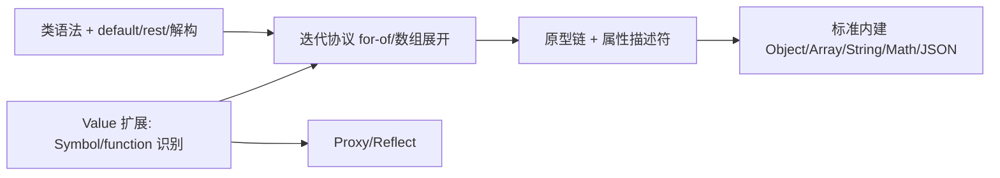

# JS 基础语法特性实现缺口（现状盘点）

> 基线：`docs/design.md`（目标契约）对比当前 `crates/compiler` + `crates/vm` 代码（提交时点）。
> 本文只描述"当前已实现什么、还缺什么"，不是路线图。所有缺口均以编译期 `unsupported syntax: …`（带源码行号）形式拒绝，或以 VM 层缺失值类型呈现。

## 1. 值模型缺口

当前 `Value`：`Undefined / Null / Bool / Number(f64) / String / Symbol(SymbolId) / Object(ObjectId)`。

| 特性 | 目标（design.md） | 现状 | 缺口性质 |
| --- | --- | --- | --- |
| `Symbol` | 支持，含 `Symbol.for/keyFor`、`Symbol.iterator`，快照保留注册表与身份 | 已支持：`Symbol()`/`Symbol.for/keyFor`/`Symbol.iterator`，`PropertyKey::Symbol` 分表存储，快照保留描述、注册表与高水位（iterator 与注册项恒为根）；Symbol 不可跨宿主边界，不能 `new` | 已落地 |
| 正则字面量 | `RegExp` 支持 | 字面量与 `RegExp` 内建均无（落到 fallback 表达式拒绝） | 内建 + 字面量编译 |
| `BigInt` | （设计未列） | 无；`Build::validate` 拒绝非有限数，`1n` 直接走"表达式形式超出子集"拒绝 | 未列入首版契约 |
| 数字语义 | 标准 | f64 直接编码，无 -0/-NaN 规范化问题，但无 `Number` 包装 | 部分覆盖 |
| `type_of` | `"function"`、`"symbol"` 等 | 已含 `"symbol"`；可调用对象报 `"function"`（`exec.rs::unary`），不可调用对象仍是 `"object"` | 部分覆盖 |

## 2. 编译期已拒绝（`lower` 各处显式 `unsupported`）

### 2.1 绑定与函数
- **默认参数**（`lower/mod.rs`，"default parameter"）
- **rest 参数**（"rest parameter"）
- **参数/catch 处解构**（"parameter destructuring"、"catch parameter destructuring"）；变量声明解构（"destructuring declaration"）
- **generator / async generator**（"generator"；async 支持但生成器整体拒绝）
- **匿名顶层/嵌套函数声明**（"anonymous declaration"）

### 2.2 表达式
- **`instanceof` 运算符**；`in` 已支持，沿原型链检查属性是否存在，不读取属性或调用 getter。键转换沿用成员访问的子集语义（Symbol 保留身份，对象键不走完整 `ToPrimitive`）；右操作数不是对象时抛出可捕获的 `TypeError`。
- **`delete`**：仅当操作数为标识符/成员/可选链时拒绝；`delete` 属性删除无实现
- **实参展开、对象展开**（"spread argument" / "object spread"）。数组展开已支持：从左到右求值，复用同步迭代协议；`next` 异常时调用 `return` 且原异常优先，自然耗尽不调用。展开后的 `await` 会把已构造的部分数组写入持久槽。
- **自增/自减**：目标仅限简单绑定或成员（"update target outside the PoC subset"），其余赋值目标拒绝（"assignment to non-identifier/non-member target"）。算术复合赋值与逻辑赋值（`||=`/`&&=`/`??=`）已支持
- **私有字段**（"private field access"）
- **标签模板**、**带类正则以外的模板特性**：非标签模板已支持；标签模板拒绝
- **lone surrogate 字符串字面量**（"string with a lone surrogate"）
- **非有限数字字面量**（"non-finite numeric literal"，`Build::validate` 双保险）

### 2.3 控制流
- **`for…in`**；同步 `for…of` 已支持数组及自定义可迭代对象（含提前退出时的 `IteratorClose`）。字符串迭代和解构循环头仍未实现。
- **`with`、`debugger`**
- **`class` 声明**（整个类语法拒绝）
- **`switch` 重复 default**（编译期拒绝，正确但属于实现限制的下游）

### 2.4 顶层
- 顶层只允许**函数声明 + 空语句**；顶层 `await`、`var/let/const`、表达式语句均拒绝
- **import/export**：解析为 `.mjs` 后由子集拒绝（符合契约，但仍列出）

## 3. 运行时语义缺口（编译不拒绝但行为不完整）

| 语义点 | design.md 目标 | 现状 |
| --- | --- | --- |
| `arguments` | 支持（严格模式 `arguments`） | 无任何绑定或降级；引用即"unknown binding"/未知名 |
| 原型链、属性描述符、getter/setter 运行时 | 支持 | 已支持原型链查找、继承访问器、`hasOwnProperty`、`in`、`Reflect.ownKeys`、`Object.keys`、`Object.defineProperty` 和对象目标的 `Object.getOwnPropertyDescriptor`。定义可读取继承的描述符字段，遵守只读和不可配置限制；键转换仍沿用成员访问的子集语义。宿主原生句柄不开放属性定义。仍缺 `Object.defineProperties`、删除、原型查询和修改、冻结及冻结检查。 |
| 标准内建 | `Object`/`Array`/`String`/`Number`/`Math`/`RegExp`/`JSON`/`Error` 等 | 已有 `Promise`、`queueMicrotask`、`Error`、`TypeError`、`Symbol`、`Reflect`（仅 `ownKeys`）与 `Object`（`keys`、`getOwnPropertyDescriptor`、`defineProperty`；调用或构造接受对象或空值，不实现原始值包装）。仍无 `Array` 等全局名。 |
| 错误对象 | 标准错误类型 | `Error` / `TypeError` 可构造；VM 生成的 `TypeError` 同样是对象，提供 `name`、`message` 和简化的 `stack`。`Promise.any` 的 `AggregateError` 拒绝值仍为字符串。 |
| 完整 ECMAScript TDZ | 明确不做 | `pending_lexicals` 仅本函数静态检查；闭包提前读得 `undefined` |
| 循环每轮新绑定 | 明确不做 | 共享绑定 |
| 名称策略例外 | — | `typeof` 对被局部遮蔽的 import/顶层函数报 `"function"`（有意保留，`names.rs`） |
| Proxy / Reflect / Map / Set / WeakMap | Solid/React 验收前置 | `Reflect.ownKeys` 已支持；其他 Reflect 操作、Proxy、Map、Set、WeakMap 未实现。 |
| thenable 同化、Promise 组合子 | `all/allSettled/race/any` 等 | Promise 有基础 `then/catch/finally`；组合子未核对 |

## 4. 结构性缺口（影响后续所有语法特性）

1. **值模型单类型化**：加 `BigInt`/`RegExp` 仍要动 `Value`、`type_of`、truthy、堆边表、快照可达性（`heap.rs::write_edges`）与 `SNAPSHOT_FORMAT_VERSION`；Symbol 已按此路径落地（v8）。
2. **顶层不是脚本体**：无法承载顶层 `await`、模块语句、顶层 `var`；若要支持，需要把顶层也建成一个函数帧而非只建函数表。
3. **迭代协议**：同步 `for…of` 与数组展开使用 `[Symbol.iterator]`，缓存 `next`。`for…of` 在循环提前退出时执行 `IteratorClose`；数组展开仅在 `next` 读取异常时关闭，自然耗尽不关闭。迭代器和 `next` 通过现有持久槽跨 `await` 保存。数组支持运行时空洞（增长 `length` 或越界写索引），但数组字面量的省略项仍生成显式 `undefined`。`for…in` 仍拒绝。
4. **解构与其余 spread 仍拒绝**：数组解构尚未接入迭代协议；实参展开与对象展开也未实现。
5. **属性存在性、枚举与描述符**：`in` 与成员读取共用原型链查找。`Reflect.ownKeys` 按数值升序返回索引键，再按创建顺序分别返回其余字符串键和 Symbol 键；`Object.keys` 过滤不可枚举属性和 Symbol。快照格式 v12 保存稀疏数组索引及描述符、`length` 的可写性和各类脚本对象上的访问器。对象展开、`for…in` 和 Proxy 不变量仍未实现。

## 5. 优先级示意（仅现状组织，非承诺）

## 6. 已知非缺口（明确不做，勿当缺口实现）

- 完整 TDZ、每轮循环独立绑定（见 design.md 与 AGENTS.md）
- generator、async generator、`for await…of`、顶层 `await`、动态模块、`eval`、`Function` 构造、`with`（首版契约外）
- `WeakRef`、`FinalizationRegistry`、共享内存、`Atomics`
- 快照迁移（版本不匹配即拒绝，不做兼容层）
