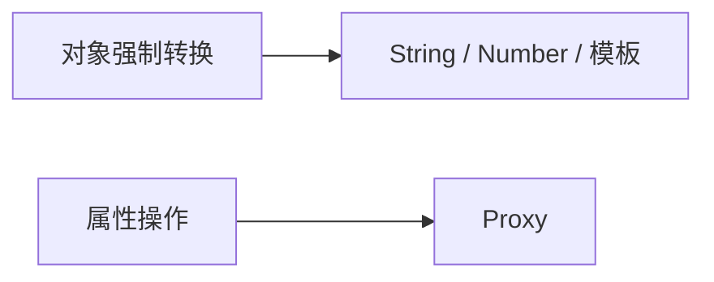

# JS 基础语法特性实现缺口（现状盘点）

> 基线：`docs/design.md` 的「首版 JavaScript 支持范围」，对照当前 `crates/compiler` + `crates/vm`。
> 本文只记还缺什么，不记已经落地的语法和内建。已实现范围以 `README.md`「已实现」一节为准，语法子集与缺口对照本文。
> 缺口有三类：编译期 `unsupported syntax: …`（带源码行号）；能编译但语义不完整；本应成为可捕获脚本异常、实际却是 `VmError`（`try`/`catch` 捕不到，VM 直接失败）。

## 1. 值、转换与全局名

`Value` 仍是 `Undefined / Null / Bool / Number(f64) / String / Symbol(SymbolId) / Object(ObjectId)`。没有 `RegExp` 值，也没有原始值装箱。

| 缺口 | 现状 |
| --- | --- |
| `RegExp` | 字面量与 `RegExp` 内建都没有。字面量落到泛化拒绝 `expression form outside the PoC subset` |
| 非有限数 | 非有限数字字面量编译拒绝；`Build::validate` 拒绝非有限常量；宿主传入非有限数拒绝。`NaN` / `Infinity` 作为全局原始值已提供，但仍是运行期值而非编译期常量。VM 内算术（如 `1/0`）和 `"Infinity"` 的 `ToNumber` 仍能产生非有限 `Value`，但宿主边界进不来 |
| 数字和字符串转换 | 数字转字符串仍用 Rust 的有限数字格式，不完全符合 JS 的指数表示规则；超长非十进制字符串转数字未保证只舍入一次。函数转字符串有意使用通用文本而非源码 |
| 原始值属性 | 字符串支持读取 `length`、索引和 `String.prototype` 上的属性；找不到的属性返回 `undefined`。严格模式下字符串成员写入抛出可捕获的 `TypeError`；其他原始值仍没有对应的包装原型。`Object()` 和 `new String()` 都不支持字符串装箱 |
| `in` 的右操作数 | 不是对象就抛 `TypeError`，不 `ToObject`。字符串上的 `in` 因此失败 |

Symbol 的身份、`Symbol.for` / `keyFor` / `iterator`、以及 Symbol 参与一元 `+`/`-`/`~` 和二元强制转换时的可捕获 `TypeError`，已经落地，不再列在这里。

## 2. 编译期拒绝（首版语法表要求，现在编不过）

### 2.1 绑定与参数

- `for…of` 多个声明（`for-of declaration`）
- `arguments` 没有绑定。引用是 `unknown binding`，不是单独的 `unsupported syntax`
- `const` 与 `let` 在绑定种类上不分。重复赋值 `const` 能编过，也不会在运行期拒绝

### 2.2 表达式

- `++` / `--` 只接受绑定或成员（`update target outside the PoC subset`）；解构赋值只支持 `=`
- 私有字段（`private field access`）
- 标签模板。非标签模板已支持
- lone surrogate 字符串字面量与属性名（`string with a lone surrogate`、`property key with a lone surrogate`）
- 正则字面量，以及未单列的表达式形式，都落到 `expression form outside the PoC subset`：类表达式、`super`、`new.target`、`import.meta`、`import()`、`yield`、`bigint`

### 2.3 控制流与顶层

- `class` 声明（`class declaration`）。首版约定由离线构建降级，编译器仍整段拒绝

## 3. 能编过，但语义不完整

这些相对首版契约是缺口，而且上一版盘点没有单独写出。

| 语义点 | 现状 |
| --- | --- |
| Promise 方法覆写与派生构造器 | `Promise.prototype.catch` / `finally` 仍走内部反应，不调用接收者覆写的 `then`；`then` / `finally` 不按 `Symbol.species` 选择结果构造器 |
| Promise 组合子 | `all` / `allSettled` / `race` / `any` 已接入同步迭代协议，但仍使用 VM 内部决议流程，不查找接收者覆写的 `resolve`。`Promise.any` 全拒绝时现拒绝真实 `AggregateError`，其 `errors` 按输入顺序保存拒绝原因 |
| `queueMicrotask` | 回调抛错没有结果 Promise，异常被丢掉；未处理拒绝不跟踪 |
| 函数对象 | 函数通过共享内部原型继承 `toString` 和 `Object.prototype`，但默认 `toString` 有意返回固定通用文本，不保留源码。`call` / `apply` / `bind` 仍是脚本函数按次分配的虚拟方法；`apply` 的参数表只接受数组、`null` 或 `undefined`。绑定函数不能 `new`，也不自动带 `.prototype`。没有 `Function` 全局或函数的 `name` / `length` |
| 数组字面量空洞 | `[1,,2]` 的省略项写成显式 `undefined`，不是稀疏洞。运行时增长 `length`、越界写索引或删除索引可以形成真正的洞 |
| 原型与描述符 | `Object.getPrototypeOf` 不对原始值装箱。宿主原生句柄固定不可扩展，不开放属性定义。 |
| 未声明名字 | 除 `typeof` 折叠为 `"undefined"` 外，读取或赋值都是编译错误，不是运行时 `ReferenceError`。没有 `globalThis`，不能做 `globalThis.MessageChannel` 这种探测 |

VM 字符串只能存储有效 UTF-8：按 UTF-16 码元读取、切片、拆分、填充或从码元/码点构造字符串时，若结果包含单独的代理码元，会抛出可捕获的 `TypeError`。字符串的对象展开也有这个限制。

对象解构读取字符串索引和 rest 复制字符串时也受此限制；其他原始值没有对应的包装原型，命名属性查找从 `Object.prototype` 开始。

名称策略里有一处有意偏差，先不要当疏漏改掉：`typeof` 对被局部遮蔽的 import 或顶层函数仍报 `"function"`（`names.rs`）。这和 design 里「未声明全局的 `typeof` 保持标准语义」不是同一条；未声明且不是 import/顶层函数的名字已经折叠为 `"undefined"`。

宿主 import 目前只能调用，不能当值读取（`import value … is not first-class`）。若验收包要把宿主函数存进变量或传给其它函数，这是阻断项；当前是明确的名称策略，不是漏实现的语法。

## 4. 首版内建还缺的表面

已提供 `Promise`、`queueMicrotask`、`Error`（含标准子类及 `AggregateError`）、`Symbol`、`Reflect`、`Object`、`Array`、`String`，以及数值全局 `NaN` 和 `Infinity`。

| 内建 | 已有 | 仍缺 |
| --- | --- | --- |
| `Object` | `keys`、`assign`、`is`、`create`、`getPrototypeOf` / `setPrototypeOf`、`getOwnPropertyDescriptor` / `getOwnPropertyDescriptors`、`defineProperty`、`defineProperties`；`preventExtensions` / `seal` / `freeze` 及对应检查；原型上的 `hasOwnProperty` / `toString` / `valueOf`；调用或构造只接受对象或空值 | — |
| `Reflect` | `get`、`set`、`has`、`getOwnPropertyDescriptor`、`ownKeys`、`deleteProperty`、`defineProperty`、`preventExtensions`、`isExtensible`、`getPrototypeOf` / `setPrototypeOf` | `apply`、`construct` |
| `Function` | 共享内部原型上的 `toString`；虚拟的 `call` / `apply` / `bind` | `Function` 全局、函数的 `name` / `length` |
| `Array` | 构造与函数调用、`isArray` / `from` / `of`、稀疏索引和常用修改、切片、搜索、转换、回调与迭代方法 | 新增原型方法仅接受数组接收者；借用 `join` 时接收者须是对象；不支持 species、自定义 `from` / `of` 构造器或 `concat` 展开协议 |
| `String` | 函数调用、`fromCharCode` / `fromCodePoint` / `raw`、UTF-16 长度与索引、常用搜索、切片、转换、填充、替换和共享原型上的 `[Symbol.iterator]` | 不支持 `new String()`、包装对象、单独的代理码元或正则匹配；可直接调用 `String.raw`，但编译器仍拒绝标签模板语法 |
| 错误构造器 | `Error`、`TypeError`、`RangeError`、`ReferenceError`、`SyntaxError`、`EvalError`、`URIError`、`AggregateError` 均可调用或构造；`AggregateError` 同步收集可迭代 `errors` | —
| `Number` / `Math` / `JSON` / `RegExp` | 无全局，也无方法 | 对应的转换、数学运算、JSON 和正则 |
| `Map` / `Set` / `WeakMap` | 无 | 集合、插入顺序、`WeakMap` 的弱键可达性都未做。快照格式也还没有这些边 |
| `Proxy` | 无 | 普通对象/数组目标上的 `get` / `set` / `has` / `deleteProperty` / `ownKeys` / `getOwnPropertyDescriptor`，以及不可扩展目标的不变量。快照不保存代理关系 |

`Promise` 的构造器、`then` / `catch` / `finally`、`resolve` / `reject` 和四个组合子已经在 VM 内，不再算「未核对」。剩下的偏差在第 3 节。

## 5. 结构性缺口

1. **原始值装箱和数字边界语义仍不完整。** 见第 1 节；这些限制也影响依赖转换的内建。
2. **属性操作尚未覆盖代理。** 对象展开和 rest 已复用自有键顺序；`Proxy` 仍需将各 trap 接入属性操作，并根据目标的扩展性和自有描述符校验 trap 结果。
3. **新的堆种类仍要改可达性**。`RegExp`、`Map` / `Set`、`Proxy`、`WeakMap` 都要进 `Value` 或 `Object`、`heap.rs::write_edges` 和快照。`WeakMap` 不能把键提升成强根。记录形状变化要 bump `SNAPSHOT_FORMAT_VERSION`；执行语义变化靠 `build_id` 拒绝旧快照，不必因此 bump `BYTECODE_VERSION`。

## 6. 依赖关系（现状组织，非承诺）

## 7. 明确不做（不要当缺口实现）

- 完整 ECMAScript TDZ、每轮循环独立绑定
- generator、async generator、`for await…of`、顶层 `await`、动态 `import()`、`eval`、`Function` 构造、`with`
- `class` 与标签模板：首版由离线构建降级。编译器拒绝它们是符合契约的，不是 VM 还欠的语法
- 离线打包后的单个严格 ESM 模块支持本地命名导出，但不支持模块查找、加载或链接；残留的静态 `import`、`import.meta`、默认导出和再导出均在编译期拒绝。
- `debugger`、`using` / `await using`：不在首版语法表
- `BigInt`：design 未列入
- `WeakRef`、`FinalizationRegistry`、共享内存、`Atomics`
- 可撤销代理、代理函数/构造器，以及 design 未点名的其它 Proxy traps
- 快照迁移：版本不匹配即拒绝
- 重复 `default`、匿名函数声明：按语法错误拒绝，不是未实现的特性
- 严格模式下删除裸标识符（包括加括号的标识符）：按语法错误拒绝。
