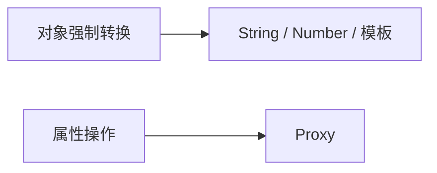

# JS 基础语法特性实现缺口（现状盘点）

> 基线：`docs/design.md` 的「首版 JavaScript 支持范围」，对照当前 `crates/compiler` + `crates/vm`。
> 已实现范围见 [`implemented.md`](implemented.md)，语法子集与缺口对照本文。
> 缺口有三类：编译期 `unsupported syntax: …`（带源码行号）；能编译但语义不完整；本应成为可捕获脚本异常、实际却是 `VmError`（`try`/`catch` 捕不到，VM 直接失败）。

## 1. 值、转换与全局名

`Value` 仍是 `Undefined / Null / Bool / Number(f64) / String / Symbol(SymbolId) / Object(ObjectId)`。没有 `RegExp` 值；显式包装是堆对象，不是新的 `Value` 变体。

| 缺口 | 现状 |
| --- | --- |
| `RegExp` | 字面量与 `RegExp` 内建都没有。字面量落到泛化拒绝 `expression form outside the PoC subset` |
| 非有限数 | 非有限数字字面量编译拒绝；`Build::validate` 拒绝非有限常量；宿主传入非有限数拒绝。`NaN` / `Infinity` 作为全局原始值已提供，但仍是运行期值而非编译期常量。VM 内算术（如 `1/0`）和 `"Infinity"` 的 `ToNumber` 仍能产生非有限 `Value`，但宿主边界进不来 |
| 数字和字符串转换 | 默认十进制数字转字符串（含 `Number.prototype.toString()`）仍沿用现有格式，不完全符合 JS 的指数表示规则；`toFixed`、`toExponential`、`toPrecision` 依赖 Rust 格式化，舍入结果可能与 ECMAScript 不同。超长非十进制字符串转数字未保证只舍入一次。函数转字符串有意使用通用文本而非源码 |
| 原始值属性 | `Object(value)` / `new Object(value)` 可显式包装字符串、数值、布尔值和 Symbol；`new String` / `new Number` / `new Boolean` 也可构造包装对象。原始值属性访问保留原始接收者，不会创建完整的临时包装对象。字符串包装的 UTF-16 索引与 `length` 不可写；严格写入抛出可捕获的 `TypeError`。 |
| `in` 的右操作数 | 不是对象就抛 `TypeError`，不 `ToObject`。字符串上的 `in` 因此失败 |

Symbol 的身份、`Symbol.for` / `keyFor` / `iterator`、以及 Symbol 参与一元 `+`/`-`/`~` 和二元强制转换时的可捕获 `TypeError`，已经落地，不再列在这里。

## 2. 编译期拒绝（首版语法表要求，现在编不过）

### 2.1 绑定与参数

- `for…of` 多个声明（`for-of declaration`）

### 2.2 表达式

- `++` / `--` 只接受绑定或成员目标，包括括号括起的绑定/成员目标如 `(x)++`、`++(obj.x)`、`((obj.x))--`（非左值目标仍拒绝：`update target outside the PoC subset`）；解构赋值只支持 `=`
- 私有字段（`private field access`）
- 标签模板。非标签模板已支持
- lone surrogate 字符串字面量与属性名（`string with a lone surrogate`、`property key with a lone surrogate`）
- 正则字面量，以及未单列的表达式形式，都落到 `expression form outside the PoC subset`：类表达式、`super`、`new.target`、`import.meta`、`import()`、`yield`、`bigint`

### 2.3 控制流与顶层

- `class` 声明（`class declaration`）。首版约定由离线构建降级，编译器仍整段拒绝

## 3. 能编过，但语义不完整

这些相对首版契约是缺口，而且上一版盘点没有单独写出。

| 语义点 | 现状 |
| --- | --- |
| `queueMicrotask` / Promise 拒绝 | `queueMicrotask` 回调抛出的异常通过 `Host::report_error` 交给宿主；未处理的 Promise 拒绝仍不跟踪 |
| 函数对象 | 函数的 `name` / `length` 是只读虚拟属性：可读取并用 `in` / `Reflect.has` 检查，但不出现在自有键或自有描述符中。匿名函数与箭头函数不推断名称；计算方法名只使用静态可知的键或编译期提示，不按运行时键命名。内建函数的 `length` 统一为 `0`。共享的 `Function.prototype` 不可调用，默认 `toString` 返回固定通用文本，不保留源码。`call` / `apply` / `bind` 仍是脚本函数按次分配的虚拟方法。绑定函数不自动创建 `.prototype`，其可构造性取决于目标。 |
| 原型与描述符 | `Object.getPrototypeOf` 对四种非空原始值返回对应共享原型，但这不意味着所有 `Object` / `Reflect` API 都会隐式装箱；例如 `Reflect.getPrototypeOf` 仍要求对象。宿主原生句柄固定不可扩展，不开放属性定义。 |
| 未声明名字 | 除 `typeof` 折叠为 `"undefined"` 外，读取或赋值都是编译错误，不是运行时 `ReferenceError`。没有 `globalThis`，不能做 `globalThis.MessageChannel` 这种探测 |

VM 字符串只能存储有效 UTF-8：按 UTF-16 码元读取、切片、拆分、填充或从码元/码点构造字符串时，若结果包含单独的代理码元，会抛出可捕获的 `TypeError`。字符串的对象展开也有这个限制。

对象解构读取字符串索引和 rest 复制字符串时也受此限制。`for…in` 枚举原始值时仍从 `Object.prototype` 开始查找原型属性。运算符仍走已有的对象转原始值流程（例如按 hint 调用 `valueOf` / `toString`），不会直接取出包装对象中的原始值；严格相等也不会拆箱。

名称策略里有一处有意偏差，先不要当疏漏改掉：`typeof` 对被局部遮蔽的 import 或顶层函数仍报 `"function"`（`names.rs`）。这和 design 里「未声明全局的 `typeof` 保持标准语义」不是同一条；未声明且不是 import/顶层函数的名字已经折叠为 `"undefined"`。

宿主 import 目前只能调用，不能当值读取（`import value … is not first-class`）。若验收包要把宿主函数存进变量或传给其它函数，这是阻断项；当前是明确的名称策略，不是漏实现的语法。

## 4. 首版内建还缺的表面

已提供 `Promise`、`queueMicrotask`、`Error`（含标准子类及 `AggregateError`）、`Symbol`、`Reflect`、`Object`、`Proxy`、`Function`（仅命名空间）、`Array`、`Map`、`Set`、`WeakMap`、`String`、`Number`、`Boolean`、`Math`、`JSON`，以及数值全局 `NaN` 和 `Infinity`。

| 内建 | 已有 | 仍缺 |
| --- | --- | --- |
| `Object` | `keys`、`assign`、`is`、`create`、`getPrototypeOf` / `setPrototypeOf`、`getOwnPropertyDescriptor` / `getOwnPropertyDescriptors`、`defineProperty`、`defineProperties`；`preventExtensions` / `seal` / `freeze` 及对应检查；原型上的 `hasOwnProperty` / `toString` / `valueOf`；调用或构造可显式包装非空原始值 | 不提供完整隐式装箱，见第 1、3 节 |
| `Reflect` | `get`、`set`、`has`、`getOwnPropertyDescriptor`、`ownKeys`、`deleteProperty`、`defineProperty`、`preventExtensions`、`isExtensible`、`getPrototypeOf` / `setPrototypeOf`、`apply`、`construct`（包括绑定了可构造目标的函数） | `construct` 沿用 VM 的构造器限制 |
| `Function` | 可通过函数的内部原型获取共享的 `Function.prototype`；`toString`、虚拟的 `call` / `apply` / `bind` 及 `name` / `length` | 没有 `Function` 全局或动态函数构造；共享原型不可调用，元数据偏差见第 3 节 |
| `Array` | 构造与函数调用、`isArray` / `from` / `of`、稀疏索引和常用修改、切片、搜索、转换、回调与迭代方法 | 新增原型方法仅接受数组接收者；借用 `join` 时接收者须是对象；不支持 species、自定义 `from` / `of` 构造器或 `concat` 展开协议 |
| `String` | 函数调用与包装构造、`fromCharCode` / `fromCodePoint` / `raw`、UTF-16 长度与索引、常用搜索、切片、转换、填充、替换和共享原型上的 `[Symbol.iterator]` | 不支持单独的代理码元或正则匹配；可直接调用 `String.raw`，但编译器仍拒绝标签模板语法 |
| 错误构造器 | `Error`、`TypeError`、`RangeError`、`ReferenceError`、`SyntaxError`、`EvalError`、`URIError`、`AggregateError` 均可调用或构造；`AggregateError` 同步收集可迭代 `errors` | —
| `Number` | 函数调用与包装构造、非强制转换的数值判断、数值常量、`parseInt` / `parseFloat`、共享原型上的数值提取和格式化方法 | 非十进制 `toString` 只转换整数部分；`toLocaleString` 仅沿用默认十进制 `toString`，不支持区域设置；指数格式和舍入偏差见第 1 节 |
| `Math` | 数学常量、数值方法及可快照恢复的 `random` | 浮点数学函数依赖 Rust `f64` 实现；`random` 使用固定种子的非加密 PRNG |
| `JSON` | `parse` / `stringify`：普通对象与数组、可枚举自有字符串键、`toJSON`、replacer、`space`、循环检测 | 不支持 `BigInt`；单独代理码元不能表示为 VM 字符串，解析或序列化时抛可捕获异常 |
| `RegExp` | 无全局，也无字面量 | 正则 |
| `Map` / `Set` | 支持插入顺序、实时迭代及快照恢复 | — |
| `WeakMap` | 对象身份键、`get` / `has` / `set` / `delete`，快照按 ephemeron 可达性保留条目 | 不支持原始值键（包括非注册 Symbol）；所有四种方法收到原始值键均抛出 `TypeError`。弱键筛选只在生成快照时发生，不是运行期 GC |
| `Proxy` | `new Proxy` 支持普通对象、数组或原始值包装对象目标上的 `get` / `set` / `has` / `deleteProperty` / `ownKeys` / `getOwnPropertyDescriptor`，包括目标不变量及快照恢复 | 不可直接调用；不支持撤销、代理函数或构造器、其他 traps，也不保证所有需要内部槽的内建方法都能以代理为接收者 |
| `Promise` | 构造、`then` / `catch` / `finally`、`resolve` / `reject` 和四个组合子；支持覆写的 `then` / `resolve` 及 `Symbol.species` 派生构造器 | 原型方法仍要求原生 Promise 接收者，静态方法仍要求内建 `Promise` 接收者，不支持借用静态方法构造派生结果 |

## 5. 结构性缺口

1. **隐式装箱和数字边界语义仍不完整。** 见第 1 节；这些限制也影响依赖转换的内建。
2. **代理仅覆盖六种 trap。** 支持的属性操作及边界见上表和已实现清单，不等同于完整 ECMAScript Proxy。
3. **新的堆种类仍要改可达性**。例如 `RegExp` 需要定义其堆表示、追踪规则和快照表示。常规强边由 `heap.rs::write_edges` 提供；`WeakMap` 条目由快照的 ephemeron 追踪单独处理。记录形状变化要 bump `SNAPSHOT_FORMAT_VERSION`；执行语义变化靠 `build_id` 拒绝旧快照，不必因此 bump `BYTECODE_VERSION`。

## 6. 依赖关系（现状组织，非承诺）

## 7. 明确不做（不要当缺口实现）

- 完整 ECMAScript TDZ、每轮循环独立绑定
- generator、async generator、`for await…of`、顶层 `await`、动态 `import()`、`eval`、`Function` 构造、`with`
- `class` 与标签模板：首版由离线构建降级。编译器拒绝它们是符合契约的，不是 VM 还欠的语法
- 离线打包后的单个严格 ESM 模块支持本地命名导出，但不支持模块查找、加载或链接；残留的静态 `import`、`import.meta`、默认导出和再导出均在编译期拒绝。
- `debugger`、`using` / `await using`：不在首版语法表
- `BigInt`：design 未列入
- `WeakRef`、`FinalizationRegistry`、共享内存、`Atomics`
- 可撤销代理、代理函数/构造器，以及 design 未点名的其它 Proxy traps
- 快照迁移：版本不匹配即拒绝
- 重复 `default`、匿名函数声明：按语法错误拒绝，不是未实现的特性
- 严格模式下删除裸标识符（包括加括号的标识符）：按语法错误拒绝。
