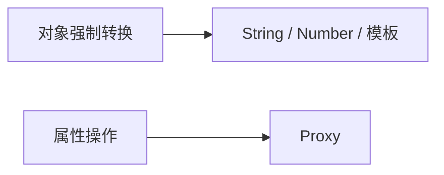

# JS 基础语法特性实现缺口（现状盘点）

> 基线：`docs/design.md` 的「首版 JavaScript 支持范围」，对照当前 `crates/compiler` + `crates/vm`。
> 已实现范围见 [`implemented.md`](implemented.md)，语法子集与缺口对照本文。
> 缺口有三类：编译期 `unsupported syntax: …`（带源码行号）；能编译但语义不完整；本应成为可捕获脚本异常、实际却是 `VmError`（`try`/`catch` 捕不到，VM 直接失败）。

## 1. 值、转换与全局名

`Value` 仍是 `Undefined / Null / Bool / Number(f64) / String / Symbol(SymbolId) / Object(ObjectId)`。`RegExp` 实例与显式包装对象通过堆对象表示，不是新的 `Value` 变体。函数转字符串返回固定通用文本是有意设计，见 [`design.md`](design.md)，不再列作缺口。

尚未提供部分 well-known Symbol（如 `Symbol.asyncIterator`）及其协议。`JSON.stringify` 查找字符串键 `toJSON`；标准没有 `Symbol.toJSON`。

## 2. 编译期拒绝（首版语法表要求，现在编不过）

### 2.1 绑定与参数

- `for…of` 多个声明（`for-of declaration`）

### 2.2 表达式

- `++` / `--` 只接受绑定或成员目标，包括括号括起的绑定/成员目标如 `(x)++`、`++(obj.x)`、`((obj.x))--`（非左值目标仍拒绝：`update target outside the PoC subset`）；解构赋值只支持 `=`
- 标签模板。非标签模板已支持
- 不支持的正则字面量模式与标志在编译时拒绝；若未被 Oxc 提前拒绝，报告带行列的 `unsupported syntax: ...`。模式子集见第 4 节。
- 未单列的表达式形式落到 `expression form outside the PoC subset`：`import.meta`、`import()`、`yield`、`bigint`。`new.target` 可在函数中使用，但不能在模块顶层或其箭头函数中使用。

## 3. 能编过，但语义不完整

这些相对首版契约是缺口，而且上一版盘点没有单独写出。

| 语义点 | 现状 |
| --- | --- |
| `queueMicrotask` / Promise 拒绝 | `queueMicrotask` 回调抛出的异常通过 `Host::report_error` 交给宿主；未处理的 Promise 拒绝仍不跟踪 |
| 函数对象 | 函数的 `name` / `length` 是只读虚拟属性：可读取并用 `in` / `Reflect.has` 检查，但不出现在自有键或自有描述符中。匿名函数与箭头函数不推断名称；计算方法名只使用静态可知的键或编译期提示，不按运行时键命名。内建函数的 `length` 统一为 `0`。共享的 `Function.prototype` 不可调用。`call` / `apply` / `bind` 仍是脚本函数按次分配的虚拟方法。绑定函数不自动创建 `.prototype`，其可构造性取决于目标。 |
| 原型与描述符 | `Object.getPrototypeOf` 对四种非空原始值返回对应共享原型，但这不意味着所有 `Object` / `Reflect` API 都会隐式装箱；例如 `Reflect.getPrototypeOf` 仍要求对象。宿主类实例是普通对象，原型为 VM 创建的类原型；`Object.create(prototype)` 只能得到普通对象，不能伪造隐藏槽。 |

`for…in` 枚举原始值时仍从 `Object.prototype` 开始查找原型属性。运算符仍走已有的对象转原始值流程（例如按 hint 调用 `valueOf` / `toString`），不会直接取出包装对象中的原始值；严格相等也不会拆箱。

名称策略仍保留一个偏差：`typeof` 对被局部遮蔽的顶层函数折叠为 `"function"`（`names.rs`）。

## 4. 首版内建还缺的表面

已提供 `Promise`、`queueMicrotask`、`Error`（含标准子类及 `AggregateError`）、`Symbol`、`Reflect`、`Object`、`Proxy`、`Function`（仅命名空间）、`Array`、`Map`、`Set`、`WeakMap`、`String`、`Number`、`Boolean`、`Math`、`JSON`，以及数值全局 `NaN` 和 `Infinity`。

| 内建 | 已有 | 仍缺 |
| --- | --- | --- |
| `Object` | `keys`、`assign`、`is`、`create`、`getPrototypeOf` / `setPrototypeOf`、`getOwnPropertyDescriptor` / `getOwnPropertyDescriptors`、`defineProperty`、`defineProperties`；`preventExtensions` / `seal` / `freeze` 及对应检查；原型上的 `hasOwnProperty` / `toString` / `valueOf`；调用或构造可显式包装非空原始值 | 缺 `values` / `entries` / `fromEntries`；原型上缺 `isPrototypeOf` / `propertyIsEnumerable` / `toLocaleString` / `__proto__` 访问器。不提供完整隐式装箱，见第 1、3 节 |
| `Reflect` | `get`、`set`、`has`、`getOwnPropertyDescriptor`、`ownKeys`、`deleteProperty`、`defineProperty`、`preventExtensions`、`isExtensible`、`getPrototypeOf` / `setPrototypeOf`、`apply`、`construct`（包括绑定了可构造目标的函数） | `construct` 沿用 VM 的构造器限制 |
| `Function` | 可通过函数的内部原型获取共享的 `Function.prototype`；`toString`、虚拟的 `call` / `apply` / `bind` 及 `name` / `length` | 没有 `Function` 全局或动态函数构造；共享原型不可调用，元数据偏差见第 3 节 |
| `Array` | 构造与函数调用、`isArray` / `from` / `of`、稀疏索引和常用修改、切片、搜索、转换、回调与迭代方法 | 缺 `at`、`sort`、`reverse`、`copyWithin`、`findLast` / `findLastIndex`、`keys` / `entries`。新增原型方法仅接受数组接收者；借用 `join` 时接收者须是对象；不支持 species、自定义 `from` / `of` 构造器或 `concat` 展开协议 |
| `String` | 函数调用与包装构造、`fromCharCode` / `fromCodePoint` / `raw`、UTF-16 长度与索引、常用搜索、切片、转换、填充、替换和共享原型上的 `[Symbol.iterator]`；`match` / `matchAll` / `replace` / `replaceAll` / `search` / `split` 通过正则协议分派 | `matchAll` 与 `split` 克隆匹配器时忽略 `Symbol.species` 与自定义构造器；可直接调用 `String.raw`，但编译器仍拒绝标签模板语法 |
| 错误构造器 | `Error`、`TypeError`、`RangeError`、`ReferenceError`、`SyntaxError`、`EvalError`、`URIError`、`AggregateError` 均可调用或构造；`AggregateError` 同步收集可迭代 `errors` | 原型上缺 `toString`；`stack` 是简化文本，不解析或格式化为标准多行形式 |
| `Number` | 函数调用与包装构造、非强制转换的数值判断、数值常量、`parseInt` / `parseFloat`、共享原型上的数值提取和格式化方法 | 非十进制 `toString` 只转换整数部分；`toLocaleString` 仅沿用默认十进制 `toString`，不支持区域设置；指数格式和舍入偏差见第 1 节 |
| `Math` | 数学常量、数值方法及可快照恢复的 `random` | 浮点数学函数依赖 Rust `f64` 实现；`random` 使用固定种子的非加密 PRNG |
| `JSON` | `parse` / `stringify`：普通对象与数组、可枚举自有字符串键、`toJSON`、replacer、`space`、循环检测 | 不支持 `BigInt` |
| `RegExp` | 字面量、调用和构造、`exec` / `test` / `toString`、模式和标志访问器、`lastIndex`、`d` indices 与 `RegExp.escape`；`Symbol.match` / `Symbol.matchAll` / `Symbol.replace` / `Symbol.search` / `Symbol.split` 协议，`matchAll` 迭代器可快照恢复。固定 ECMAScript 语法后端支持反向引用、前后行断言、Unicode 属性、v 集合、内联 `ims` 和命名组；匹配与捕获按码元范围返回任意 UTF-16 字符串 | `matchAll` 与 `split` 通过内建 `RegExp` 构造克隆匹配器，忽略 `Symbol.species` 与自定义构造器；不支持 Annex B 历史语法 |
| `Map` / `Set` | 支持插入顺序、实时迭代及快照恢复 | — |
| `WeakMap` | 对象身份键、`get` / `has` / `set` / `delete`；快照与显式运行期 GC 均按 ephemeron 可达性筛选条目 | 不支持原始值键（包括非注册 Symbol）；所有四种方法收到原始值键均抛出 `TypeError` |
| `Proxy` | `new Proxy` 支持普通对象、数组或原始值包装对象目标上的 `get` / `set` / `has` / `deleteProperty` / `ownKeys` / `getOwnPropertyDescriptor`，包括目标不变量及快照恢复 | 不可直接调用；不支持撤销、代理函数或构造器、其他 traps，也不保证所有需要内部槽的内建方法都能以代理为接收者 |
| `Promise` | 构造、`then` / `catch` / `finally`、`resolve` / `reject` 和四个组合子；支持覆写的 `then` / `resolve` 及 `Symbol.species` 派生构造器 | 原型方法仍要求原生 Promise 接收者，静态方法仍要求内建 `Promise` 接收者，不支持借用静态方法构造派生结果 |

## 5. 结构性缺口

1. **隐式装箱和数字边界语义仍不完整。** 见第 1 节；这些限制也影响依赖转换的内建。
2. **代理仅覆盖六种 trap。** 支持的属性操作及边界见上表和已实现清单，不等同于完整 ECMAScript Proxy。
3. **新的堆种类仍要改可达性**。常规强边由 `Heap::write_edges` 提供；宿主实例的隐藏槽和模块状态槽由 GC 和快照共享的追踪器显式遍历，`WeakMap` 条目由 ephemeron 追踪单独处理。记录形状变化要 bump `SNAPSHOT_FORMAT_VERSION`；执行语义变化靠 `build_id` 拒绝旧快照，不必因此 bump `BYTECODE_VERSION`。
4. **宿主绑定首版仍有未决项。** 尚未实现弱引用槽、`JsMap` 槽、C ABI、TypeScript 定义生成、payload 流式/资源上限和跨线程交付。宿主绑定与脚本继承的已支持范围见 [`implemented.md`](implemented.md)。
5. **宿主回调只同步恢复。** `HostStep::Call` 不等待 Promise，不排空微任务，也不把 Rust 恢复函数写入快照。需要跨异步边界的宿主工作仍使用 operation。
6. **GC 不会自动触发。** 宿主须在 VM 调用之间排空微任务并显式调用 `Vm::collect_garbage`，每次提供 VM 自身未持有、之后仍需使用的本 VM 值。

## 6. 依赖关系（现状组织，非承诺）

## 7. 明确不做（不要当缺口实现）

- 完整 ECMAScript TDZ、每轮循环独立绑定
- generator、async generator、`for await…of`、顶层 `await`、动态 `import()`、`eval`、`Function` 构造、`with`
- 标签模板：仍由离线构建降级。`class` 由 VM 原生执行，不再离线降级。
- 严格 ESM 支持本地命名导出（含本地宿主导入绑定）和清单中的静态宿主模块；不查找或加载 JS 文件。`import.meta`、导入属性、默认导出和带模块来源的再导出在编译期拒绝。
- `debugger`、`using` / `await using`：不在首版语法表
- `BigInt`：design 未列入
- `WeakRef`、`FinalizationRegistry`、共享内存、`Atomics`
- 可撤销代理、代理函数/构造器，以及 design 未点名的其它 Proxy traps
- 快照迁移：只接受当前快照格式（38）与字节码版本（30），拒绝旧记录。
- 重复 `default`、匿名函数声明：按语法错误拒绝，不是未实现的特性
- 严格模式下删除裸标识符（包括加括号的标识符）：按语法错误拒绝。
