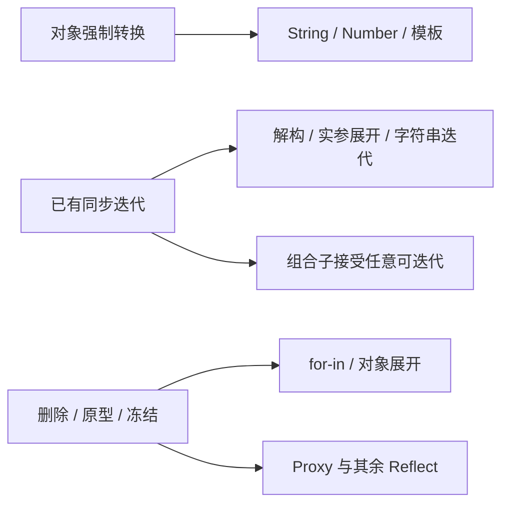

# JS 基础语法特性实现缺口（现状盘点）

> 基线：`docs/design.md` 的「首版 JavaScript 支持范围」，对照当前 `crates/compiler` + `crates/vm`。
> 本文只记还缺什么，不记已经落地的语法和内建。已实现范围以 `README.md`「已实现 / 当前子集」为准。
> 缺口有三类：编译期 `unsupported syntax: …`（带源码行号）；能编译但语义不完整；本应成为可捕获脚本异常、实际却是 `VmError`（`try`/`catch` 捕不到，VM 直接失败）。

## 1. 值、转换与全局名

`Value` 仍是 `Undefined / Null / Bool / Number(f64) / String / Symbol(SymbolId) / Object(ObjectId)`。没有 `RegExp` 值，也没有原始值装箱。

| 缺口 | 现状 |
| --- | --- |
| `RegExp` | 字面量与 `RegExp` 内建都没有。字面量落到泛化拒绝 `expression form outside the PoC subset` |
| `NaN` / `Infinity` 全局 | 不是内建。裸引用是 `unknown binding`；`typeof NaN` / `typeof Infinity` 在编译期折叠成 `"undefined"` |
| 非有限数 | 非有限数字字面量编译拒绝；`Build::validate` 拒绝非有限常量；宿主传入非有限数拒绝。VM 内算术（如 `1/0`）和 `"Infinity"` 的 `ToNumber` 仍能产生非有限 `Value`，但宿主边界进不来 |
| `ToPrimitive` | 对象不调用 `valueOf` / `toString`。对象或本子集无法解析的数字字符串（如 `"foo"`、`"0x10"`，也不识别 `0x` / `0b` / `0o`）参与二元算术或位运算时，是 `VmError::InvalidState`，不是 `NaN` 或 `TypeError`。一元 `+` / `-` 走 lossy 转换，对象和非法数字字符串变成 `NaN`；`~` 先 `ToInt32`，非有限数变成 `0`，所以 `~{}` 是 `-1`。关系运算同样 lossy，结果是 `false` 而不是抛错。`==` 不对对象做转换，对象与数字比较为 `false`。任一操作数已经是字符串时，`+` 与模板插值把对象拼成 `"[object Object]"`。属性键同样不走 `ToPrimitive`，对象键变成 `"[object Object]"` |
| 原始值属性 | 对字符串、数字、布尔、`null`、`undefined` 做成员读写，抛可捕获的 `property access on a non-object` / `property write on a non-object`。`Object()` 拒绝装箱。`Object.keys("ab")` 会按 UTF-16 码元枚举索引，但不能用下标读出字符 |
| `in` 的右操作数 | 不是对象就抛 `TypeError`，不 `ToObject`。字符串上的 `in` 因此失败 |

Symbol 的身份、`Symbol.for` / `keyFor` / `iterator`、以及 Symbol 参与一元 `+`/`-`/`~` 和二元强制转换时的可捕获 `TypeError`，已经落地，不再列在这里。

## 2. 编译期拒绝（首版语法表要求，现在编不过）

### 2.1 绑定与参数

- 默认参数（`default parameter`）、rest（`rest parameter`）
- 参数解构、变量声明解构、`catch` 参数解构、`for…of` 解构（`parameter destructuring`、`destructuring declaration`、`catch parameter destructuring`、`for-of destructuring`）
- `for…of` 多个声明（`for-of declaration`）
- `arguments` 没有绑定。引用是 `unknown binding`，不是单独的 `unsupported syntax`
- `const` 与 `let` 在绑定种类上不分。重复赋值 `const` 能编过，也不会在运行期拒绝

### 2.2 表达式

- `instanceof`
- 引用形式的 `delete`（标识符、成员、可选链、私有字段）。非引用的 `delete` 会求值操作数并得到 `true`，不删除属性
- 实参展开（`spread argument`）、对象展开（`object spread`）。数组展开已支持，见第 3 节的迭代差异
- 赋值或 `++`/`--` 的目标不是简单绑定或成员（`assignment to non-identifier/non-member target`、`update target outside the PoC subset`）
- 私有字段（`private field access`）
- 标签模板。非标签模板已支持
- lone surrogate 字符串字面量与属性名（`string with a lone surrogate`、`property key with a lone surrogate`）
- 正则字面量，以及未单列的表达式形式，都落到 `expression form outside the PoC subset`：类表达式、`super`、`new.target`、`import.meta`、`import()`、`yield`、`bigint`

### 2.3 控制流与顶层

- `for…in`（`for-in`）
- `class` 声明（`class declaration`）。首版约定由离线构建降级，编译器仍整段拒绝

## 3. 能编过，但语义不完整

这些相对首版契约是缺口，而且上一版盘点没有单独写出。

| 语义点 | 现状 |
| --- | --- |
| `await` 普通对象 | thenable 同化已有。没有可调用 `then` 的对象（普通对象、数组、函数、宿主原生句柄）在 `await` 上是 `VmError`：`await only supports VM promises and plain values`。同一值交给 `Promise.resolve` 可以兑现 |
| Promise 自决议 | 用自身决议被忽略，不抛规范里的 `TypeError` |
| Promise 组合子 | `all` / `allSettled` / `race` / `any` 已实现，但只接受数组，不走迭代协议。`Promise.any` 全拒绝时的拒绝值是字符串 `AggregateError: All promises were rejected`，不是 `AggregateError` 对象 |
| `queueMicrotask` | 回调抛错没有结果 Promise，异常被丢掉；未处理拒绝不跟踪 |
| 函数对象 | 可构造函数会安装 `.prototype`。函数对象内部原型是 `None`，不连到 `Object.prototype`，也没有 `name` / `length`。`call` / `apply` / `bind` 是按次分配的虚拟方法，不是共享的 `Function.prototype` 方法；每次读取都是新对象。`apply` 的参数表只接受数组、`null` 或 `undefined`，不接受其它 array-like。绑定函数不能 `new`，也不自动带 `.prototype`。没有 `Function` 全局 |
| 数组字面量空洞 | `[1,,2]` 的省略项写成显式 `undefined`，不是稀疏洞。运行时增长 `length` 或越界写索引可以形成真正的洞 |
| 字符串迭代 | `for…of` 与数组展开对非对象抛可捕获的 `value is not iterable`。字符串没有迭代器 |
| 迭代关闭 | `for…of` 提前退出会 `IteratorClose`；继续同一循环或自然耗尽不调用 `return`。数组展开只在 `next` 抛错时关闭，自然耗尽不关闭 |
| 原型与描述符 | 查找、继承访问器、`in`、`hasOwnProperty`、`Object.keys`、`Reflect.ownKeys`、`Object.getOwnPropertyDescriptor`、`Object.defineProperty` / `defineProperties` 已有。定义可读取继承描述符，遵守只读和不可配置限制。批量定义先转换全部可枚举自有键，再按序应用，失败不回滚。仍没有 `delete`、原型查询和修改、`Object.create` / `assign` / `is`、冻结、密封、扩展检查。宿主原生句柄不开放属性定义。键转换沿用第 1 节的子集语义 |
| 错误对象 | `Error` / `TypeError` 可调用或 `new`，含 `name`、`message` 和简化 `stack`。没有 `RangeError`、`ReferenceError`、`SyntaxError`、`AggregateError` 等其它标准错误类型 |
| 未声明名字 | 除 `typeof` 折叠为 `"undefined"` 外，读取或赋值都是编译错误，不是运行时 `ReferenceError`。没有 `globalThis`，不能做 `globalThis.MessageChannel` 这种探测 |

名称策略里有一处有意偏差，先不要当疏漏改掉：`typeof` 对被局部遮蔽的 import 或顶层函数仍报 `"function"`（`names.rs`）。这和 design 里「未声明全局的 `typeof` 保持标准语义」不是同一条；未声明且不是 import/顶层函数的名字已经折叠为 `"undefined"`。

宿主 import 目前只能调用，不能当值读取（`import value … is not first-class`）。若验收包要把宿主函数存进变量或传给其它函数，这是阻断项；当前是明确的名称策略，不是漏实现的语法。

## 4. 首版内建还缺的表面

已有全局名只有 `Promise`、`queueMicrotask`、`Error`、`TypeError`、`Symbol`、`Reflect`、`Object`。

| 内建 | 已有 | 仍缺 |
| --- | --- | --- |
| `Object` | `keys`、`getOwnPropertyDescriptor`、`defineProperty`、`defineProperties`；`Object.prototype.hasOwnProperty`；调用或构造只接受对象或空值 | `create`、`assign`、`is`、`getPrototypeOf`、`setPrototypeOf`、`freeze` / `seal` / `preventExtensions` 及对应检查、`getOwnPropertyDescriptors`、原型上的 `toString` / `valueOf` |
| `Reflect` | `ownKeys` | design 点名的 `get`、`set`、`has`、`deleteProperty`、`getOwnPropertyDescriptor`，以及其余 Reflect 操作 |
| `Function` | 虚拟的 `call` / `apply` / `bind` | `Function` 全局、共享 `Function.prototype`、函数的 `name` / `length` |
| `Array` | 数组对象、`length`、稀疏索引、共享的 `values` 与 `[Symbol.iterator]` | `Array` 全局，因而没有 `isArray` / `from` / `of`；没有 `push` / `pop` / `shift` / `unshift` / `splice` / `map` / `filter` / `reduce` / `forEach` / `some` / `every` / `flat` 等 |
| `String` / `Number` / `Math` / `JSON` / `RegExp` | 无全局，也无方法 | design 要求的访问、转换、搜索、切片、迭代，以及 `Math` / `JSON` / 正则 |
| `Map` / `Set` / `WeakMap` | 无 | 集合、插入顺序、`WeakMap` 的弱键可达性都未做。快照格式也还没有这些边 |
| `Proxy` | 无 | 普通对象/数组目标上的 `get` / `set` / `has` / `deleteProperty` / `ownKeys` / `getOwnPropertyDescriptor`，以及不可扩展目标的不变量。快照不保存代理关系 |

`Promise` 的构造器、`then` / `catch` / `finally`、`resolve` / `reject` 和四个组合子已经在 VM 内，不再算「未核对」。剩下的偏差在第 3 节。

## 5. 结构性缺口

1. **强制转换是标量路径**。对象或非法数字字符串参与二元算术、位运算时是 `VmError`，`try`/`catch` 捕不到。一元正号收成 `NaN`，关系运算得到 `false`。模板和字符串 `+` 不调用 `toString`。验收包里的对象拼接和数值转换会先撞上这里。
2. **迭代协议只接了两处**。同步 `for…of` 和数组展开会取 `[Symbol.iterator]` 并缓存 `next`，两者都能把迭代器放进持久槽跨 `await`。解构、实参展开、字符串、`for…in`、Promise 组合子都还没接上。
3. **属性模型还不能做删除、原型变更和冻结**。`for…in`、对象展开、`Proxy` 不变量都依赖这层，而不是再写一个查找。
4. **新的堆种类仍要改可达性**。`RegExp`、`Map` / `Set`、`Proxy`、`WeakMap` 都要进 `Value` 或 `Object`、`heap.rs::write_edges` 和快照。`WeakMap` 不能把键提升成强根。记录形状变化要 bump `SNAPSHOT_FORMAT_VERSION`；执行语义变化靠 `build_id` 拒绝旧快照，不必因此 bump `BYTECODE_VERSION`。

## 6. 依赖关系（现状组织，非承诺）

## 7. 明确不做（不要当缺口实现）

- 完整 ECMAScript TDZ、每轮循环独立绑定
- generator、async generator、`for await…of`、顶层 `await`、动态 `import()`、`eval`、`Function` 构造、`with`
- `class` 与标签模板：首版由离线构建降级。编译器拒绝它们是符合契约的，不是 VM 还欠的语法
- 打包后仍残留的 `import` / `export`：构建应失败。解析成 `.mjs` 只为强制严格模式，模块语法由子集拒绝
- `debugger`、`using` / `await using`：不在首版语法表
- `BigInt`：design 未列入
- `WeakRef`、`FinalizationRegistry`、共享内存、`Atomics`
- 可撤销代理、代理函数/构造器，以及 design 未点名的其它 Proxy traps
- 快照迁移：版本不匹配即拒绝
- 重复 `default`、匿名函数声明：按语法错误拒绝，不是未实现的特性
