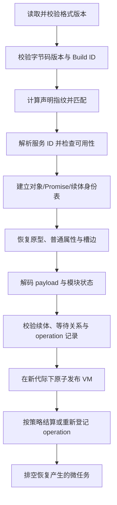

# 宿主绑定详细设计（草案）

> **状态：首版契约已落地，仍非最终设计。** 本文展开 [`design.md`](design.md) 中「静态模块与原型」「JS 值槽与非 JS 数据」「Operation 的中断与恢复」三节；命名与记录编码仍可能调整。
>
> 当前实现与本文的对应关系：`crates/vm/src/binding.rs` 提供静态 `Bindings`、`ModuleDecl`、`HostClass`、`HostModuleState`、`Operation`、`JsValue` 与 `CallCx`；VM 持有原型、实例槽、payload、模块状态和 operation 记录；旧 `Host::call` / `Host::call_native` / `NativeKey` / `HostValue` / `HostData` 已删除。第 15 节记录已选定的后续策略及尚未实现的能力，不代表这些策略均已落地。

## 1. 目标与范围

### 1.1 目标

- 宿主绑定不再以「模块 + 导出名 + 实例 ID」作为运行时分派键。模块函数、原型方法和实例都由 VM 持有，按普通 JavaScript 对象语义访问。
- 绑定作者只声明**行为**（函数、方法、访问器、codec、operation 策略）；实例的 JS 引用、生命周期和持久化由 VM 统一管理。
- 一份快照包含恢复所需的全部状态。恢复只需要：同一 Build、同一静态绑定声明、同一份快照和平台服务，不需要旧 VM、旧宿主内存或旧宿主索引表。
- 所有宿主异步工作都必须能从任一 pending 阶段被中断，并在恢复时按声明策略结算原 VM Promise。

### 1.2 非目标

- 不追求完整的 ECMAScript 内建或 Node/DOM 兼容；绑定的 JS 可见面由声明决定。
- 不提供宿主在任意时刻同步重入 VM 的通道，也不允许在原生调用栈上保存脚本执行状态。
- 不支持旧快照迁移。绑定契约变化即拒绝恢复。
- 首版不实现动态插件加载；所有绑定在编译 VM 之前静态注册。

## 2. 术语

| 术语 | 含义 |
| --- | --- |
| 模块（module） | 一个静态宿主命名空间，例如 `test`、`platform`。JS 侧通过 `import { expect } from 'test'` 取得导出。 |
| 导出（export） | 模块声明的函数、常量或构造器。导出值是 VM 对象，在模块命名空间中不可改写。 |
| 类（class） | 一个静态类型声明：内部槽布局、可选 payload 类型、原型成员和可选构造器。注册类不等于导出构造器。 |
| 实例（instance） | VM 堆中的对象，带类标签、槽和 payload。对象身份、原型和属性由 VM 持有。 |
| 槽（slot） | 实例上声明的、不可从 JS 伪装的强引用，保存任意 `JsValue`。 |
| payload | 实例上声明的非 JS 数据，由绑定提供的 codec 编解码，随快照保存。 |
| 服务（service） | 按进程提供的平台能力，例如节点工厂、单调时钟、网络客户端、错误日志。不随快照保存。 |
| operation | 一次可由中断恢复的异步工作。VM 为其创建 Promise 并保存持久记录。 |
| 声明指纹（fingerprint） | 由静态声明语义字段计算出的稳定标识，用于恢复时精确匹配绑定契约。 |

## 3. 核心不变量

- **H1 单一状态来源。** 可达实例的 JS 引用、payload、模块状态和 pending operation 状态都在 VM 快照中。宿主侧的映射表只能缓存，不能是权威状态。
- **H2 值句柄不越界。** `JsValue` 句柄只在当前 VM 的当前同步调用、或显式的快照/恢复过程中有效。跨调用保存必须写入声明槽。
- **H3 没有字符串分派。** VM 不向宿主询问「这个对象有哪些属性」「调用这个名字」。函数、原型、成员都在链接期绑定到声明。
- **H4 实例身份即对象身份。** 宿主不分配实例 ID；同一实例的任何别名在快照前后保持同一对象身份。
- **H5 方法共享。** 同类实例共享原型函数；方法通过内部标签校验接收者，裸调抛可捕获的 `TypeError`。
- **H6 payload 不含 VM 引用。** payload 字节中不得出现 VM 对象 ID、`NativeKey` 或函数指针；这类边只能走槽。
- **H7 恢复原子。** 任何声明缺失、指纹不符、槽非法或 payload 解码失败都整体拒绝恢复；不启动脚本、不投递事件、不重发请求。
- **H8 无同步重入。** 宿主函数不得在调用期间回调 VM 执行脚本或排空微任务。异步结果只能通过 operation 或新任务轮次交付。
- **H9 精确版本。** 格式版本、字节码版本、Build ID、绑定指纹、payload schema 版本和 operation 策略必须全部匹配。
- **H10 中断必有策略。** 没有声明恢复策略的异步类型不能注册，也不能启动。

## 4. 声明层

### 4.1 模块描述

模块描述由 `#[host_module]` 生成，`host_bindings!` 一次性链接模块、类、状态、operation 与服务。VM、编译器和未来的 TypeScript 生成器消费同一份规范声明，不要求宿主实现统一的字符串分派入口。

```rust
ModuleDecl {
    name: "test",
    exports: [
        Function { name: "expect", signature: (JsValue) -> Instance<Matcher> },
        Constant { name: "version", kind: JsString },
    ],
    classes:  [Matcher],
    state:    None,
}
```

- 编译器只从描述中取得 `module -> export names` 清单，用于校验 `import` 并在 `Build.imports` 中记录；它不需要知道类的槽布局或 codec。
- VM 在创建时校验：Build 引用的每个模块和导出都已注册；导出种类匹配（函数必须是函数，常量必须是常量）。
- 声明可以在多个 VM 之间共享，但**实例、原型和模块状态每 VM 一份**。声明的数据结构必须 `Send + Sync`。

### 4.2 类、槽与成员

```rust
#[host_class]
struct Matcher {
    #[js_slot]
    actual: JsValue,          // 任意 JS 值，含函数、符号、环
}

#[methods(Matcher)]
impl Matcher {
    #[method(name = "toBe")]
    fn to_be(cx: &mut CallCx, this: This<Matcher>, expected: JsValue)
        -> JsResult<()> { … }

    #[method(name = "toEqual")]
    fn to_equal(cx: &mut CallCx, this: This<Matcher>, expected: JsValue)
        -> JsResult<()> { … }
}
```

类声明包含：

- **标签**：稳定字符串或宏生成的 ID，出现在快照与诊断中，不出现在 JS。
- **父类**：可选的父类标签。声明层把原型链接到父类原型，并把父类槽排在子类槽之前；基类方法与访问器接收派生实例，子类声明的槽索引按自身布局计数。
- **槽布局**：有序、带名字、带种类。首版槽种类只有 `Js`（单个 `JsValue`）与 `JsList`（有序 `JsValue` 列表）。`JsList` 用于事件监听器集合这类「数量可变、元素是 JS 值」的状态，避免把引用塞进 payload。是否需要 `JsMap`、弱引用槽见[未决问题](#15-未决问题)。
- **payload**：可选的 `T` 及其 schema 版本与 codec。`T` 不得包含 `JsValue`。payload 属于具体实例类，不沿继承链合并。
- **原型成员**：方法、访问器。成员名区分字符串与符号；`Symbol.iterator` 这类内建符号由稳定的枚举（`WellKnownSymbol`）在声明期内静态给出，不接受运行期 Symbol。
- **可选构造器**：只有声明了 `Constructor` 的类才导出可 `new` 的函数。未声明时，类只作为返回类型和原型存在。

实例是普通 JavaScript 对象，可以有普通自有属性；槽与 payload 不可枚举、不可由 `Object.getOwnPropertyNames`、`Object.getOwnPropertySymbols` 或 `Reflect` 观察到，也不能借 `Object.create(prototype)` 伪造。原型上的方法与访问器是普通属性，脚本可以读取、改写或删除；快照保存玩家修改后的原型，而不是每个 VM 重建静态模板。

### 4.3 稳定标识与契约指纹

绑定声明在链接期计算**指纹**，写入快照头部；恢复时用本进程的声明重新计算并比对。指纹只覆盖语义字段：

- 模块名、导出名及种类；
- 类标签、槽名字/顺序/种类、payload schema 版本与 codec 标识；
- 成员名、种类（方法/访问器/数据）、参数与返回种类；
- operation 类型、状态 schema 版本、恢复策略；
- 声明引用的服务 ID 集合。

指纹不含 Rust 类型名、函数地址、宏展开细节或调试名称，因此重命名内部符号不会使快照失效；删除槽、改变顺序、更换 codec 或改变恢复策略会使快照失效。变更策略沿用项目的精确版本约定：不自动迁移，报告具体不匹配项。

### 4.4 与编译器的接口

- `CompileOptions.imports` 由声明集合派生，不在手写源码里重复维护。
- 编译器只拒绝三种情况：导入未声明的模块、导入模块中不存在的导出、从宿主模块做默认导入。其余签名不匹配留给 VM 在首次调用时即时检查，或在开发模式下做静态签名检查。
- 类名和成员名不进入 Build。Build 中只保留模块命名空间和函数值，函数值携带声明 ID。

### 4.5 TypeScript 定义生成

生成器读取同一份声明，输出模块 `.d.ts`：

| 声明 | TypeScript |
| --- | --- |
| `Function(expect: (JsValue) -> Instance<Matcher>)` | `export function expect(actual: unknown): Matcher;` |
| `Instance<Matcher>`（无构造器导出） | `export interface Matcher { toBe(expected: unknown): void; toEqual(expected: unknown): void; }` |
| `Constructor<Matcher>` | `export class Matcher { constructor(...); … }` |
| `JsValue` 参数或返回值 | `unknown`（未知类型，不做 `any` 宣传） |
| 常量 `version: JsString` | `export const version: string;` |
| `Symbol.iterator` 成员 | `[Symbol.iterator](): Iterator<…>;` |

已知局限：TypeScript 无法表达「方法要求内部槽」；生成器只给接口，不生成可 `new` 的值，除非声明了构造器。接受回调等复杂签名可标注为 `unknown`，后续通过显式 `#[ts(...)]` 覆盖。

## 5. 值层

### 5.1 `JsValue` 生命周期

- `JsValue` 是 16 字节以内的可复制句柄，包含对象 ID 和 VM 代际。VM 在不同步调用、跨代恢复或跨 VM 使用时拒绝该句柄，报 `HostFault`，而不是抛出可捕获的脚本异常。
- 宿主函数接收的实参、`this`、以及 `cx` 上读取到的值都是这种句柄。调用返回后句柄失效，但通过槽写入的值继续有效。
- 句柄不暴露给宿主序列化；`HostValue`、`NativeKey`、`HostData` 投影全部删除。

### 5.2 边界值域与转换

| JS 值 | 宿主可做什么 |
| --- | --- |
| `undefined`、`null`、布尔、数字、字符串 | 直接读取；字符串按 UTF-8 视图或 `&JsString` 访问，拒绝时抛 `TypeError` 或 `HostFault`（见 6.3） |
| 对象、数组、函数、符号 | 只能作为句柄传递、比较身份、读取受控的自有数据；不能转成 Rust 结构 |
| Promise、Proxy、绑定实例 | 同上；绑定实例可用 `Instance<T>` 提取 payload |
| 宿主函数值 | 可由宿主读取并比较声明 ID，但不得据此在外部表里查状态 |

`JsValue` 不实现 `Serialize`。需要保存任意值时用槽，不需要在宿主侧构造第二套值模型。

### 5.3 槽的访问与追踪

```rust
let actual: JsValue = this.actual(cx);        // 读槽：返回当前值句柄
this.set_actual(cx, value);                   // 写槽：替换强引用
this.pending(cx).push(callback);              // JsList 槽
```

- 槽写只能通过 `CallCx`（或恢复期的等价上下文）。宿主既然拿不到底层对象表，就不存在绕过 VM 的写入路径。
- 槽是强边，参与与普通属性相同的可达性遍历：保留身份、别名和环；实例本身不是根，只有从模块命名空间、模块状态、脚本根或 operation 可达时才进入快照。
- 槽的读取不触发 getter 或 Proxy trap；它只是对象图边。
- 槽布局在声明期固定，快照按声明顺序写值。恢复时先建立对象身份，再写入槽；缺失或数量不符即拒绝。

### 5.4 非 JS payload 与 codec

```rust
trait PayloadCodec<T> {
    fn encode(&self, value: &T, cx: &EncodeCx, out: &mut PayloadWriter)
        -> Result<(), CodecError>;
    fn decode(&self, cx: &mut DecodeCx, input: &mut PayloadReader)
        -> Result<T, CodecError>;
}
```

规则：

- **上下文提供能力，快照提供状态。** `EncodeCx` 可提供只读的 VM 元信息（例如当前时间、服务 ID）；`DecodeCx` 提供服务句柄，例如 `cx.service::<NodeFactory>()?`。解码绝不能依赖「旧宿主里的节点 42」。
- **解码期不改 VM 堆。** codec 只能创建自己的 Rust 数据和平台资源；需要 JS 引用的值必须来自快照槽，而不是在解码时构造新对象。这样恢复失败时可以整体丢弃，不留半成品。
- **副作用可回滚。** codec 创建的平台资源必须在失败路径上可释放（`Drop` 或显式回收）。恢复器只在全部 payload 解码成功后发布 VM。
- **版本独立。** 每种 payload 有自己的 schema 版本；同一 crate 内不同类的版本互不影响。未知版本拒绝恢复。
- **尺寸与错误。** 解码错误带声明 ID、槽或字段路径；超限、截断、非规范编码都视为损坏快照。
- 普通 `serde` 类型可经适配器转为 `PayloadCodec`；但这只是无上下文情形的便利路径，不要求所有 payload 只实现标准 trait。

平台服务不是快照的一部分，但它的**稳定 ID**进入声明指纹。缺少服务或服务版本不匹配时，恢复整体拒绝，而不是在首次调用时失败。

### 5.5 模块状态

- 影响后续调用的模块级可变状态必须声明在模块状态类型中；它的 JS 引用走槽，非 JS 数据走 codec。
- 模块状态是快照的持久根。静态声明表不持有任何 VM 状态；注册闭包捕获 `Rc<RefCell<_>>` 这类做法在评审中直接视为违约。
- 模块状态只在 VM 创建或恢复时构造，不在每次调用时重建。

## 6. 调用协议

### 6.1 `CallCx`

```rust
impl CallCx {
    fn args(&self) -> &[JsValue];
    fn arg(&self, index: usize) -> JsResult<JsValue>;      // 缺失即 TypeError
    fn this(&self) -> JsValue;
    fn is_construct(&self) -> bool;
    fn alloc<T: HostClass>(&mut self, init: T::Init) -> JsResult<Instance<T>>;
    fn throw(&mut self, value: JsValue) -> JsError;        // 可捕获脚本异常
    fn fault(&mut self, message: &str) -> HostFault;       // 不可捕获，终止执行
    fn inspect(&self, value: JsValue) -> Inspect<'_>;      // 只读自有数据视图
    fn start_operation<O: Operation>(&mut self, state: O::State) -> JsResult<JsValue>;
}
```

- `CallCx` 在栈上，生命周期绑定本次调用；不能保存到 Rust 数据结构或在调用结束后使用。
- `inspect` 提供只读视图：自有可枚举数据、数组长度、原型身份、`SameValue` 比较。它不触发 getter/Proxy，也不允许写入任意脚本对象。绑定要修改脚本可见状态时，返回值或写自己的槽。
- 绑定函数可以在调用内分配实例、读取堆元信息；但这些操作都在 VM 线程内同步完成，不执行用户脚本。

### 6.2 原型、方法与接收者

- 每个 VM 为每个类创建一份原型对象。同类实例共享同一函数值：`a.toEqual === b.toEqual`。
- 方法入口用 `This<T>` 校验内部标签。接收者不是该类的实例时抛出可捕获的 `TypeError`（例如 `TypeError: toEqual called on incompatible receiver`）。
- 裸调用 `const f = a.toEqual; f(x)` 因此失败；需要跨调用携带接收者时用 `a.toEqual.bind(a)` 或保留 `a` 作成员调用。VM 的 `bind` 是普通脚本语义，不需要绑定层支持。
- 原型方法可以被脚本改写或删除；这与普通 JS 一致，快照保存改写结果。静态模板只在新建 VM 时安装。
- 若类声明了构造器，构造器同样只是模块导出中的函数；`new` 走普通构造调用路径，由声明决定是否允许无 `new` 调用。

### 6.3 错误分类

| 情形 | 结果 | 脚本可捕获 |
| --- | --- | --- |
| 参数类型不符、断言失败、接收者类型不符 | `JsError`（值为脚本异常） | 是 |
| 绑定代码按声明抛出任意 `JsValue` | 脚本异常，沿正常 try/catch 路径 | 是 |
| 句柄过期、跨 VM 使用、`CallCx` 误用、越界槽访问 | `HostFault` → `VmError` | 否，VM 进入失败状态 |
| 绑定 panic | 视为 `HostFault`（Rust 路径可配置为中止；C ABI 必须捕获） | 否 |
| 恢复期声明缺失、指纹不符、payload 解码失败 | 恢复失败，VM 不创建 | 否 |

区分原则：**可由脚本处理的语义错误用 `JsError`；违反宿主契约用 `HostFault`。**

### 6.4 重入与执行线程

- 宿主函数执行期间，VM 不排空微任务、不接受事件、不执行脚本。绑定不得调用 `Vm::run_until_idle`、`Vm::start` 或任何会执行脚本的接口。
- 异步结果只能通过 operation 交付，或在 VM 空闲后由宿主以新的任务轮次投递。原生 timer、网络回调、UI 事件都属于后者。
- 绑定函数不得阻塞等待另一个 operation；需要等待时返回 Promise。

## 7. 异步 operation

### 7.1 声明

```rust
#[operation(name = "wait", recovery = pause)]
struct Wait {
    label: String,              // 持久状态，编码进快照
}
```

每个 operation 类型声明：类型 ID、状态 schema 版本、状态 codec、恢复策略。状态不得包含 `JsValue`；需要 JS 引用（例如回调）时，让发起函数把回调写进某个实例槽，或把它作为参数传给 operation 记录中的槽字段。

### 7.2 启动与结算

- `cx.start_operation::<Wait>(state)` 做三件事：分配 VM operation ID、创建 VM Promise、写入持久记录。返回给 JS 的是 Promise，不是 ID 字符串。
- 宿主把 operation 交给平台执行，但**不得**把「operation ID → 平台句柄」当作恢复权威。平台任务丢失后，恢复依据只有快照状态。
- 结算接口携带 `(epoch, operation_id)` 能力令牌。VM 只接受当前代际、仍处于 pending 的记录；未知、已结算或来自旧 VM 的交付被拒绝，且不会产生第二次结算。
- 同一 operation 的结算恰好一次；重复交付是宿主 bug，返回 `HostFault` 给宿主侧调用者，但不影响已经在跑的脚本。

### 7.3 恢复策略

| 策略 | 语义 | 典型用途 |
| --- | --- | --- |
| `Pause` | 恢复时以 `undefined` 兑现原 Promise，不重新登记工作 | 测试暂停点、仅用于挂起的 `wait` |
| `Resume` | 从快照状态重新登记，未来交付时结算原 Promise | timer、UI 事件订阅、等待外部输入 |
| `Reissue` | 从快照状态重新发起，结果交付原 Promise | 幂等查询、可重放请求 |
| `Reject` | 恢复时用声明的错误值拒绝原 Promise | 不可重放的外部副作用 |

约束：

- `Resume` 的状态必须足以重建登记，不能引用平台句柄；例如 timer 记录剩余时长和时钟域，而不是 `TimerId`。
- `Reissue` 必须由绑定作者确认幂等；默认不允许。
- `Reject` 是**成功的恢复**：拒绝经原有反应和异常路径交付，不阻塞其他续体。错误的恢复拒绝（校验失败）与策略拒绝必须区分。
- 选择在声明期固定，不能按调用点临时改变；否则快照无法判断语义。确需按调用区分时，把策略标识写进状态并在声明中列出允许集合。

### 7.4 时序与快照边界

- 快照只能在微任务队列排空后创建；已有约束不变。
- 快照记录 pending operation 的类型、状态、原 Promise 引用和代际之外的标识。恢复后 VM 使用新代际，旧宿主持有的交付令牌永久失效。
- 恢复成功后，`Pause` 与 `Reject` 的结算进入微任务队列，按正常顺序执行；`Resume`/`Reissue` 保持 pending，由宿主在 `Vm::restore` 返回后调用 `Vm::start_recovered_operations` 重新登记。任何外部交付都在恢复完成之后。
- 恢复不得重跑发起 operation 的函数，也不得重放该函数之前的副作用。

## 8. 快照

### 8.1 概念记录

```text
Snapshot {
    header:    format, bytecode, build_id, binding_fingerprints, payload_schemas,
               service_ids, instance_epochs?          // 见 11
    objects:   [ObjectRecord]                        // 含绑定实例
    module_states: [ { module, state } ]
    continuations: […]                               // 现有续体记录
    operations: [ { type, schema, state, promise, strategy } ]
    globals / roots / imports / script_env / …
}

ObjectRecord(NativeInstance) {
    id, class_tag, prototype: ObjectId,
    properties: ordinary own properties,
    slots: [slot kind payload…],     // 顺序由声明决定
    payload: Option<{ schema, bytes }>,
}
```

- 原型、普通属性、槽和 payload 都按 VM 对象图保存；函数对象只保存声明 ID。
- `module_states` 按模块名排序；`operations` 按稳定 ID 排序；`objects` 顺序不影响语义，但恢复器不得依赖顺序做身份假设。
- 记录中不出现字符串分派键、宿主指针或外部句柄。

### 8.2 不进入快照的内容

- Rust 机器码、函数指针、trait object、平台服务实例。
- OS timer、socket、文件描述符、事件订阅句柄。
- 宿主侧的实例索引表、matcher 数组、operation 映射。
- 已入队但未执行的 VM 微任务；快照前必须排空。
- 正在执行的宿主调用栈；绑定调用不能跨 `await`。

### 8.3 确定性

- 同一对象图在同一 Build、同一声明下重复快照，除时间戳类外部信息外应逐字节一致。时间、随机数种子等若影响脚本语义，必须作为 VM 状态记录（现有 `random_state` 即此原则）。
- 指纹和版本字段在头部的顺序固定；codec 必须产生规范编码。

## 9. 恢复协议



阶段规则：

1. **只读校验。** 前四步失败时不分配任何平台资源，不修改任何全局注册表。
2. **先图后数据。** 先建立对象身份和引用边，再解码 payload；这样 payload 的上下文能安全引用快照中的结构，而无需在字节里藏 ID。
3. **最后发布。** 所有记录就绪前，VM 不对外可用；注册、重发、拒绝都发生在发布之后。
4. **失败可回滚。** 平台资源在失败路径释放；恢复器对已解码但未发布的对象执行统一清理。
5. **不执行脚本。** 恢复过程不跑模块初始化、不调用绑定函数、不触发 getter。

## 10. 版本与失败策略

- 校验顺序：快照格式 → 字节码版本 → Build ID → 所需模块与导出 → 类指纹（槽布局、成员、payload schema）→ operation 类型与策略 → 服务可用性。
- 任一失败：整体拒绝，错误中列出第一处不匹配及声明 ID；不启动 VM，不投递事件，不发请求。
- 运行时 `HostFault`：VM 进入不可继续执行的状态；宿主可丢弃该 VM 并选择按策略重新初始化，但不能把它当作成功恢复。
- 策略性拒绝（`Reject`）与恢复失败在 API 层必须使用不同类型，避免宿主误把可重试的业务拒绝当成存档损坏。

## 11. 多 VM、代际与生命周期

- 静态声明共享；每个 VM 有独立原型表、模块状态和实例。实例、句柄和 operation 令牌不能跨 VM 使用。
- VM 创建时分配随机代际，恢复时分配新代际。代际不写入快照：分叉恢复出的两个 VM 各自拥有不同代际，旧宿主持有的交付只会在匹配原代际时被接受，从而避免「旧任务结算新 VM」。
- 实例不可达时，payload 随对象释放；平台资源由 payload 的 `Drop` 或绑定提供的释放钩子处理。快照不保存平台句柄，因此恢复不会「复活」旧平台对象。
- VM 销毁时释放全部实例与平台资源；静态声明不持有资源。

## 12. 性能预算

- 调用路径不按字符串查表：函数对象直接持有声明指针，成员查找走普通属性路径。
- 每次调用创建 `CallCx` 不分配堆内存；参数切片借用 VM 栈。
- 槽访问是固定偏移；payload 访问不做序列化往返。
- `inspect` 只读视图按需构造，不复制整棵对象图。
- 快照编解码允许分配，但必须线性于可达对象数；指纹在链接期计算一次，不每次快照重算。

## 13. 从现有 PoC 迁移映射

| 现有构件 | 新设计 |
| --- | --- |
| `Host::resolve_export(module, export)` | 静态模块声明的导出表；链接期校验 |
| `HostExport::{Value, Function}` | 常量导出 / 函数导出；函数对象携带声明 ID |
| `Host::call(module, export, args)` | 强类型导出函数 `fn(&mut CallCx, …)` |
| `Host::get_property(NativeKey, prop)` | 原型成员；普通属性查找，无宿主查询 |
| `Host::call_native(NativeKey, args)` | 原型方法函数；`this` 校验 + payload/槽访问 |
| `Host::project_arguments` / `project_native_arguments` | 删除；绑定直接用 `JsValue` 与 `CallCx::inspect` |
| `HostValue::{Native, NativeFunction}` | 绑定实例对象 / 宿主函数对象 |
| `NativeKey { type_name, id }` | 类标签 + 槽/payload；`NativeKey` 不再出现在公共 API |
| `TestHost.matchers: Vec<HostValue>` | `Matcher.actual` 槽；实例对象由 VM 分配 |
| `NativeKey { type_name: "toBe", id: matcher_id }` | 共享原型方法 `Matcher.prototype.toBe` |
| `PendingOperationMeta` + 字符串 ID | operation 记录（类型、状态、Promise） |
| `Host::has_native` / `rebuild_operation` | 声明指纹 + codec 解码 + 策略驱动的恢复 |
| `HostData` 投影 | 删除；`CallCx::inspect` 提供只读视图 |
| `HostReply::{Value, Throw, Operation}` | 返回值 / `JsError` / `start_operation` |

迁移顺序建议（实现阶段，不在本文范围）：先引入声明与原型，再替换 `TestHost`，最后删除旧 trait 与 `HostValue`；每一阶段都应有可运行的用例。

## 14. 验收用例

以下用例应作为实现完成的门槛：

1. **跨进程式恢复。** 保存 `m = expect(obj)`、`obj.matcher = m`、`f = m.toEqual.bind(m)` 和环；销毁 VM 与宿主，只用快照、Build、声明恢复；通过别名修改 `obj` 后调用 `f`，断言看到修改，且实例身份、原型和别名延续。
2. **方法共享与接收者校验。** `a.toEqual === b.toEqual`；裸调抛 `TypeError`；`Object.create(Matcher.prototype)` 对象不能冒充实例；脚本改写原型方法后快照保留修改。
3. **值域。** 函数、符号、环、同一对象的多个槽、`undefined` 与「未初始化」区分正确；跨调用保存的旧句柄被拒绝。
4. **payload 与服务。** 带 payload 的节点从平台工厂重建，不依赖旧节点表；缺少服务、schema 版本不符、payload 截断均整体拒绝恢复且无资源泄漏。
5. **operation 策略。** `Pause` 以 `undefined` 兑现且只兑现一次；`Resume` 重新登记后交付一次；`Reissue` 不重跑发起函数；`Reject` 经原 `catch` 路径；旧代际交付被拒绝。
6. **策略性拒绝 vs 恢复失败。** 前者脚本可观察、其他续体继续；后者 VM 不创建。
7. **不可达实例。** 不在快照中的实例不要求解码，快照也不包含其 payload。
8. **快照确定性。** 同一对象图重复快照产生相同内容；恢复后再次快照与首次一致（时间类状态除外）。
9. **迁移后的 `test.expect` / `test.assert` / `test.wait`** 在无投影、无字符串分派的路径下通过现有语义用例。

## 15. 已决策事项

以下策略作为后续实现基线。它们是设计决策，不代表对应能力已经实现；若与当前代码不一致，以「首版落地状态」中的实现说明为准。

1. **弱引用槽与 `JsMap` 槽：暂不增加。** 宿主实例槽维持 `Js` / `JsList`；弱键缓存使用 VM 已有的 `WeakMap`。出现具体绑定需求后再评估是否扩展槽种类。
2. **访问器失败时机：延迟到脚本访问。** 恢复只做结构和声明校验，不执行 getter/setter 或其他脚本可观察逻辑。
3. **绑定类继承：允许 `class extends` 并调用 `super`。** 派生类可复用基类构造路径和基类槽初始化；脚本定义的派生类不增加 `HostClass` 槽或 payload。`new.target`、派生实例初始化及非法构造路径须按此约束验证。声明层的 `HostClass::PARENT` 已实现原型链、槽合并、基类接收者校验与快照往返；脚本 `class extends` 仍随首版约定由编译器拒绝，脚本派生类路径尚未存在。
4. **符号成员：支持显式列出的 well-known Symbol。** 声明使用稳定的符号枚举 ID，不接受任意运行期 Symbol；宿主私有状态仍走隐藏槽，不映射为 JS 私有名。
5. **C ABI：暂缓。** Rust 应用链接 VM、实现 `Host` 并调用平台服务；本库不提供 C ABI 或移动端绑定。若未来需要外部语言直接声明绑定，再单独设计 ABI。
6. **声明入口：宏是最终用户 API，builder 是过渡/内部实现工具。** 最终由宏生成或校验规范声明结构；不保留公开 builder 作为平行的声明逃生口。codec、operation 等行为可由 Rust trait 实现。
7. **TypeScript 定义生成：暂缓。** 待声明和签名模型稳定后再确定生成范围，不引入手工补丁机制。
8. **payload 编码：继续使用自定义 codec。** 不绑定 postcard、bincode 或 CBOR；规范编码、字段顺序、长度与版本规则由 codec 契约明确。
9. **流式 payload：暂缓。** 维持整段写入/读取接口；只有实测证明峰值内存构成问题时再改为流式 API。
10. **宿主并发与 operation 恢复：** VM 不承诺跨线程安全。宿主可在其他线程完成平台工作，但只向宿主自己的队列投递令牌与结果；VM 交付仍在 VM 所在线程进行。恢复成功返回前不启动 `Resume` / `Reissue` 外部工作；`Vm::restore` 返回后由 VM 所在线程调用 `Vm::start_recovered_operations` 启动。启动失败按对应 operation 的声明拒绝结算原 Promise，不回滚已恢复的 VM。
11. **恢复资源限制：暂不由 VM 设通用上限。** 前提是快照仅来自可信本地存档；接入方须在读取/解析前限制文件大小。若快照转为导入、同步或其他不可信输入，必须重新评估解析前的大小、对象数、payload 大小和嵌套深度限制。

## 16. 首版落地状态

已落地：类型化宏声明与签名指纹；VM 自有原型、方法共享、接收者校验、访问器；字符串与 well-known Symbol 成员名（`MemberName` / `WellKnownSymbol`）；绑定类父类声明的原型链、槽合并、基类接收者校验与快照往返；实例隐藏槽（`Js` / `JsList`）、payload codec 与服务；非零大小载荷必须声明 schema；类实例身份与普通自有属性；`JsValue` 句柄的代际/调用校验；模块状态槽与 payload；operation 的 `Pause` / `Resume` / `Reissue` / `Reject` 策略、代际令牌；恢复只做 `Pause` / `Reject` 结算，`Resume` / `Reissue` 在任何外部工作前保持 pending，并在 `Vm::restore` 返回后由 `Vm::start_recovered_operations` 重新登记（启动失败结算该 operation）；快照只保存可达实例，恢复前原子校验绑定指纹、槽布局、payload schema 与 operation 声明。

尚未实现：脚本 `class` / `extends` / `super`（编译器按首版契约拒绝，因此脚本派生类路径不存在，声明层父类已经可用）；TypeScript 生成、C ABI、弱引用槽、`JsMap` 槽与流式 payload 按第 15 节暂缓；恢复资源限制仅由可信本地快照这一前提约束。带 `class` 的 `#[constructor]` 导出将类原型用于 `new` 与 `instanceof`。

Rust 回调从 `&mut CallCx<'_>` 开始，类成员接着接收 `This<Class>`；其余位置为 `JsValue`（必需）或 `Option<JsValue>`（省略为 `None`，显式 `undefined` 为 `Some`）。签名决定 `length` 和绑定指纹。返回类型是 `JsResult<JsValue>`、`JsResult<()>` 或 `JsResult<Instance<T>>`。VM 内部调用协议不变；不匹配的旧绑定指纹按 `InvalidSnapshot` 拒绝，不迁移也不启动恢复工作。

